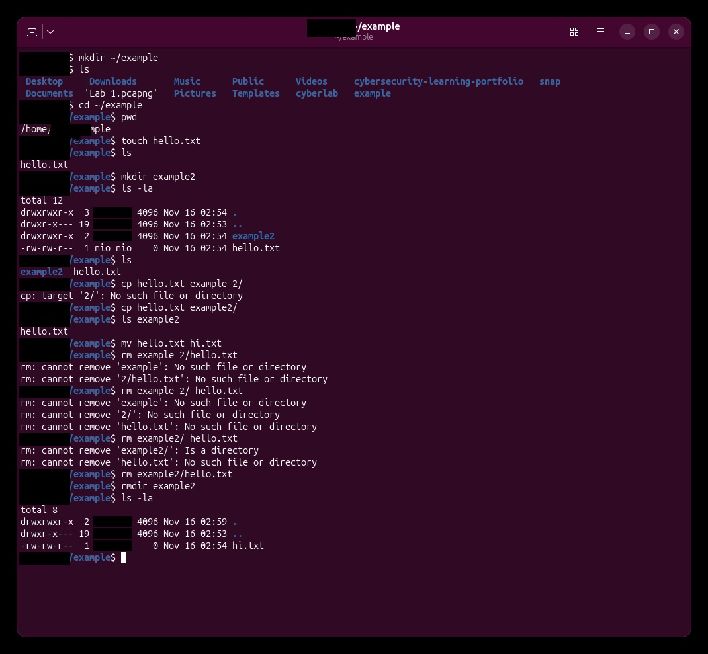

# Mini-Lab 1 — Linux Files and Directories

## 1. Lab Overview

| Field | Value |
| --- | --- |
| Lab Title | Mini-Lab 1 — Linux Files and Directories |
| Lab ID | P01-ML-01 |
| Phase | Phase 01 — Linux, Networking & Foundations |
| Category | Linux Administration / Filesystem Fundamentals |
| Status | Completed |
| Date | 2026-11-01 |
| Author | Daniel Solano |
| Scope / Target | Personal Ubuntu virtual machine (controlled laboratory environment) |
| Authorization | Personal lab |

### Description

This mini-lab practices basic Linux filesystem navigation and file management using the terminal: creating directories and files, moving between directories, listing and inspecting contents, copying and renaming files, and safely deleting files and empty directories. It establishes the working-directory conventions used by later Phase 01 labs, including a dedicated `evidence/` directory for storing hashes, logs, packet captures, and suspicious files during future cybersecurity exercises.

### Key Results

- Created the laboratory directory `~/cyberlab` and verified it with `ls` and `pwd`.
- Created the file `notes.txt`, copied it into a new `evidence/` directory, then renamed the original to `lab1.txt`.
- Removed the copy with `rm` and the empty `evidence/` directory with `rmdir`; the final listing contains only `lab1.txt`.
- Confirmed the working distinction between `rm` (files) and `rmdir` (empty directories only), and that `mv` serves both as a move and a rename operation.

> **Documentation accuracy note.** The original execution took place on November 1, 2026, and was not captured in screenshots. The procedure in Section 5 is the authoritative record, taken from the author's handwritten notes. The screenshot in Section 13 is **supplementary evidence from a later recreation** of the exercise (November 16, 2026): it uses different names (`~/example`, `hello.txt`, `example2/`) and includes command-entry mistakes that were corrected during that session. It does **not** document the original command sequence, and the original filenames have not been replaced with the recreation's names anywhere in this document. Usernames and hostnames in commands and outputs use the generic identifiers `student` (local user) and `linux-vm` (hostname) in place of the author's real local account details.

## 2. Objectives

- Create directories and files.
- Navigate between directories.
- Verify the current working directory.
- List files and inspect directory contents.
- Copy and rename files.
- Delete files and empty directories.
- Understand how the Linux filesystem is organized.

## 3. Laboratory Environment

| Component | Details |
| --- | --- |
| Host OS | Windows 11 |
| Hypervisor / VM Platform | Oracle VM VirtualBox 7.2.8 |
| Guest OS | Ubuntu Desktop 26.04 |
| Network Configuration | Not applicable — local filesystem exercise; the VM uses VirtualBox NAT (10.0.2.0/24) |
| Tools | GNU coreutils (`mkdir`, `ls`, `cp`, `mv`, `rm`, `rmdir`), Bash (version not recorded during the original execution) |

## 4. Technical Background

- **Home directory (`~`):** The tilde is a shell shortcut for the current user's home directory (`/home/student` on this VM). `~/cyberlab` is therefore the `cyberlab` directory inside the home directory.
- **Absolute vs. relative paths:** A path starting with `/` or `~` is absolute (complete from the filesystem root or home); a path such as `evidence/` is relative to the current working directory.
- **Current working directory:** The directory the shell is operating in. `pwd` prints it, and `cd` changes it.
- **Hidden entries (`.` and `..`):** Every directory contains `.` (itself) and `..` (its parent). `ls` hides them by default; `ls -la` shows them along with all other hidden files.
- **`ls -l` columns:** Permissions, link count, owner, group, size in bytes, modification date, and name. An empty file created with `touch` has size 0 bytes.
- **Default permissions and `umask`:** The permissions of a newly created file or directory depend on the shell's `umask`, which masks bits from the base permissions (`666` for files, `777` for directories). The same commands can therefore produce different permissions on different systems — `664`/`775` is one common result, not a universal default.
- **Files vs. directories:** `touch` creates an empty regular file; `mkdir` creates a directory. `rm` removes files, while `rmdir` removes empty directories only.

## 5. Laboratory Procedure

> The original execution (November 1, 2026) was not captured in screenshots. The command sequence below is the authoritative procedure from the author's handwritten notes. The outputs shown are representative: they illustrate what each command produces, confirmed by reproducing the same command sequence on a Linux system. They are not a transcript of the original execution, and no claim is made that the original run was independently recorded. The screenshot in Section 13 is from a later recreation with different names and is not presented as evidence of this original run.

### Step 1: Create the laboratory directory

**Purpose:** Create the working directory for the exercise inside the home directory.

**Commands Executed:**

```bash
mkdir ~/cyberlab
```

**Command Explanation:** `mkdir` creates a new directory. `~` expands to the user's home directory, so the directory is created at `/home/student/cyberlab`.

**Expected Output:** No output on success; the directory is created silently.

**Representative Output:**

```text
(no output — success is silent)
```

**Technical Interpretation:** A silent return with no error confirms the directory was created.

### Step 2: Verify directory creation

**Purpose:** Confirm that `cyberlab` appears in the home directory listing.

**Commands Executed:**

```bash
ls
```

**Command Explanation:** `ls` lists the contents of the current working directory (the home directory, in this case).

**Expected Output:** The listing includes `cyberlab` among the home directory entries.

**Representative Output:**

```text
cyberlab
```

**Technical Interpretation:** `cyberlab` is present in the home directory; the creation in Step 1 succeeded.

### Step 3: Enter the directory

**Purpose:** Move into the laboratory directory and confirm the current working directory.

**Commands Executed:**

```bash
cd ~/cyberlab
pwd
```

**Command Explanation:** `cd` changes the current working directory to `~/cyberlab`; `pwd` prints the current working directory.

**Expected Output:** `pwd` returns the absolute path of the laboratory directory.

**Representative Output:**

```text
/home/student/cyberlab
```

**Technical Interpretation:** The shell is now operating inside `~/cyberlab`; all subsequent relative paths resolve from here.

### Step 4: Create a file

**Purpose:** Create an empty file inside the laboratory directory and confirm it exists.

**Commands Executed:**

```bash
touch notes.txt
ls
```

**Command Explanation:** `touch` creates an empty file (or updates the timestamp of an existing one); `ls` lists the directory contents to confirm it.

**Expected Output:** `ls` shows `notes.txt`.

**Representative Output:**

```text
notes.txt
```

**Technical Interpretation:** The file `notes.txt` exists in `~/cyberlab` (0 bytes, as expected from `touch`).

### Step 5: Create an evidence directory

**Purpose:** Create a subdirectory intended as a common location for storing hashes, logs, packet captures, and suspicious files during future cybersecurity exercises.

**Commands Executed:**

```bash
mkdir evidence
```

**Command Explanation:** `mkdir` creates the `evidence` subdirectory inside the current working directory (`~/cyberlab`).

**Expected Output:** No output on success.

**Representative Output:**

```text
(no output — success is silent)
```

**Technical Interpretation:** The `evidence/` directory now exists as a dedicated location for future lab artifacts.

### Step 6: Inspect directory contents

**Purpose:** Compare the detailed and the all-entries listings of the laboratory directory.

**Commands Executed:**

```bash
ls -l
ls -la
```

**Command Explanation:** `ls -l` displays detailed information (permissions, owner, size, date, name). `ls -la` adds hidden entries, including `.` and `..`.

**Expected Output:** `ls -l` shows the `evidence` directory and the 0-byte `notes.txt` file. `ls -la` shows the same entries plus `.` and `..`.

**Representative Output:**

```text
# ls -l
evidence
notes.txt     (0 bytes)

# ls -la
.
..
evidence
notes.txt     (0 bytes)
```

**Technical Interpretation:** The directory contains exactly two entries — the `evidence/` subdirectory and `notes.txt`. The `-a` flag reveals the hidden `.` and `..` entries, which `ls -l` omits.

### Step 7: Copy the file

**Purpose:** Copy `notes.txt` into the `evidence/` directory.

**Commands Executed:**

```bash
cp notes.txt evidence/
```

**Command Explanation:** `cp` copies the source file into the destination directory. The trailing `/` on `evidence/` marks it as a directory target.

**Expected Output:** No output on success; the copy is created at `evidence/notes.txt`.

**Representative Output:**

```text
(no output — success is silent)
```

**Technical Interpretation:** A copy of `notes.txt` now exists inside `evidence/`; the original remains in place.

### Step 7.1: Verify the copy

**Purpose:** Confirm that the copy exists inside `evidence/`.

**Commands Executed:**

```bash
ls evidence
```

**Command Explanation:** `ls` with a directory argument lists that directory's contents.

**Expected Output:** The listing shows `notes.txt`.

**Representative Output:**

```text
notes.txt
```

**Technical Interpretation:** The copy succeeded; `evidence/notes.txt` exists.

### Step 8: Rename the original file

**Purpose:** Rename the original `notes.txt` to `lab1.txt`, demonstrating that `mv` renames as well as moves.

**Commands Executed:**

```bash
mv notes.txt lab1.txt
ls
```

**Command Explanation:** `mv` moves a file; when source and destination are in the same directory, the effect is a rename. `ls` confirms the result.

**Expected Output:** The listing shows `evidence` and `lab1.txt`; `notes.txt` is gone from the top level.

**Representative Output:**

```text
evidence
lab1.txt
```

**Technical Interpretation:** The original file was renamed in place. Only the copy inside `evidence/` still carries the name `notes.txt`.

### Step 9: Delete the copied file

**Purpose:** Remove the copy from the `evidence/` directory.

**Commands Executed:**

```bash
rm evidence/notes.txt
```

**Command Explanation:** `rm` removes the specified file. The path is relative to the current working directory (`~/cyberlab`).

**Expected Output:** No output on success; `evidence/` becomes empty.

**Representative Output:**

```text
(no output — success is silent)
```

**Technical Interpretation:** The copy is deleted. `evidence/` is now empty, which is the precondition for Step 10.

### Step 10: Remove the empty directory

**Purpose:** Remove the now-empty `evidence/` directory and confirm the final state.

**Commands Executed:**

```bash
rmdir evidence
ls -la
```

**Command Explanation:** `rmdir` removes empty directories only. `ls -la` shows the final state of the laboratory directory, including hidden entries.

**Expected Output:** The final listing shows only `lab1.txt` (plus `.` and `..`); `evidence` no longer appears.

**Representative Output:**

```text
.
..
lab1.txt      (0 bytes)
```

**Technical Interpretation:** The `evidence/` directory was removed because it was empty, and `lab1.txt` remains as the only file. The filesystem workflow is complete.

## 6. Commands & Technical Analysis

| Command | Purpose | Flags / Arguments | Technical Relevance |
| --- | --- | --- | --- |
| `mkdir` | Create directories | `~/cyberlab`, `evidence` | Builds the lab workspace and the evidence store |
| `cd` | Change directories | `~/cyberlab` | Moves the shell into the working directory |
| `pwd` | Display the current working directory | — | Verifies where relative paths resolve from |
| `touch` | Create an empty file | `notes.txt` | Creates a placeholder file without content |
| `ls` | List directory contents | —, `evidence` | Confirms creation, copy, and rename results |
| `ls -l` | Display detailed file information | — | Shows permissions, owner, size, and dates |
| `ls -la` | Display all entries, including hidden ones | — | Reveals `.` and `..` and hidden files |
| `cp` | Copy files | `notes.txt evidence/` | Duplicates a file into the evidence directory |
| `mv` | Move or rename files | `notes.txt lab1.txt` | Renames the original file in place |
| `rm` | Remove files | `evidence/notes.txt` | Deletes a file (irreversible — no trash) |
| `rmdir` | Remove empty directories | `evidence` | Removes a directory only when it is empty |

## 7. Results & Observations

### Findings

- The complete filesystem workflow ran end to end: create a directory, enter it, create a file, create a subdirectory, copy, rename, delete the copy, and remove the empty directory.
- The final state of `~/cyberlab` is a single file, `lab1.txt` (0 bytes); the `evidence/` directory no longer exists.
- `ls -l` and `ls -la` differ only by the hidden `.` and `..` entries; both confirm the same two visible entries at Step 6.
- `mv` within one directory acts as a rename; `cp` leaves the original untouched; `rmdir` refuses non-empty directories (by design — see Section 9).

### Expected vs. Representative Behavior

| Item | Expected | Representative | Notes |
| --- | --- | --- | --- |
| `mkdir ~/cyberlab` | Directory created silently | Created silently | Verified by `ls` in Step 2 |
| `pwd` after `cd` | `/home/student/cyberlab` | `/home/student/cyberlab` | Matches |
| `touch notes.txt` | Empty file listed | `notes.txt` (0 bytes) listed | Matches |
| `ls -la` | Shows `.` and `..` | Shows `.` and `..` | Matches |
| `cp notes.txt evidence/` | Copy at `evidence/notes.txt` | Copy present | Verified in Step 7.1 |
| `mv notes.txt lab1.txt` | `notes.txt` replaced by `lab1.txt` | `evidence`, `lab1.txt` listed | Matches |
| `rm evidence/notes.txt` | Copy deleted | Copy deleted | Matches |
| `rmdir evidence` | Empty directory removed | Directory removed | Final `ls -la` shows only `lab1.txt` |

### Supporting Evidence

- `screenshots/01-recreated-terminal-session.jpg` — **supplementary evidence from a recreated practice session (November 16, 2026), not the original execution.** It shows the same command families (`mkdir`, `cd`, `pwd`, `touch`, `ls -la`, `cp`, `mv`, `rm`, `rmdir`) run with different names (`~/example`, `hello.txt`, `example2/`, renamed to `hi.txt`), including command-entry mistakes that were corrected during that session (see Section 9). It is included to illustrate the terminal workflow, not as proof of the original run.



## 8. Security Analysis

### Security Mechanisms

- **File permissions:** Default permissions depend on the shell's `umask`. The recreated session (November 16, 2026) showed files `664` and directories `775` under the VM's default umask (`0002`); on a system with a different umask (for example `0022`, a common default elsewhere) the same commands would produce files `644` and directories `755`. These values are therefore not universal Linux defaults, and the recreated session's permissions are not attributed to the original run. No permissions were changed in this lab.
- **Controlled environment:** All operations ran on a personal virtual machine; no network service, remote host, or other user's data was involved.

### Vulnerabilities & Weaknesses

- None identified. This was a local filesystem exercise with no network exposure and no sensitive data.

### Attack Surfaces & Abuse Scenarios

- None in scope. The commands used operate only on the local filesystem of the lab VM.

### Defensive Controls & Mitigations

- **`rm` is irreversible:** Deleted files do not go to a trash folder. The safe habit demonstrated here is to verify the target path with `ls` before deleting, and to delete copies rather than originals when possible.
- **Quoting paths:** Paths containing spaces must be quoted (see Section 9) to avoid deleting or copying the wrong target.

### Real-World Relevance

- The `evidence/` directory convention mirrors incident-response and forensic workflows, where hashes, logs, packet captures, and suspicious files are kept in a dedicated location separate from working files.
- Reliable navigation and file handling are prerequisites for SOC work: triaging logs, handling captures, and documenting findings all depend on these commands.

## 9. Troubleshooting & Challenges

> The issues below were observed during the **recreated session (November 16, 2026)**, not the original execution. No issues were recorded during the original execution (November 1, 2026). They are documented here because they illustrate a common and instructive failure mode.

| Issue | Diagnostics | Resolution | Status |
| --- | --- | --- | --- |
| `cp hello.txt example 2/` failed: `cp: target '2/': No such file or directory` | The shell splits arguments on spaces, so `cp` received three arguments (`hello.txt`, `example`, `2/`) and treated `2/` as the destination directory | Quote the path (`cp hello.txt "example 2/"`) or avoid spaces in names; the session continued with `example2/` | Resolved |
| `rm example 2/hello.txt` failed: `rm: cannot remove 'example': No such file or directory` and `rm: cannot remove '2/hello.txt': No such file or directory` | Same word-splitting cause — `rm` received two nonexistent paths | Use the full quoted path or the correct name (`rm example2/hello.txt`) | Resolved |
| `rm example2/ hello.txt` failed: `rm: cannot remove 'example2/': Is a directory` and `rm: cannot remove 'hello.txt': No such file or directory` | Two separate problems: `rm` without `-r` refuses directories, and `hello.txt` no longer existed (it had been renamed to `hi.txt`) | Remove the file inside the directory (`rm example2/hello.txt`), then remove the empty directory with `rmdir` | Resolved |

## 10. Lessons Learned

- The basic Linux filesystem workflow — create, navigate, list, copy, rename, delete — works as a single coherent sequence and is the foundation for all later lab work.
- `ls`, `ls -l`, and `ls -la` answer different questions: a quick listing, detailed information, and hidden entries respectively.
- `mv` is both a move and a rename operation; `cp` always leaves the original in place.
- `rm` deletes files only, and `rmdir` deletes empty directories only; neither asks for confirmation, so the target must be verified before running them.
- Paths with spaces are split into separate arguments unless quoted — the cause of every error in the recreated session.
- Keeping an `evidence/` directory for hashes, logs, captures, and suspicious files is a habit worth establishing from the first lab.

## 11. References

| Source | Link |
| --- | --- |
| GNU Coreutils manual (mkdir, ls, cp, mv, rm, rmdir, touch, pwd) | https://www.gnu.org/software/coreutils/manual/ |
| Ubuntu man pages — coreutils commands | https://manpages.ubuntu.com/ |
| The Linux Documentation Project — Filesystem Hierarchy | https://tldp.org/LDP/Linux-Filesystem-Hierarchy/html/ |

## 12. Conclusion

Mini-Lab 1 demonstrates the complete basic Linux filesystem workflow in a controlled environment: a laboratory directory was created and entered, a file was created and inspected, an evidence directory was established, the file was copied and renamed, and the copy and the empty directory were safely removed. The final state — a single file, `lab1.txt`, in `~/cyberlab` — confirms every objective. The `evidence/` convention introduced here carries into later Phase 01 work, and the distinction between `rm` and `rmdir`, together with the path-quoting lesson from the recreated session, applies to every lab that follows. Natural next steps are Mini-Lab 6 (Advanced Permissions), which builds directly on the permissions observed here, and Practice 03 (SSH + SFTP), which moves these same file operations to a remote host.

## 13. Evidence & Supporting Files

> Sanitize all evidence before publishing: remove credentials, private keys, API tokens, personal information, and sensitive network details. The screenshot below was sanitized by the author (username redacted). No packet capture is published with this lab.

| Filename | Description | Related Step |
| --- | --- | --- |
| `screenshots/01-recreated-terminal-session.jpg` | Terminal session from the recreated practice (November 16, 2026): `mkdir`, `cd`, `pwd`, `touch`, `ls -la`, `cp`, `mv`, `rm`, `rmdir` with different names (`~/example`, `hello.txt`, `example2/`), including corrected entry mistakes. Supplementary evidence only — not the original execution. | 1–10 (recreation) |

### Mini-Lab Directory Structure

```text
mini-lab-01-linux-files-and-directories/
├── README.md
└── screenshots/
    └── 01-recreated-terminal-session.jpg
```

## 14. Laboratory Completion Record

| Field | Value |
| --- | --- |
| Completion Status | Completed |
| Completion Date | 2026-11-01 |
| Documentation Version | v1.0 |
| Author | Daniel Solano |
| Related Phase | Phase 01 — Linux, Networking & Foundations |
| Related Resources | [Practice 01 — Wireshark, ICMP & ARP Analysis](../practices/practice-01-wireshark-ping-arp/README.md) |
