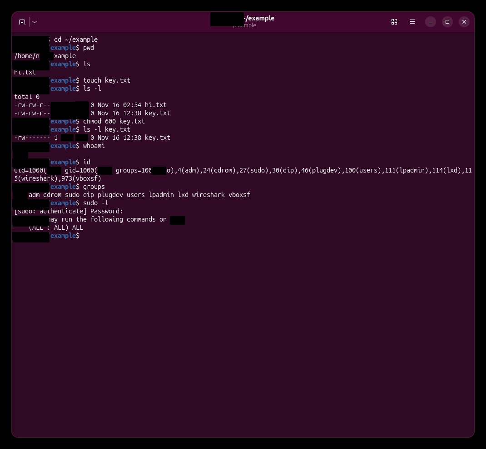

# Mini-Lab 2 — Linux File Permissions and User Identification

## 1. Lab Overview

| Field | Value |
| --- | --- |
| Lab Title | Mini-Lab 2 — Linux File Permissions and User Identification |
| Lab ID | P01-ML-02 |
| Phase | Phase 01 — Linux, Networking & Foundations |
| Category | Linux Administration / Access Control Fundamentals |
| Status | Completed |
| Date | 2026-09-03 |
| Author | Daniel Solano |
| Scope / Target | Personal Ubuntu virtual machine (controlled laboratory environment) |
| Authorization | Personal lab |

### Description

This mini-lab introduces Linux file permissions and user identification: reading permission notation, changing access with `chmod`, and identifying the current user, UID, GID, group membership, and sudo privileges. It establishes why permissions matter in cybersecurity — misconfigured permissions can expose sensitive files or allow unauthorized access — and introduces the principle of least privilege.

### Key Results

- Created the file `secret.txt` in `~/cyberlab` and inspected its permissions with `ls -l`.
- Changed its permissions to `600` (`-rw-------`), so only the owner can read and write it.
- Verified the change with `ls -l secret.txt`.
- Identified the current user with `whoami`, and inspected UID, GID, and group membership with `id` and `groups` (UID 1000, GID 1000).
- Inspected sudo privileges with `sudo -l`, which showed the user may run any command as any user (`(ALL : ALL) ALL`).

> **Documentation accuracy note.** The original execution took place on September 3, 2026, and was not captured in screenshots. The procedure in Section 5 is the authoritative record, taken from the author's handwritten notes. The screenshot in Section 13 is **supplementary evidence from a later recreation** of the exercise (November 16, 2026): it uses different names (`~/example`, `key.txt`) and shows `hi.txt`, which was already present in the recreated directory. It does **not** document the original command sequence, and the original filenames have not been replaced with the recreation's names anywhere in this document. Usernames and hostnames in commands and outputs use the generic identifiers `student` (local user) and `linux-vm` (hostname) in place of the author's real local account details.

## 2. Objectives

- Understand Linux file permission notation.
- Interpret owner, group, and others permissions.
- Distinguish read (r), write (w), and execute (x) permissions.
- Modify file permissions using `chmod`.
- Verify permissions using `ls -l`.
- Identify the current user using `whoami`.
- Inspect UID, GID, and group membership using `id` and `groups`.
- Inspect available administrative privileges using `sudo -l`.
- Understand why file permissions matter in cybersecurity.

## 3. Laboratory Environment

| Component | Details |
| --- | --- |
| Host OS | Windows 11 |
| Hypervisor / VM Platform | Oracle VM VirtualBox 7.2.8 |
| Guest OS | Ubuntu Desktop 26.04 |
| Network Configuration | Not applicable — local filesystem exercise; the VM uses VirtualBox NAT (10.0.2.0/24) |
| Tools | GNU coreutils (`ls`, `chmod`, `touch`), `whoami`, `id`, `groups`, `sudo` (versions not recorded during the original execution) |

## 4. Technical Background

- **Permission string:** `ls -l` shows permissions as a 10-character string. The first character is the file type (`-` for a regular file, `d` for a directory, `l` for a symbolic link). The next nine characters are three triplets: owner, group, and others.
- **Permission triplets:** Each triplet is read (`r`), write (`w`), and execute (`x`), or `-` where the permission is not granted. For example, `rw-` means read and write, but no execute.
- **Numeric (octal) notation:** Each permission has a value — read = 4, write = 2, execute = 1 — and each triplet is the sum of its permissions. `600` means owner `6` (`4 + 2` = read + write), group `0` (nothing), others `0` (nothing).
- **Owner, group, others:** Every file has an owner user and an owner group. Permissions decide what the owner, members of the group, and everyone else may do.
- **UID and GID:** The User ID (UID) identifies a user account; the Group ID (GID) identifies a group. `id` shows both, plus the supplementary groups the user belongs to.
- **Default permissions and `umask`:** The permissions of a newly created file depend on the shell's `umask`, which masks bits from the base permissions (`666` for files, `777` for directories). The same command can therefore produce different permissions on different systems — `664` is one common result, not a universal default.
- **`sudo` and `sudo -l`:** `sudo` runs a command with administrative privileges. `sudo -l` does not execute an administrative command; it lists the commands the current user is permitted to run through `sudo`, according to the system's sudoers configuration.

## 5. Laboratory Procedure

> The original execution (September 3, 2026) was not captured in screenshots. The command sequence below is the authoritative procedure from the author's handwritten notes. The outputs shown are representative: they illustrate what each command produces, confirmed by reproducing the same command sequence on a Linux system. They are not a transcript of the original execution, and no claim is made that the original run was independently recorded. The screenshot in Section 13 is from a later recreation with different names and is not presented as evidence of this original run.

### Step 1: Enter the laboratory directory

**Purpose:** Move into the laboratory directory created in Mini-Lab 1 and confirm the location and contents.

**Commands Executed:**

```bash
cd ~/cyberlab
pwd
ls
```

**Command Explanation:** `cd` changes the working directory to `~/cyberlab`; `pwd` prints it; `ls` lists the directory contents (including `lab1.txt` from Mini-Lab 1).

**Expected Output:** `pwd` returns `/home/student/cyberlab`; `ls` shows the files already present in the directory.

**Representative Output:**

```text
/home/student/cyberlab
lab1.txt
```

**Technical Interpretation:** The shell is operating inside the laboratory directory, ready for the permission exercises.

### Step 2: Create a file and inspect permissions

**Purpose:** Create a new file and read its permission string.

**Commands Executed:**

```bash
touch secret.txt
ls -l
```

**Command Explanation:** `touch` creates an empty file; `ls -l` shows detailed information, including the permission string, owner, group, size, and name.

**Expected Output:** The listing shows `secret.txt` with its default permissions, which depend on the system's `umask`.

**Representative Output:**

```text
-rw-rw-r-- 1 student student 0 Jul 14 11:28 lab1.txt
```

**Technical Interpretation:** This is the permission example recorded in the author's notes, shown here to explain the structure — it is the listing line for `lab1.txt`, not for `secret.txt`. Reading it left to right: `-` means a regular file; `rw-` is the owner's permissions (read and write); `rw-` is the group's permissions (read and write); `r--` is the others' permissions (read only). The owner and group are both `student`, and the file is 0 bytes.

> The permission values a new file receives depend on the `umask`. On the author's VM (umask `0002`) a new file is created as `-rw-rw-r--` (`664`). Reproducing the same `touch` on a system with umask `0007` produced `-rw-rw----` (`660`) instead — the same command, different defaults. No specific default is claimed as universal.

### Step 3: Change file permissions

**Purpose:** Restrict `secret.txt` so only the owner can read and write it.

**Commands Executed:**

```bash
chmod 600 secret.txt
```

**Command Explanation:** `chmod` changes file permissions. The numeric mode `600` is three octal digits — owner, group, others:

| Identity | Numeric value | Permission |
| --- | --- | --- |
| Owner | 6 | `rw-` |
| Group | 0 | `---` |
| Others | 0 | `---` |

**Expected Output:** No output on success. The resulting permission string is `-rw-------`.

**Representative Output:**

```text
(no output — success is silent)
```

**Technical Interpretation:** Only the file owner now has read and write permissions; group and others have none. This is the standard way to protect a sensitive file.

### Step 4: Verify permissions

**Purpose:** Confirm that the permission change took effect.

**Commands Executed:**

```bash
ls -l secret.txt
```

**Command Explanation:** `ls -l` with a filename argument shows the detailed information for that file only.

**Expected Output:** The permission string reads `-rw-------`.

**Representative Output:**

```text
-rw------- 1 student student 0 Nov 16 12:38 secret.txt
```

**Technical Interpretation:** The `600` mode is in effect: owner read and write only, nothing for group or others.

### Step 5: Identify the current user

**Purpose:** Display the effective username of the current session.

**Commands Executed:**

```bash
whoami
```

**Command Explanation:** `whoami` prints the effective username. It does not display the UID or GID — that is what `id` is for (Step 6).

**Expected Output:** The username of the current user.

**Representative Output:**

```text
student
```

**Technical Interpretation:** The session runs as user `student`, the owner of the laboratory files.

### Step 6: Inspect user and group information

**Purpose:** Show the UID, GID, and supplementary groups for the current user.

**Commands Executed:**

```bash
id
```

**Command Explanation:** `id` prints the user ID (UID), the primary group ID (GID), and all supplementary groups with their IDs.

**Expected Output:** `uid=1000(student) gid=1000(student)` followed by the supplementary groups.

**Representative Output:**

```text
uid=1000(student) gid=1000(student) groups=1000(student),4(adm),24(cdrom),27(sudo),30(dip),46(plugdev),100(users),111(lpadmin),114(lxd),115(wireshark),973(vboxsf)
```

**Technical Interpretation:** The UID and GID are both `1000` (recorded in the author's notes). The user belongs to several supplementary groups, including `adm`, `cdrom`, `sudo`, `dip`, `plugdev`, `users`, `lpadmin`, `lxd`, `wireshark`, and `vboxsf` — the full list is as observed in the recreated session on the same machine. Group membership is what grants capabilities such as using `sudo` or capturing packets with Wireshark.

### Step 7: List group membership

**Purpose:** Display the groups associated with the current user, by name.

**Commands Executed:**

```bash
groups
```

**Command Explanation:** `groups` lists the groups the current user belongs to.

**Expected Output:** The group names for the current user.

**Representative Output:**

```text
student adm cdrom sudo dip plugdev users
```

**Technical Interpretation:** The groups recorded in the author's notes. The recreated session additionally showed `lpadmin`, `lxd`, `wireshark`, and `vboxsf`. Membership in `sudo` is what allows the user to run commands with administrative privileges (Step 8).

### Step 8: Inspect administrative privileges

**Purpose:** List the commands the current user is permitted to execute through `sudo`.

**Commands Executed:**

```bash
sudo -l
```

**Command Explanation:** `sudo -l` lists the permitted sudo commands according to the system's sudoers configuration. It does not execute any administrative command; it only reports what is allowed (it may ask for the user's password first).

**Expected Output:** The list of permitted sudo commands for the current user.

**Representative Output:**

```text
User student may run the following commands on linux-vm:
    (ALL : ALL) ALL
```

**Technical Interpretation:** The user may run any command as any user through `sudo` — full administrative access. This is the output as observed in the recreated session. Such broad privileges should be assigned carefully (see Section 8).

## 6. Commands & Technical Analysis

| Command | Purpose | Flags / Arguments | Technical Relevance |
| --- | --- | --- | --- |
| `cd` | Change directories | `~/cyberlab` | Moves the shell into the working directory |
| `pwd` | Display the current working directory | — | Verifies where relative paths resolve from |
| `ls` | List directory contents | — | Confirms the files present before the exercise |
| `touch` | Create an empty file | `secret.txt` | Creates the file whose permissions are studied |
| `ls -l` | Display detailed file information | —, `secret.txt` | Shows the permission string, owner, group, and size |
| `chmod` | Change file permissions | `600 secret.txt` | Sets owner `rw-`, group `---`, others `---` |
| `whoami` | Display the effective username | — | Identifies who owns the session |
| `id` | Show UID, GID, and groups | — | Identifies the account numerically and its group memberships |
| `groups` | List the current user's groups | — | Shows group membership by name |
| `sudo -l` | List permitted sudo commands | — | Reports the user's administrative privileges without executing anything |

## 7. Results & Observations

### Findings

- `chmod 600 secret.txt` changed the permission string from the default (`-rw-rw-r--` on the author's VM) to `-rw-------`, verified with `ls -l secret.txt`.
- The permission structure is consistent: the first character is the file type, followed by owner, group, and others triplets.
- The current user is `student` (UID 1000, GID 1000), a member of several supplementary groups including `sudo`.
- `sudo -l` reported `(ALL : ALL) ALL` — the user holds full sudo privileges on this machine.
- The recreated session showed the same workflow with different names (`key.txt` instead of `secret.txt`): the file was created as `-rw-rw-r--`, then changed to `-rw-------` after `chmod 600`.

### Expected vs. Representative Behavior

| Item | Expected | Representative | Notes |
| --- | --- | --- | --- |
| `touch secret.txt` | Empty file created | File created (0 bytes) | Matches |
| `ls -l` permission string | Shows owner/group/others triplets | `-rw-rw-r--` on the author's VM | Default depends on `umask` |
| `chmod 600 secret.txt` | Permission string becomes `-rw-------` | `-rw-------` | Matches; verified in Step 4 |
| `whoami` | Effective username | `student` | Matches |
| `id` | UID 1000, GID 1000, groups listed | `uid=1000(student) gid=1000(student)`, groups listed | Matches the notes |
| `groups` | Group names listed | `student adm cdrom sudo dip plugdev users` | Matches the notes |
| `sudo -l` | Permitted sudo commands listed | `(ALL : ALL) ALL` | As observed in the recreation |

### Conceptual Questions and Answers

**What does `rw-------` mean?**

Only the owner can read and write the file. Group and others have no permissions.

**What does `chmod 600` do?**

It grants read and write permissions to the owner and removes permissions from the group and others.

**What are UID and GID?**

UID identifies a user account, while GID identifies a group.

**Why are permissions important in cybersecurity?**

Misconfigured permissions can expose sensitive files or allow unauthorized access.

**What is the difference between `whoami` and `id`?**

`whoami` displays the effective username. `id` provides the UID, GID, and group membership information.

### Supporting Evidence

- `screenshots/01-file-permissions-and-user-identification.jpg` — **supplementary evidence from a recreated practice session (November 16, 2026), not the original execution.** It shows the same command families (`cd`, `pwd`, `ls`, `touch`, `ls -l`, `chmod 600`, `whoami`, `id`, `groups`, `sudo -l`) run with different names (`~/example`, `key.txt`), including the before/after permission change (`-rw-rw-r--` → `-rw-------`) and the `sudo -l` output (`(ALL : ALL) ALL`). The file `hi.txt` was already present in the recreated directory. It is included to illustrate the terminal workflow, not as proof of the original run.



## 8. Security Analysis

### Security Mechanisms

- **Unix file permissions:** `chmod 600` restricts a file to its owner through the permission bits. The check is enforced by the kernel on every access.
- **`sudo` authorization:** Administrative actions require membership in the `sudo` group and authentication; `sudo -l` reports exactly what is permitted.
- **Group-based capabilities:** Membership in groups such as `wireshark` (packet capture) and `vboxsf` (shared folders) grants specific capabilities without full administrative access.

### Vulnerabilities & Weaknesses

- **Overly broad sudo access:** The recreated session showed `(ALL : ALL) ALL` — the user may run any command as any user. That is convenient for a personal lab machine but violates least privilege if applied to a shared or production system.
- **Default permissions are permissive:** A newly created file on this VM is readable by group and others (`-rw-rw-r--`). A sensitive file left at the default is exposed to every local user until its permissions are tightened.

### Attack Surfaces & Abuse Scenarios

- A sensitive file (credentials, private keys, tokens) left world-readable can be read by any local user or by a compromised low-privilege process.
- SSH private keys with incorrect permissions are a classic failure: SSH refuses keys that are too open, and exposed keys can be copied and reused. The author's notes record this directly — many security problems occur because SSH keys have incorrect permissions and sensitive files are left too open.
- An account with unrestricted sudo access is a single point of compromise: any code running as that user can escalate to full administrative control.

### Defensive Controls & Mitigations

- **Least privilege:** Grant only the permissions a file or user actually needs. `chmod 600` for private files, `chmod 644` for files meant to be read by others, and narrow sudo rules instead of `(ALL : ALL) ALL` where possible.
- **Verify after changing:** Always confirm with `ls -l` after `chmod`, as done in Step 4.
- **Permissions are not encryption:** `chmod 600` controls who may open the file through the filesystem; it does not encrypt its contents. Anyone who can read the raw disk, or an administrator, can still read it. Sensitive data that must stay secret needs encryption as well as permissions.
- **Audit group membership:** Review `id` and `groups` output periodically; remove users from privileged groups (such as `sudo`) when they no longer need them.

### Real-World Relevance

- File permissions are the first layer of Linux access control and appear in every SOC and system-hardening workflow: triaging a host starts with checking who can read logs, keys, and configuration files.
- The `evidence/` convention from Mini-Lab 1 depends on permissions: captured material must be readable by the analyst and unreadable to anyone else.
- Understanding UID, GID, and sudo scope is required for incident response — knowing which account acted, and what it was allowed to do, determines the blast radius of a compromise.

## 9. Troubleshooting & Challenges

> No issues were recorded during the original execution (September 3, 2026). The notes below concern the recreation and the documentation itself.

| Issue | Diagnostics | Resolution | Status |
| --- | --- | --- | --- |
| The notes' step numbering skips a number (`id` is unnumbered, `groups` is #6, `sudo -l` is #7) | Compared the handwritten steps with the intended sequence | Normalized to Steps 1–8 in this document, preserving the original command order and filenames | Resolved |
| A new file's default permissions differ between systems (`-rw-rw-r--` on the author's VM vs. `-rw-rw----` on the verification system) | `umask` differs (`0002` vs. `0007`) | Documented that defaults depend on `umask`; no universal default is claimed | Resolved |
| `sudo -l` asks for a password and cannot be run non-interactively in a verification run | The command prompts for authentication | The output is documented from the recreated session instead of a fresh verification run | Resolved |

## 10. Lessons Learned

- A permission string is read as file type + owner + group + others; each triplet is read, write, execute.
- Numeric modes are sums: `6 = 4 + 2` (read + write), so `chmod 600` means owner `rw-` and nothing for anyone else.
- `chmod` sets absolute permissions, while the permissions a new file starts with depend on the `umask`.
- `whoami` answers "who am I" and `id` answers "who am I, numerically, and which groups am I in" — they are not interchangeable.
- `sudo -l` reports privileges; it does not use them. Checking it is a safe first step before running anything as administrator.
- Permissions restrict access; they do not encrypt. A `600` file is private through the filesystem, not secret from the disk or from an administrator.
- The principle of least privilege applies to files and to users: give the minimum access that the work requires.

## 11. References

| Source | Link |
| --- | --- |
| GNU Coreutils manual (ls, chmod, touch) | https://www.gnu.org/software/coreutils/manual/ |
| Ubuntu man pages — coreutils and user commands | https://manpages.ubuntu.com/ |
| sudo manual — `sudo -l` and sudoers | https://www.sudo.ws/docs/man/sudo.man/ |

## 12. Conclusion

Mini-Lab 2 demonstrates the core of Linux access control in a controlled environment: a file was created, its permission string was read and explained, access was restricted to the owner with `chmod 600`, and the change was verified. The lab then identified the user behind the session (`whoami`, UID 1000, GID 1000), mapped group membership (`id`, `groups`), and inspected sudo privileges (`sudo -l` → `(ALL : ALL) ALL`). The key takeaway is the principle of least privilege: permissions decide who can read, write, or execute, but they are not encryption, and broad sudo access should be granted with care. Natural next steps are Mini-Lab 6 (Advanced Permissions), which builds directly on the notation and commands used here, and Practice 03 (SSH + SFTP), where SSH key permissions become a real operational requirement.

## 13. Evidence & Supporting Files

> Sanitize all evidence before publishing: remove credentials, private keys, API tokens, personal information, and sensitive network details. The screenshot below was sanitized by the author (username and hostname redacted). No packet capture is published with this lab.

| Filename | Description | Related Step |
| --- | --- | --- |
| `screenshots/01-file-permissions-and-user-identification.jpg` | Terminal session from the recreated practice (November 16, 2026): `cd`, `pwd`, `ls`, `touch key.txt`, `ls -l`, `chmod 600 key.txt`, `ls -l key.txt`, `whoami`, `id`, `groups`, `sudo -l`, with different names (`~/example`, `key.txt`). Supplementary evidence only — not the original execution. | 1–8 (recreation) |

### Mini-Lab Directory Structure

```text
mini-lab-02-linux-file-permissions/
├── README.md
└── screenshots/
    └── 01-file-permissions-and-user-identification.jpg
```

## 14. Laboratory Completion Record

| Field | Value |
| --- | --- |
| Completion Status | Completed |
| Completion Date | 2026-09-03 |
| Documentation Version | v1.0 |
| Author | Daniel Solano |
| Related Phase | Phase 01 — Linux, Networking & Foundations |
| Related Resources | [Mini-Lab 1 — Linux Files and Directories](../mini-lab-01-linux-files-and-directories/README.md), [Practice 01 — Wireshark, ICMP & ARP Analysis](../../practices/practice-01-wireshark-ping-arp/README.md) |
