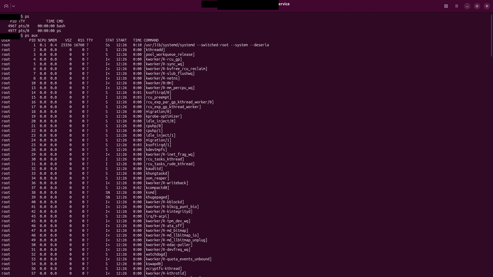
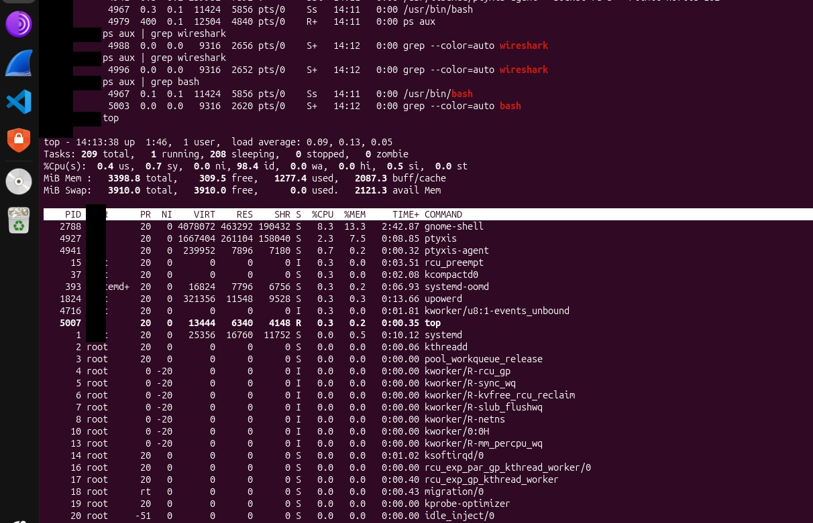
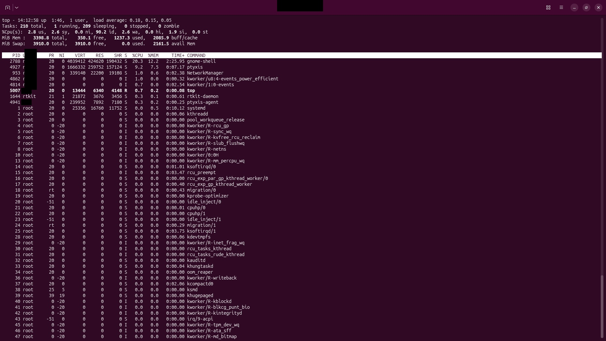
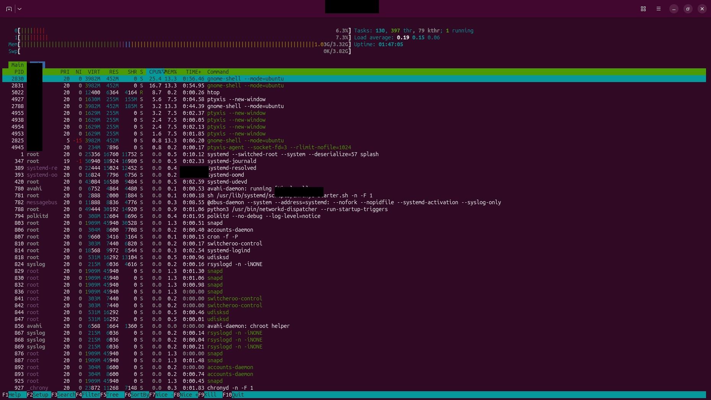
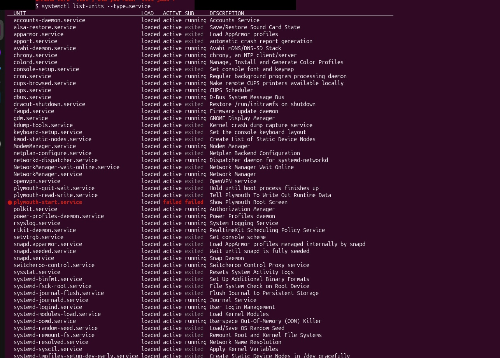
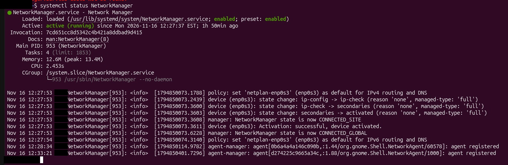
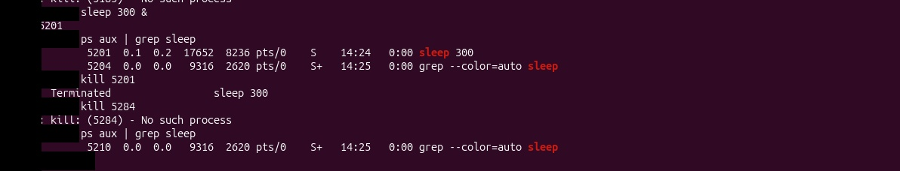
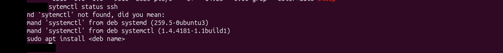

# Mini-Lab 3 — Linux Processes & Services

## 1. Lab Overview

| Field | Value |
| --- | --- |
| Lab Title | Mini-Lab 3 — Linux Processes & Services |
| Lab ID | P01-ML-03 |
| Phase | Phase 01 — Linux, Networking & Foundations |
| Category | Linux Administration / Process & Service Management |
| Status | Completed |
| Date | 2026-09-08 |
| Author | Daniel Solano |
| Scope / Target | Personal Ubuntu virtual machine (controlled laboratory environment) |
| Authorization | Personal lab |

### Description

This mini-lab introduces Linux processes and system services: listing processes with `ps`, filtering them with `grep`, monitoring them in real time with `top` and `htop`, inspecting services managed by `systemd`, and controlling a background process with `&` and `kill`. It establishes why process and service monitoring matters in cybersecurity — an unfamiliar process, an unexpected background job, or a service that should not be running can be the first sign of a compromise — and introduces the habit of verifying a process by its path, owner, arguments, and behavior before drawing conclusions.

### Key Results

- Listed the processes of the current terminal with `ps` (2 processes: the shell and `ps` itself) and all processes on the system with `ps aux` (PID 1 is `systemd`; the rest are kernel threads and system daemons).
- Filtered process listings with `ps aux | grep wireshark` (run twice; both times the only match was the `grep` process itself) and `ps aux | grep bash` (the shell, PID 4967, and the `grep` process itself).
- Monitored the system in real time with `top` (210 tasks, 1 running, 209 sleeping; 90.2% idle CPU) and `htop` (130 tasks, 397 threads; `gnome-shell` the largest CPU and memory consumer).
- Listed all system services with `systemctl list-units --type=service` and inspected `NetworkManager` in detail (`active (running)`, Main PID 953, since November 16, 2026, 12:27:37 EST).
- Started a background process with `sleep 300 &` (PID 5201), located it with `ps aux | grep sleep`, and terminated it with `kill 5201` (SIGTERM by default); a later `kill 5284` failed with `No such process`, and a repeat search confirmed the process was gone.
- Recorded two command-entry mistakes accurately: `sytemctl status ssh` (misspelled `systemctl`, command not found) and the failed `kill` attempts on PIDs 5185 and 5284.
- Observed `plymouth-start.service` in a `failed` state in the service listing; the cause was not investigated and is not claimed here.

> **Documentation accuracy note.** The original execution took place on September 8, 2026, and was not captured in screenshots. The procedure in Section 5 is documented from the terminal evidence (the screenshots in Section 13) and the lab specification, which agree on every command, PID, and result reported here. The screenshots are **supplementary evidence from a later recreation** of the exercise (November 16, 2026): the terminal in the recreation shows the same command families, the same service names, and the same workflow as the original run, but the PIDs, timestamps, and resource values are those of the recreated session, not the original one. The outputs shown are representative: they illustrate what each command produces, confirmed against the recreated terminal evidence and by reproducing the same command sequence on a Linux system. They are not a transcript of the original execution, and no claim is made that the original run was independently recorded. Usernames and hostnames in commands and outputs use the generic identifiers `student` (local user) and `linux-vm` (hostname) in place of the author's real local account details.

## 2. Objectives

- Understand what a Linux process is and what a Process ID (PID) identifies.
- List processes with `ps` and read the full process table with `ps aux`.
- Explain the `a`, `u`, and `x` options of `ps aux` and the difference between terminal and non-terminal processes.
- Filter process output with `grep` and the pipe (`|`), and recognize that the `grep` process itself can appear in its own results.
- Monitor processes in real time with `top` and `htop`, and interpret their CPU, memory, and process-state fields.
- Explain CPU statistics (`us`, `sy`, `ni`, `id`, `wa`, `hi`, `si`, `st`) and memory concepts (VIRT/VSZ, RES/RSS, SHR, MiB, Swap, available memory).
- Read process states (`R`, `S`, `D`, `Z`, `T`, `I`) and `STAT` modifiers (`s`, `l`, `+`, `<`, `N`).
- Inspect system services with `systemctl`, distinguish a service from a process, and read service states (`active`, `running`, `exited`, `failed`).
- Start a background process with `&`, identify it by PID, and terminate it with `kill` (SIGTERM by default).
- Recognize and document command-entry mistakes (`sytemctl`) and failed operations (`kill` on a nonexistent PID) accurately.
- Understand why process and service monitoring matters in cybersecurity.

## 3. Laboratory Environment

| Component | Details |
| --- | --- |
| Host OS | Windows 11 |
| Hypervisor / VM Platform | Oracle VM VirtualBox 7.2.8 |
| Guest OS | Ubuntu Desktop 26.04 |
| Network Configuration | VirtualBox NAT (10.0.2.0/24); the VM's interface is `enp0s3`, managed by NetworkManager |
| Tools | `ps`, `top`, `htop`, `systemctl`, `grep`, `kill`, `sleep` (versions not recorded during the original execution) |

## 4. Technical Background

- **Process:** A process is a running instance of a program. The kernel gives each process a unique number, the Process ID (PID). PID 1 is the first process started at boot — on this system it is `systemd`, the init system, which starts and supervises everything else.
- **PID:** PIDs identify processes for inspection (`ps`, `top`) and control (`kill`). PIDs are assigned sequentially and are reused after a process exits, so a PID alone is not a permanent identity — always confirm what the process actually is before acting on it.
- **`ps`:** With no options, `ps` shows only the processes attached to the current terminal: the shell and `ps` itself. It answers "what is running in this terminal right now."
- **`ps aux`:** Shows every process on the system in a user-oriented format. The options are `a` (show processes of all users, not just the current one), `u` (display user-oriented columns: user, %CPU, %MEM, VSZ, RSS, TTY, STAT, START, TIME, COMMAND), and `x` (include processes without a controlling terminal, such as daemons and kernel threads). A `?` in the TTY column means the process has no controlling terminal.
- **Kernel threads:** Entries in brackets such as `[kthreadd]`, `[kworker/R-rcu_gp]`, and `[ksoftirqd/0]` are kernel threads, not user programs. They do work inside the kernel (workqueues, soft interrupts, memory management) and have no user-space memory (VSZ and RSS of 0).
- **Pipe (`|`) and `grep`:** A pipe connects one command's standard output to another command's standard input. `ps aux | grep bash` sends the full process list to `grep`, which prints only the lines containing `bash`. Because `grep` itself is a running process while it searches, its own command line usually matches the pattern and appears in the results — that line is the search tool, not a second copy of the thing searched for.
- **`top`:** A real-time, full-screen monitor that refreshes the process list. It shows a summary (uptime, load average, task counts, CPU percentages, memory) and a table sorted by CPU usage by default. Press `q` to quit.
- **`htop`:** An interactive alternative to `top` with a color interface, a full process tree, mouse support, and function-key controls (see Section 5, Part 3). It shows the same information in a form that is easier to sort, filter, and act on.
- **CPU statistics (from `top`):** `us` is time spent in user space; `sy` is time spent in the kernel (system calls, interrupts handled in kernel context); `ni` is time spent running processes whose nice value was adjusted; `id` is idle time; `wa` is time spent waiting for I/O to complete; `hi` is time spent handling hardware interrupts; `si` is time spent handling software interrupts; `st` is time stolen from this virtual machine by the hypervisor.
- **Memory concepts:** VIRT (VSZ) is the total virtual memory a process has mapped, including shared libraries and memory it has reserved but not touched; RES (RSS) is the physical memory actually held in RAM; SHR is the portion of RES shared with other processes (mostly shared libraries). `MiB Mem` shows total, free, used, and buff/cache (memory the kernel uses for disk caching and can reclaim); `avail Mem` is the memory available for starting new programs without swapping. `MiB Swap` shows swap space usage; 0 used means the system has not needed to page memory to disk.
- **Process states:** `R` (running or runnable — on the CPU or waiting for it), `S` (interruptible sleep — waiting for an event, the normal state of an idle process), `D` (uninterruptible sleep — usually waiting for disk I/O; cannot be killed while in this state), `Z` (zombie — the process has exited but its parent has not yet collected its exit status), `T` (stopped — suspended, usually by a signal such as `Ctrl+Z`), `I` (idle kernel thread — a kernel thread that is idle). In the captures in this lab, `R`, `S`, and `I` were observed; `D`, `Z`, and `T` were not present (the `top` summaries report 0 stopped and 0 zombie tasks), and are documented here from the reference material.
- **`STAT` modifiers (additional letters after the state):** `s` means the process is a session leader; `l` means the process is multithreaded; `+` means the process is in the foreground process group of its terminal; `<` means the process has a higher scheduling priority (a negative nice value); `N` means the process has a lower scheduling priority (a positive nice value). Examples observed in this lab: `Ss` (PID 1, `systemd` — sleeping session leader), `S+` (the `grep` processes — sleeping, in the foreground process group), `I<` (kernel workers — idle, high priority), `SN` (`ksmd`, `khugepaged` — sleeping, low priority), `R+` (`ps` itself in one capture — running, foreground).
- **Service:** A service is a background program managed by the init system (`systemd` on Ubuntu). A service is a process (or a set of processes) plus a unit file that tells `systemd` how to start it, when to start it, and what to do if it fails. Every service is a process, but not every process is a service — `gnome-shell`, the shell, and `top` are processes that no service unit manages.
- **`systemd` and `systemctl`:** `systemd` is PID 1; it starts services at boot and supervises them. `systemctl` is the tool used to inspect and control it. `systemctl list-units --type=service` lists the loaded service units with their LOAD, ACTIVE, SUB, and DESCRIPTION columns. `systemctl status <name>` shows one unit in detail: whether it is loaded and enabled, whether it is active, its main PID, its resource use, and its recent log lines.
- **Service states:** LOAD is `loaded` when the unit file was read successfully. ACTIVE is `active` when the unit is in its desired state, `failed` when it entered a failure state. SUB is the more specific state: `running` for a long-lived daemon, `exited` for a unit whose job finished successfully (a one-shot task such as setting the console font), `failed` when the unit failed. A service can be `active (exited)` — healthy and finished — which is not an error.
- **Background jobs (`&`):** Appending `&` to a command runs it in the background: the shell starts it, reports its job number and PID, and returns the prompt immediately. The process keeps running while the shell accepts new commands.
- **`kill` and signals:** `kill <PID>` sends a signal to a process. By default it sends SIGTERM (signal 15), a polite request to terminate — the process may catch it, clean up, and exit. SIGKILL (signal 9, `kill -9`) cannot be caught and forces immediate termination, but it is a last resort because the process gets no chance to clean up. `kill` on a PID that does not exist fails with `No such process`; it does not terminate anything.

## 5. Laboratory Procedure

> The original execution (September 8, 2026) was not captured in screenshots. The command sequence below is the authoritative procedure, documented from the terminal evidence (the screenshots in Section 13) and the lab specification, which agree on every command, PID, and result reported here. The outputs shown are representative: they illustrate what each command produces, confirmed against the recreated terminal evidence (November 16, 2026) and by reproducing the same command sequence on a Linux system. They are not a transcript of the original execution, and no claim is made that the original run was independently recorded. The screenshots are from the later recreation and show the recreated session's PIDs, timestamps, and resource values.

### Part 1: Understanding Processes

**Purpose:** See what processes are, list the processes of the current terminal, then list every process on the system.

**Commands Executed:**

```bash
ps
ps aux
```

**Command Explanation:** `ps` with no options lists the processes attached to the current terminal. `ps aux` lists all processes on the system (`a`), in user-oriented format (`u`), including processes without a controlling terminal (`x`).

**Expected Output:** `ps` shows two lines (the shell and `ps` itself). `ps aux` shows the full table, starting with PID 1 (`systemd`) followed by kernel threads and daemons.

**Representative Output:**

```text
  PID TTY          TIME CMD
 4967 pts/0    00:00:00 bash
 4977 pts/0    00:00:00 ps
```

```text
USER         PID %CPU %MEM    VSZ   RSS TTY      STAT START   TIME COMMAND
root           1  0.1  0.4  25356 16760 ?        Ss   12:26   0:10 /usr/lib/systemd/systemd --switched-root --system --deserialize
root           2  0.0  0.0      0     0 ?        S    12:26   0:00 [kthreadd]
root           3  0.0  0.0      0     0 ?        S    12:26   0:00 [pool_workqueue_release]
root           4  0.0  0.0      0     0 ?        I<   12:26   0:00 [kworker/R-rcu_gp]
root          14  0.0  0.0      0     0 ?        S    12:26   0:01 [ksoftirqd/0]
root          38  0.0  0.0      0     0 ?        SN   12:26   0:00 [ksmd]
root          39  0.0  0.0      0     0 ?        SN   12:26   0:00 [khugepaged]
```

**Technical Interpretation:** The `ps` output shows that the current terminal (`pts/0`) runs exactly two processes: the interactive shell (`bash`, PID 4967) and the `ps` command itself (PID 4977), which exits as soon as it prints. The `ps aux` output starts with PID 1, `systemd`, in state `Ss` (sleeping, session leader) — the init process that has been running since the system booted at 12:26. Below it are kernel threads, recognizable by their bracketed names and by VSZ and RSS of 0: `[kthreadd]` (PID 2, the parent of all kernel threads), workqueue workers (`[kworker/...]`), `[ksoftirqd/0]` (soft-interrupt handling), and memory-management threads (`[ksmd]`, `[khugepaged]`, both `SN` — sleeping with a low scheduling priority). The `?` in the TTY column confirms these processes have no controlling terminal, which is why plain `ps` never shows them — the `x` option is what includes them.

### Part 2: Searching for Processes

**Purpose:** Find specific processes in the full list by filtering `ps aux` output with `grep`.

**Commands Executed:**

```bash
ps aux | grep wireshark
ps aux | grep wireshark
ps aux | grep bash
```

**Command Explanation:** The pipe (`|`) sends the standard output of `ps aux` to the standard input of `grep`, which prints only the lines containing the given pattern. The first command was run twice in the captured session.

**Expected Output:** Matching process lines. The `grep` process itself usually appears, because its own command line contains the pattern.

**Representative Output:**

```text
 4988  0.0  0.0   9316  2656 pts/0    S+   14:12   0:00 grep --color=auto wireshark
```

```text
 4996  0.0  0.0   9316  2652 pts/0    S+   14:12   0:00 grep --color=auto wireshark
```

```text
 4967  0.1  0.1  11424  5856 pts/0    Ss   14:11   0:00 /usr/bin/bash
 5003  0.0  0.0   9316  2620 pts/0    S+   14:12   0:00 grep --color=auto bash
```

**Technical Interpretation:** The `wireshark` search returned only the `grep` process itself, twice (PIDs 4988 and 4996, one per run) — no Wireshark process was running at the time, so there was nothing else to match. That is the expected result and the point of the exercise: a search that returns only `grep` means the thing searched for is not running, and the `grep` line must not be mistaken for a real match. The `bash` search returned two lines: the interactive shell itself (`/usr/bin/bash`, PID 4967, `Ss` — sleeping session leader) and the `grep` process (PID 5003, `S+` — sleeping, in the foreground process group). Filtering this way is the basic technique for finding a suspicious process by name: if an unfamiliar name appears in the list, the next step is to inspect its full command line, owner, and executable path before deciding what it is (see Section 8).

### Part 3: Real-Time Process Monitoring

**Purpose:** Watch processes as they run, and read CPU, memory, and state information from `top` and `htop`.

**Commands Executed:**

```bash
top
htop
```

**Command Explanation:** `top` opens a full-screen, continuously refreshing view of the system and its processes, sorted by CPU usage. `htop` is an interactive alternative with a color display, a process tree, and function-key controls. Both are exited with `q` (`top`) or `F10` (`htop`).

**Expected Output:** A summary (uptime, load average, task counts, CPU and memory) followed by a process table with the columns PID, USER, PR, NI, VIRT, RES, SHR, S, %CPU, %MEM, TIME+, and COMMAND.

**Representative Output (`top`, 14:12:58):**

```text
top - 14:12:58 up 1:46,  1 user,  load average: 0.18, 0.15, 0.05
Tasks: 210 total,   1 running, 209 sleeping,   0 stopped,   0 zombie
%Cpu(s):  2.8 us,  2.6 sy,  0.0 ni, 90.2 id,  2.6 wa,  0.0 hi,  1.9 si,  0.0 st
MiB Mem :   3398.8 total,    350.1 free,   1237.3 used,   2085.9 buff/cache
MiB Swap:   3910.0 total,   3910.0 free,      0.0 used.   2161.5 avail Mem

  PID USER      PR  NI    VIRT    RES    SHR S  %CPU  %MEM     TIME+ COMMAND
 2788 student   20   0 4039412 424620 190432 S  20.3  12.2   2:25.95 gnome-shell
 4927 student   20   0 1666332 259752 157124 S   9.2   7.5   0:07.17 ptyxis
  953 root      20   0  339140  22200  19108 S   1.0   0.6   0:02.38 NetworkManager
 4862 root      20   0       0      0      0 I   1.0   0.0   0:00.32 kworker/u8:4-events_power_efficient
 4814 root      20   0       0      0      0 I   0.7   0.0   0:00.54 kworker/1:0-events
 5007 student   20   0   13444   6340   4148 R   0.7   0.2   0:00.08 top
 1644 rtkit     21   1   21872   3676   3456 S   0.3   0.1   0:00.61 rtkit-daemon
 4941 student   20   0  239952   7892   7180 S   0.3   0.2   0:00.25 ptyxis-agent
    1 root      20   0   25356  16760  11752 S   0.0   0.5   0:10.12 systemd
    2 root      20   0       0      0      0 S   0.0   0.0   0:00.06 kthreadd
    4 root       0 -20       0      0      0 I   0.0   0.0   0:00.00 kworker/R-rcu_gp
   18 root      rt   0       0      0      0 S   0.0   0.0   0:00.43 migration/0
   20 root     -51   0       0      0      0 S   0.0   0.0   0:00.00 idle_inject/0
```

**Representative Output (`top`, 14:13:38, from the filtering capture):**

```text
top - 14:13:38 up 1:46,  1 user,  load average: 0.09, 0.13, 0.05
Tasks: 209 total,   1 running, 208 sleeping,   0 stopped,   0 zombie
%Cpu(s):  0.4 us,  0.7 sy,  0.0 ni, 98.4 id,  0.0 wa,  0.0 hi,  0.5 si,  0.0 st
MiB Mem :   3398.8 total,    309.5 free,   1277.4 used,   2087.3 buff/cache
MiB Swap:   3910.0 total,   3910.0 free,      0.0 used.   2121.3 avail Mem
```

**Representative Output (`htop`):**

```text
Tasks: 130, 397 thr, 79 kthr; 1 running
Load average: 0.19 0.15 0.06
Uptime: 01:47:05
Mem: 1.03G/3.32G
Swp: 0K/3.82G

  PID USER  PRI  NI  VIRT   RES   SHR S  CPU% MEM%  TIME+   Command
 2830       20   0 3982M  452M     0 S  25.4 13.3  0:56.46 gnome-shell --mode=ubuntu
 2831       20   0 3982M  452M     0 S  16.7 13.3  0:54.95 gnome-shell --mode=ubuntu
 5022       20   0  12400  6364  4164 R   8.7  0.2  0:00.26 htop
 4927       20   0  1630M  255M  155M S   5.6  7.5  0:04.58 ptyxis --new-window
 2788       20   0  3982M  452M  185M S   3.2 13.3  0:44.39 gnome-shell --mode=ubuntu
 2825        5 -15  3982M  452M     0 S   0.8 13.3  0:06.20 gnome-shell --mode=ubuntu
    1 root  20   0  25356  16760 11752 S   0.0  0.5  0:10.12 systemd --switched-root --system --deserialize=57 splash
  347 root  19  -1   59040  10924  10980 S   0.0  0.3  0:02.33 systemd-journald
  389       20   0  22444  11024  12452 S   0.0  0.4          systemd-resolved
  393       20   0  16824   7796  6756 S   0.0  0.2  0:06.93 systemd-oomd
  420 root  20   0   43084  10500   9484 S   0.0  0.3  0:02.59 systemd-udevd
  780 avahi 20   0   6752   4864  4480 S   0.0  0.1  0:00.53 avahi-daemon: running [hostname redacted]
  781 root  20   0   2888   2000  1884 S   0.0  0.1  0:00.18 sh /usr/lib/systemd/scripts/chronyd-starter.sh -n -F 1
  807 root  20   0   9660   3416  3164 S   0.0  0.1  0:00.15 cron -f -P
  829 root  20   0  1909M  45940     0 S   0.0  1.3  0:01.30 snapd
```

**Technical Interpretation:** Both tools show the same system from different angles. At 14:12:58 the machine had been up 1 hour 46 minutes, with 210 tasks of which only 1 was running and 209 were sleeping; 90.2% of CPU time was idle, so the system was lightly loaded. `gnome-shell` (PID 2788) was the largest consumer — 20.3% CPU and 12.2% of memory at that instant, with a very large virtual size (about 4 GB of VIRT, of which 424 MB was resident) — normal for a desktop shell that maps shared libraries and graphics buffers. `top` itself (PID 5007) appears in its own list in state `R`, because it is running while it prints. Kernel threads show VIRT and RES of 0 and states `I` (idle) or `S`; several carry a negative nice value (`NI -20`, `NI -51`) and one, `migration/0`, runs at real-time priority (`PR rt`). The `htop` capture, taken at a different moment, shows the same picture: `gnome-shell` on top, `htop` itself at 8.7% CPU, and the system daemons (`systemd`, `systemd-journald`, `systemd-resolved`, `systemd-oomd`, `systemd-udevd`, `avahi-daemon`, `chronyd`, `cron`, `snapd`) all near 0% CPU. The `htop` footer records its controls: `F1` Help, `F2` Setup, `F3` Search, `F4` Filter, `F5` Tree, `F6` SortBy, `F7` Nice −, `F8` Nice +, `F9` Kill, `F10` Quit. Searching (`F3`) finds a process by name, filtering (`F4`) narrows the list to matches, sorting (`F6`) changes the sort column, `F7`/`F8` raise or lower a process's nice value (changing its priority), and `F9` sends a signal to the selected process. The exact keys can vary with the installed `htop` version and the terminal, so they are recorded here as observed in this capture rather than as universal shortcuts.

### Part 4: Inspecting System Services

**Purpose:** List the services `systemd` manages and inspect one service in detail.

**Commands Executed:**

```bash
systemctl list-units --type=service
systemctl status NetworkManager
```

**Command Explanation:** `systemctl list-units --type=service` lists the loaded service units with their LOAD, ACTIVE, SUB, and DESCRIPTION. `systemctl status NetworkManager` shows the full status of the NetworkManager service: its loaded/enabled state, whether it is active, its main PID, its resource use, and its recent log lines.

**Expected Output:** A list of services, most `loaded active running` or `loaded active exited`, with one unit — `plymouth-start.service` — in a `failed` state. The NetworkManager status shows `active (running)` with Main PID 953.

**Representative Output (`systemctl list-units --type=service`, excerpt):**

```text
UNIT                          LOAD   ACTIVE SUB     DESCRIPTION
accounts-daemon.service       loaded active running Accounts Service
alsa-restore.service          loaded active exited  Save/Restore Sound Card State
apparmor.service              loaded active exited  Load AppArmor profiles
avahi-daemon.service          loaded active running Avahi mDNS/DNS-SD Stack
chrony.service                loaded active running chrony, an NTP client/server
cron.service                  loaded active running Regular background program processing daemon
cups-browsed.service          loaded active running Make remote CUPS printers available locally
cups.service                  loaded active running CUPS Scheduler
dbus.service                  loaded active running D-Bus System Message Bus
fwupd.service                 loaded active running Firmware update daemon
gdm.service                   loaded active running GNOME Display Manager
ModemManager.service          loaded active running Modem Manager
NetworkManager.service        loaded active running Network Manager
plymouth-start.service        loaded failed failed  Show Plymouth Boot Screen
polkit.service                loaded active running Authorization Manager
rsyslog.service               loaded active running System Logging Service
rtkit-daemon.service          loaded active running RealtimeKit Scheduling Policy Service
snapd.service                 loaded active running Snap Daemon
systemd-journald.service      loaded active running Journal Service
systemd-logind.service        loaded active running User Login Management
systemd-oomd.service          loaded active running Userspace Out-Of-Memory (OOM) Killer
systemd-resolved.service      loaded active running Network Name Resolution
```

**Representative Output (`systemctl status NetworkManager`):**

```text
● NetworkManager.service - Network Manager
     Loaded: loaded (/usr/lib/systemd/system/NetworkManager.service; enabled; preset: enabled)
     Active: active (running) since Mon 2026-11-16 12:27:37 EST; 1h 50min ago
   Invocation: 7cd651cc8d5342c4b421a8dbdab9d415
       Docs: man:NetworkManager(8)
   Main PID: 953 (NetworkManager)
      Tasks: 4 (limit: 1853)
     Memory: 12.6M (peak: 13.4M)
        CPU: 2.453s
     CGroup: /system.slice/NetworkManager.service
             └─953 /usr/sbin/NetworkManager --no-daemon

Nov 16 12:27:53 NetworkManager[953]: <info>  [1794850073.1788] policy: set 'netplan-enp0s3' (enp0s3) as default for IPv4 routing and DNS
Nov 16 12:27:53 NetworkManager[953]: <info>  [1794850073.3600] device (enp0s3): state change: ip-check -> secondaries (reason 'none', managed-type: 'full')
Nov 16 12:27:53 NetworkManager[953]: <info>  [1794850073.3603] device (enp0s3): state change: secondaries -> activated (reason 'none', managed-type: 'full')
Nov 16 12:27:53 NetworkManager[953]: <info>  [1794850073.3611] manager: NetworkManager state is now CONNECTED_SITE
Nov 16 12:27:53 NetworkManager[953]: <info>  [1794850073.6221] manager: NetworkManager state is now CONNECTED_GLOBAL
Nov 16 12:33:21 NetworkManager[953]: <info>  [1794850401.7296] agent-manager: agent[d274225c9065a34c,:1.88/org.gnome.Shell.NetworkAgent/1000]: agent registered
```

**Technical Interpretation:** The service list shows the shape of a normal Ubuntu desktop: long-running daemons in `running` (`NetworkManager`, `cron`, `dbus`, `cups`, `avahi-daemon`, `fwupd`, `gdm`, `snapd`, `systemd-journald`, `systemd-logind`, `systemd-oomd`, `systemd-resolved`) and one-shot units in `exited` (`alsa-restore`, `apparmor`, `console-setup`, `keyboard-setup`, `systemd-sysctl`) — `exited` means the unit did its job and finished, which is a healthy state, not an error. The one exception is `plymouth-start.service`, shown as `loaded failed failed` with a red marker: it failed during boot. Its cause was not investigated in this lab, and no cause is claimed here; a failed boot-splash service does not affect networking or the desktop, which is why the system otherwise behaves normally. The NetworkManager status shows a healthy service: `enabled` (it starts at boot), `active (running)` since 12:27:37, Main PID 953, 4 tasks, 12.6 MB of memory, 2.453 seconds of CPU time. Its log lines record the interface `enp0s3` coming up through NetworkManager's states (`ip-check` → `secondaries` → `activated`) until the manager reported `CONNECTED_SITE` and then `CONNECTED_GLOBAL` — the machine had full network connectivity. Two distinctions matter here. First, GNOME is not a single service: `gdm` (the GNOME Display Manager) is a service, but `gnome-shell` — the desktop itself — is an ordinary process started by the display manager, visible in `ps` and `top` but not as a system service unit. Second, PipeWire (the audio/video server) does not appear in this list because it runs as a *user* service, managed per user session rather than by the system `systemd`; `systemctl list-units --type=service` without `--user` only shows system units.

### Part 5: Inspecting and Managing a Background Process

**Purpose:** Start a process in the background, find it by PID, and terminate it with `kill`.

**Commands Executed:**

```bash
sleep 300 &
ps aux | grep sleep
kill 5201
kill 5284
ps aux | grep sleep
```

**Command Explanation:** `sleep 300 &` runs `sleep` for 300 seconds in the background (`&` returns the prompt immediately and reports the job's PID). `ps aux | grep sleep` locates the process. `kill 5201` sends the default signal, SIGTERM, to PID 5201. `kill 5284` attempts the same on a PID that does not exist. The final search confirms whether the process is gone.

**Expected Output:** The shell reports PID 5201 for the background job; the search shows the `sleep 300` process and the `grep` process; `kill 5201` terminates it; `kill 5284` fails with `No such process`; the final search shows only the `grep` process.

**Representative Output:**

```text
# (partially visible at the top of the capture)
: kill: (5185) - No such process
5201
 5201  0.1  0.2  17652  8236 pts/0    S    14:24   0:00 sleep 300
 5204  0.0  0.0   9316  2620 pts/0    S+   14:25   0:00 grep --color=auto sleep
Terminated              sleep 300
bash: kill: (5284) - No such process
 5210  0.0  0.0   9316  2620 pts/0    S+   14:25   0:00 grep --color=auto sleep
```

**Technical Interpretation:** The shell started `sleep 300` in the background and reported PID 5201. The search found it (`S`, sleeping, started 14:24) alongside the `grep` process itself (PID 5204, `S+`). `kill 5201` sent SIGTERM, and the shell reported `Terminated` with the job's command — the process exited cleanly on the default signal; no SIGKILL was needed or used. The next command, `kill 5284`, failed: `bash: kill: (5284) - No such process` (the `bash:` prefix is cut off at the left edge of the capture). PID 5284 was never the `sleep` process — it did not exist — so nothing was terminated by that command, and the failure is the correct behavior, not an error in the tool. The final search confirms the result: only the `grep` process (PID 5210) matches `sleep`, and the `sleep 300` process is gone. Note the order recorded here, which is the order in the terminal evidence: the successful `kill 5201` came first, and the failed `kill 5284` came after it. An earlier failed attempt on PID 5185 is partially visible at the top of the same capture (`kill: (5185) - No such process`, cut off at the top edge); it happened before the `sleep 300 &` command and is recorded here for completeness — it is a second failed `kill` on a nonexistent PID, not a termination.

### Part 6: Service Inspection and Troubleshooting

**Purpose:** Document the command-entry mistake captured during the service inspection, and the failed service state, accurately.

**Commands Executed:**

```bash
sytemctl status ssh
```

**Command Explanation:** `sytemctl` is a misspelling of `systemctl` (the second `s` is missing). The shell cannot find a command by that name and suggests the intended one.

**Expected Output:** A `command not found` message with a suggestion, and no service status. The SSH service was **not** inspected.

**Representative Output:**

```text
Command 'sytemctl' not found, did you mean:
  command 'systemctl' from deb systemd (259.5-0ubuntu3)
  command 'systemctl' from deb systemctl (1.4.4181-1.1build1)
Try: sudo apt install <deb name>
```

**Technical Interpretation:** This is a command-entry mistake, not a service problem: the command never ran, so nothing was learned about the SSH service from it, and this document does not claim that `ssh` was inspected or that its status is known. The correct command would be `systemctl status ssh`. The shell's suggestion is useful — it identifies the intended command and the package that provides it — but it is only a suggestion; the operator still has to type the command correctly. The second troubleshooting item in this lab is the `plymouth-start.service` failure recorded in Part 4: the unit is `loaded failed failed` in the service listing. It is reported as observed, with no cause inferred and no fix claimed, because it was not investigated. A single failed unit in a listing is a finding to note, not a conclusion — the next step in a real investigation would be `systemctl status plymouth-start.service` and `journalctl -u plymouth-start.service`, neither of which was run here.

## 6. Commands & Technical Analysis

| Command | Purpose | Flags / Arguments | Technical Relevance |
| --- | --- | --- | --- |
| `ps` | List processes of the current terminal | — | Shows the shell and `ps` itself; the minimal process view |
| `ps aux` | List all processes, user-oriented format | `a` all users, `u` user format, `x` no controlling terminal | The full process table: PID, user, CPU, memory, TTY, STAT, command |
| `grep` | Filter lines matching a pattern | `wireshark`, `bash`, `sleep` | Finds processes by name in `ps` output; the `grep` process itself usually matches |
| `\|` (pipe) | Connect one command's output to another's input | `ps aux \| grep <pattern>` | The mechanism that makes process filtering possible |
| `top` | Real-time process monitor | — (interactive; `q` to quit) | Live CPU, memory, and task summary; processes sorted by CPU |
| `htop` | Interactive process monitor | — (interactive; `F1`–`F10` controls, `F10` to quit) | Color, sortable, filterable view of the same information as `top` |
| `systemctl list-units` | List loaded units | `--type=service` | Shows every system service with LOAD, ACTIVE, SUB, DESCRIPTION |
| `systemctl status` | Show one unit in detail | `NetworkManager` | Loaded/enabled state, active state, Main PID, resources, recent logs |
| `sleep` | Wait for a number of seconds | `300`, with `&` for background | A harmless, controllable process for the background-job exercise |
| `&` | Run a command in the background | `sleep 300 &` | Starts the job, reports its PID, and returns the prompt |
| `kill` | Send a signal to a process | `5201`, `5284` (default SIGTERM) | Terminates a process by PID; fails with `No such process` for a PID that does not exist |

## 7. Results & Observations

### Findings

- `ps` on the current terminal showed exactly 2 processes (`bash` PID 4967 and `ps` PID 4977); `ps aux` showed the whole system starting with PID 1 (`systemd`, `Ss`) and dozens of kernel threads (`[kthreadd]`, `[kworker/...]`, `[ksoftirqd/0]`, `[ksmd]`, `[khugepaged]`), all with VSZ and RSS of 0 and `?` in the TTY column.
- `ps aux | grep wireshark` returned only the `grep` process itself, on both runs (PIDs 4988 and 4996): no Wireshark process was running. `ps aux | grep bash` returned the shell (PID 4967, `Ss`) and the `grep` process (PID 5003, `S+`).
- `top` showed a lightly loaded system: 210 tasks (1 running, 209 sleeping, 0 stopped, 0 zombie), 90.2% idle CPU at 14:12:58 and 98.4% idle at 14:13:38. `gnome-shell` (PID 2788) was the largest consumer in both captures. `top` itself (PID 5007) appeared in state `R`.
- `htop` showed 130 tasks, 397 threads, and 79 kernel threads, with the same top consumers (`gnome-shell`, `ptyxis`, `htop` itself) and the system daemons (`systemd`, `systemd-journald`, `systemd-resolved`, `systemd-oomd`, `systemd-udevd`, `avahi-daemon`, `chronyd`, `cron`, `snapd`) near 0% CPU.
- `systemctl list-units --type=service` showed a normal Ubuntu desktop service set: daemons in `running` and one-shot units in `exited`, with a single failure — `plymouth-start.service` (`loaded failed failed`).
- `systemctl status NetworkManager` showed a healthy service: `enabled`, `active (running)` since 12:27:37, Main PID 953, 4 tasks, 12.6 MB memory, with logs recording `enp0s3` reaching `CONNECTED_GLOBAL`.
- `sleep 300 &` was assigned PID 5201, found with `ps aux | grep sleep`, and terminated with `kill 5201` (SIGTERM; the shell reported `Terminated`). A later `kill 5284` failed with `No such process`, and a repeat search confirmed the process was gone.
- `sytemctl status ssh` failed because the command was misspelled; the SSH service was not inspected.

### Expected vs. Representative Behavior

| Item | Expected | Representative | Notes |
| --- | --- | --- | --- |
| `ps` | Shell and `ps` itself | `bash` 4967, `ps` 4977 | Matches |
| `ps aux` | Full table starting with PID 1 `systemd` | PID 1 `Ss`, kernel threads with VSZ/RSS 0 | Matches |
| `ps aux \| grep wireshark` | Only the `grep` process (no Wireshark running) | PIDs 4988 and 4996, both `grep --color=auto wireshark` | Matches; run twice in the capture |
| `ps aux \| grep bash` | Shell plus the `grep` process | `bash` 4967 and `grep` 5003 | Matches |
| `top` | Live summary and process table | 210 tasks, 90.2% idle; `gnome-shell` largest | Matches |
| `htop` | Interactive monitor with the same data | 130 tasks, 397 threads; `gnome-shell` largest | Matches |
| `systemctl list-units --type=service` | Service list with LOAD/ACTIVE/SUB | Mostly `running`/`exited`; `plymouth-start.service` failed | Matches; failure noted, not investigated |
| `systemctl status NetworkManager` | `active (running)`, Main PID, resources | Main PID 953, 12.6 MB, `CONNECTED_GLOBAL` | Matches |
| `sleep 300 &` | Background job with a PID | PID 5201 | Matches |
| `kill 5201` | Process terminated (SIGTERM) | `Terminated`, confirmed gone by re-search | Matches |
| `kill 5284` | `No such process` | `bash: kill: (5284) - No such process` | Matches; nothing terminated |
| `sytemctl status ssh` | Command not found (misspelling) | `Command 'sytemctl' not found` with a suggestion | Matches; SSH not inspected |

### Conceptual Questions and Answers

**What is a process, and what is a PID?**

A process is a running instance of a program. The PID is the kernel's unique number for it, used to inspect it (`ps`, `top`) and control it (`kill`). PID 1 is `systemd`, the first process started at boot.

**What do `a`, `u`, and `x` mean in `ps aux`?**

`a` shows processes of all users, `u` selects the user-oriented column format, and `x` includes processes without a controlling terminal (daemons and kernel threads, shown with `?` in the TTY column).

**Why does `ps aux | grep bash` show a `grep` line?**

Because `grep` itself is a running process while it searches, and its own command line contains the pattern. That line is the search tool, not a second `bash` process.

**What is the difference between `top` and `htop`?**

Both show live CPU, memory, and process data. `top` is the classic minimal monitor; `htop` adds color, a process tree, and interactive controls (search, filter, sort, change priority, kill) on function keys.

**What do the CPU percentages in `top` mean?**

`us` is user-space time, `sy` is kernel time, `ni` is time for nice-adjusted processes, `id` is idle time, `wa` is I/O wait, `hi` is hardware interrupts, `si` is software interrupts, and `st` is time stolen by the hypervisor.

**What is the difference between VIRT, RES, and SHR?**

VIRT (VSZ) is all virtual memory mapped by the process; RES (RSS) is the physical memory actually in RAM; SHR is the part of RES shared with other processes.

**What is the difference between a process and a service?**

A service is a process (or set of processes) managed by `systemd` through a unit file. Every service is a process, but most processes — the shell, `gnome-shell`, `top` — are not services.

**What does `kill <PID>` send by default?**

SIGTERM (signal 15), a request to terminate that the process may catch and handle. SIGKILL (`kill -9`) forces termination without cleanup and is a last resort.

**What does `active (exited)` mean for a service?**

The unit ran its one-shot job and finished successfully. It is a healthy state, not an error — unlike `failed`, which means the unit did not complete as intended.

### Supporting Evidence

- `screenshots/01-ps-and-ps-aux.jpg` — `ps` (2 processes) and `ps aux` (PID 1 `systemd`, kernel threads). Supplementary evidence from the recreation (November 16, 2026).
- `screenshots/02-process-filtering-and-top.jpg` — `ps aux | grep wireshark` (twice, only `grep` itself), `ps aux | grep bash`, and `top` at 14:13:38. Supplementary evidence from the recreation.
- `screenshots/03-top-process-monitoring.jpg` — `top` at 14:12:58 (210 tasks, 90.2% idle). Supplementary evidence from the recreation.
- `screenshots/04-htop-process-monitoring.jpg` — `htop` (130 tasks, 397 threads; `gnome-shell` largest). Supplementary evidence from the recreation.
- `screenshots/05-systemctl-service-list.jpg` — `systemctl list-units --type=service` (including the failed `plymouth-start.service`). Supplementary evidence from the recreation.
- `screenshots/06-networkmanager-service-status.jpg` — `systemctl status NetworkManager` (Main PID 953, `CONNECTED_GLOBAL`). Supplementary evidence from the recreation.
- `screenshots/07-background-process-and-kill.jpg` — `sleep 300 &` (PID 5201), `kill 5201` (`Terminated`), `kill 5284` (`No such process`). Supplementary evidence from the recreation.
- `screenshots/08-systemctl-typo-troubleshooting.jpg` — `sytemctl status ssh` (`Command 'sytemctl' not found`). Supplementary evidence from the recreation.

## 8. Security Analysis

### Security Mechanisms

- **Process listing as an inventory:** `ps aux` gives a complete inventory of what is running, by user and by command line. That inventory is the baseline against which anything unfamiliar is compared.
- **`systemd` supervision:** Services are started from unit files with defined dependencies and restart behavior. `systemctl status` shows exactly what a service is, what started it, and what it has done recently — the information needed to tell a legitimate service from an impostor.
- **Signals and permissions:** `kill` only works on processes the user is allowed to signal. A process running as another user (for example `root`) cannot be terminated by an unprivileged user, which limits what a compromised account can do to the rest of the system.
- **Least privilege in services:** Most system services run as dedicated low-privilege users (`avahi`, `messagebus`, `polkitd`, `syslog`, `chrony`) rather than as `root`, so a vulnerability in one of them does not immediately give full control of the machine.

### Vulnerabilities & Weaknesses

- **Unfamiliar processes are easy to overlook:** A system runs well over 200 processes. A malicious process that names itself after a legitimate one (`systemd`, `cron`, `NetworkManager`) blends in unless its PID, owner, executable path, and arguments are checked.
- **Background jobs are invisible by default:** A process started with `&` keeps running after the shell prompt returns. Without a periodic `ps` check, an unexpected background job can persist unnoticed.
- **Services that start automatically are persistent:** Anything `enabled` in `systemd` returns after every reboot. A malicious service unit, once enabled, is a persistence mechanism.
- **A single failed unit is easy to dismiss:** `plymouth-start.service` failed here and the system worked fine — which is exactly why failed units deserve a look rather than a shrug. Not every failure is harmless; this one was not investigated, and this document does not claim it is benign, only that its cause is unknown.

### Attack Surfaces & Abuse Scenarios

- **Process masquerading:** Malware commonly names itself after a system binary or daemon. The defense is to verify the executable path (`/proc/<PID>/exe`), the owner, the parent PID, and the command-line arguments — a name match alone proves nothing.
- **Resource abuse:** A process consuming unusual CPU or memory (a `gnome-shell` at 20% CPU is normal for a desktop; an unknown process at a sustained 100% is not) can indicate cryptomining, a runaway loop, or data exfiltration. `top` and `htop` make that visible in seconds.
- **Abuse of legitimate services:** Attackers abuse services that are supposed to be there — `cron` for persistence, `systemd` units for startup, `NetworkManager` or `dbus` for privilege escalation paths. Knowing what the legitimate services are, and what their normal PIDs and arguments look like, is what makes the abuse detectable.
- **Background persistence:** A `sleep` or a shell started in the background with `&`, or a process detached with `nohup`, survives after the terminal closes. Checking for unexpected background jobs is part of basic host triage.

### Defensive Controls & Mitigations

- **Baseline first:** Learn the normal process list for the machine (`ps aux`, `top`) before an incident, so an unfamiliar entry stands out.
- **Verify before acting:** An unfamiliar process is not automatically malware. Check its executable path, owner, parent process, command-line arguments, resource use, open files, and network connections before deciding. Never `kill` a process by name or by a guessed PID — confirm the PID first, as the failed `kill 5284` in this lab shows what happens when the PID is wrong.
- **Prefer SIGTERM, verify the result:** Send SIGTERM first, then confirm the process is actually gone with a repeat search, as done in Part 5. Use SIGKILL only when a process ignores SIGTERM.
- **Review enabled services:** Periodically list services and ask of each one whether it should be running and whether it should start at boot. Disable what is not needed.
- **Investigate failures:** A `failed` unit gets `systemctl status <unit>` and `journalctl -u <unit>` — not a shrug. Record what was found, even if the finding is "cause unknown."

### Real-World Relevance

- Process and service triage is the first step of host-based incident response: the analyst lists what is running, compares it against a baseline, and investigates anything that does not belong.
- SOC workflows use exactly these primitives — `ps`, `top`, and service listings — before reaching for heavier tooling. A fast, accurate read of a process table is a core analyst skill.
- The habits in this lab (verify the PID before `kill`, confirm the termination, read the full `systemctl status` instead of guessing) are the same habits that prevent self-inflicted outages in production.

## 9. Troubleshooting & Challenges

> No issues were recorded during the original execution (September 8, 2026). The notes below concern the recreation and the documentation itself.

| Issue | Diagnostics | Resolution | Status |
| --- | --- | --- | --- |
| `sytemctl status ssh` returned `Command 'sytemctl' not found` | The command was misspelled (missing the second `s`); the shell suggested `systemctl` | Documented as a command-entry mistake; the SSH service was not inspected and no status is claimed for it | Resolved |
| `kill 5284` returned `No such process` | PID 5284 did not exist; it was never the `sleep` process | Documented accurately; the successful termination was `kill 5201`, which came before it, and a repeat search confirmed the process was gone | Resolved |
| An earlier failed `kill` on PID 5185 is partially visible at the top of the background-process capture | The line is cut off at the top edge of the screenshot (`kill: (5185) - No such process`) | Recorded as an earlier failed attempt on a nonexistent PID; no termination is claimed for it | Resolved |
| The lab specification listed `●` as the `ps` STAT modifier for the foreground process group | `●` is the marker `systemctl` uses for a failed unit (visible next to `plymouth-start.service`); the `ps` modifier is `+`, as shown by the `S+` entries in the captures | Corrected to `+` in Section 4; the `●` is documented here as a systemctl marker, not a `ps` modifier | Resolved |
| The lab specification described the `kill` attempts in the reverse order (5284 failing, then 5201 succeeding) | The terminal evidence shows `kill 5201` succeeding (`Terminated`) first, and `kill 5284` failing after it | The order in Section 5, Part 5 follows the terminal evidence | Resolved |
| `plymouth-start.service` appears as `failed` in the service listing | The unit is `loaded failed failed`; the cause was not investigated | Reported as observed, with no cause inferred and no fix claimed | Open — not investigated |
| The handwritten notes supplied with this lab covered a different subject (CSCI 274 memory-addressing problems), not this lab | The photos show practice problems for another course | The procedure in Section 5 is documented from the terminal evidence and the lab specification, which agree on every command, PID, and result; the accuracy note in Section 1 states this source explicitly | Resolved |

## 10. Lessons Learned

- `ps` shows only the current terminal; `ps aux` shows the whole system, including daemons and kernel threads that have no terminal.
- A `grep` search usually shows the `grep` process itself. A result that contains only `grep` means the thing searched for is not running.
- `top` and `htop` show the same system: task counts, CPU breakdown, memory, and the process table. Reading them means reading the summary first (idle CPU, task states) and the table second (who is consuming what).
- VIRT is not memory used; RES is. A large VIRT with a modest RES is normal for a desktop process that maps shared libraries.
- A service is a process plus a unit file. `active (exited)` is a healthy finished state; `failed` is the state that needs investigation.
- GNOME is not one service: `gdm` is a service, `gnome-shell` is a process. PipeWire does not appear in the system service list because it is a user service.
- `&` starts a background job and reports its PID; `kill` sends SIGTERM by default; always confirm the PID first and verify the process is gone afterward.
- A mistyped command (`sytemctl`) teaches nothing about the service it named. Record the mistake, correct the spelling, and run the real command.
- An unfamiliar process is a question, not a verdict. Check its path, owner, arguments, behavior, resources, and network activity before deciding what it is.

## 11. References

| Source | Link |
| --- | --- |
| `ps` manual — process selection and output format | https://manpages.ubuntu.com/manpages/noble/en/man1/ps.1.html |
| `top` manual — fields, CPU states, and interactive commands | https://manpages.ubuntu.com/manpages/noble/en/man1/top.1.html |
| `htop` manual — interactive process viewer | https://manpages.ubuntu.com/manpages/noble/en/man1/htop.1.html |
| `systemctl` manual — inspecting and controlling units | https://manpages.ubuntu.com/manpages/noble/en/man1/systemctl.1.html |
| `systemd.service` manual — service unit states | https://manpages.ubuntu.com/manpages/noble/en/man5/systemd.service.5.html |
| `kill` manual — signals | https://manpages.ubuntu.com/manpages/noble/en/man1/kill.1.html |
| `grep` manual — pattern matching | https://manpages.ubuntu.com/manpages/noble/en/man1/grep.1.html |

## 12. Conclusion

Mini-Lab 3 covers the core of Linux process and service management in a controlled environment: the process table was read with `ps` and `ps aux`, filtered with `grep` and the pipe, watched live with `top` and `htop`, and the service layer was inspected with `systemctl` — including a healthy `NetworkManager` (Main PID 953) and a failed `plymouth-start.service` that was reported, not explained away. A background process was started with `&`, found by PID, and terminated with `kill` (SIGTERM), with the failed attempts on PIDs 5185 and 5284 recorded as what they were: `kill` on PIDs that did not exist. The key takeaway is a habit, not a command: know the normal process list, verify a process by its path, owner, and behavior before acting on it, confirm the PID before `kill`, and confirm the result afterward. Natural next steps are Mini-Lab 6 (Advanced Permissions), which builds on the identity and privilege concepts used here, and Practice 03 (SSH + SFTP), where the SSH service — not inspected in this lab because of the `sytemctl` typo — becomes the subject.

## 13. Evidence & Supporting Files

> Sanitize all evidence before publishing: remove credentials, private keys, API tokens, personal information, and sensitive network details. The screenshots below were sanitized by the author (usernames and hostnames redacted); three of them received additional redaction in this documentation pass (a hostname fragment in the `avahi-daemon` line, a username in the window title, and two username cells in the `top` user column) — see the file list for details. No packet capture is published with this lab.

| Filename | Description | Related Step |
| --- | --- | --- |
| `screenshots/01-ps-and-ps-aux.jpg` | `ps` (2 processes: `bash` 4967, `ps` 4977) and `ps aux` (PID 1 `systemd`, kernel threads). Supplementary evidence from the recreation (November 16, 2026). The window title was additionally redacted in this documentation pass. | Part 1 |
| `screenshots/02-process-filtering-and-top.jpg` | `ps aux \| grep wireshark` (twice, only the `grep` process itself, PIDs 4988 and 4996), `ps aux | grep bash` (shell 4967 and `grep` 5003), and `top` at 14:13:38. Supplementary evidence from the recreation. The prompts were additionally redacted in this documentation pass. | Parts 2–3 |
| `screenshots/03-top-process-monitoring.jpg` | `top` at 14:12:58 (210 tasks, 90.2% idle; `gnome-shell` largest). Supplementary evidence from the recreation. Two username cells in the USER column were additionally redacted in this documentation pass. | Part 3 |
| `screenshots/04-htop-process-monitoring.jpg` | `htop` (130 tasks, 397 threads; `gnome-shell` largest; function-key footer). Supplementary evidence from the recreation. A hostname fragment in the `avahi-daemon` line was additionally redacted in this documentation pass. | Part 3 |
| `screenshots/05-systemctl-service-list.jpg` | `systemctl list-units --type=service` (including the failed `plymouth-start.service`). Supplementary evidence from the recreation. | Part 4 |
| `screenshots/06-networkmanager-service-status.jpg` | `systemctl status NetworkManager` (Main PID 953, `active (running)`, `CONNECTED_GLOBAL`). Supplementary evidence from the recreation. The final prompt was additionally redacted in this documentation pass. | Part 4 |
| `screenshots/07-background-process-and-kill.jpg` | `sleep 300 &` (PID 5201), `kill 5201` (`Terminated`), `kill 5284` (`No such process`). Supplementary evidence from the recreation. The prompts were additionally redacted in this documentation pass. | Part 5 |
| `screenshots/08-systemctl-typo-troubleshooting.jpg` | `sytemctl status ssh` (`Command 'sytemctl' not found`). Supplementary evidence from the recreation. The prompts were additionally redacted in this documentation pass. | Part 6 |

















### Mini-Lab Directory Structure

```text
mini-lab-03-linux-processes-and-services/
├── README.md
└── screenshots/
    ├── 01-ps-and-ps-aux.jpg
    ├── 02-process-filtering-and-top.jpg
    ├── 03-top-process-monitoring.jpg
    ├── 04-htop-process-monitoring.jpg
    ├── 05-systemctl-service-list.jpg
    ├── 06-networkmanager-service-status.jpg
    ├── 07-background-process-and-kill.jpg
    └── 08-systemctl-typo-troubleshooting.jpg
```

## 14. Laboratory Completion Record

| Field | Value |
| --- | --- |
| Completion Status | Completed |
| Completion Date | 2026-09-08 |
| Documentation Version | v1.0 |
| Author | Daniel Solano |
| Related Phase | Phase 01 — Linux, Networking & Foundations |
| Related Resources | [Mini-Lab 1 — Linux Files and Directories](../mini-lab-01-linux-files-and-directories/README.md), [Mini-Lab 2 — Linux File Permissions and User Identification](../mini-lab-02-linux-file-permissions/README.md), [Practice 01 — Wireshark, ICMP & ARP Analysis](../../practices/practice-01-wireshark-ping-arp/README.md) |
