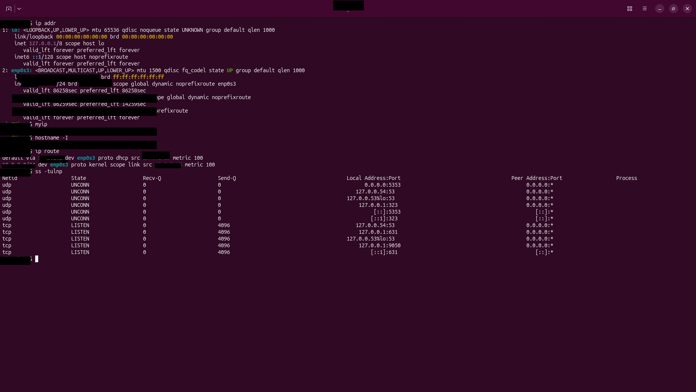

# Mini-Lab 4 — Network Configuration and Socket Inspection

## 1. Lab Overview

| Field | Value |
| --- | --- |
| Lab Title | Mini-Lab 4 — Network Configuration and Socket Inspection |
| Lab ID | P01-ML-04 |
| Phase | Phase 01 — Linux, Networking & Foundations |
| Category | Networking / Network Configuration & Socket Inspection |
| Status | Completed |
| Date | 2026-09-12 |
| Author | Daniel Solano |
| Scope / Target | Personal Ubuntu virtual machine (controlled laboratory environment) |
| Authorization | Personal lab |

### Description

This mini-lab introduces local network inspection on Linux: reading the network interfaces and their IP configuration with `ip addr`, displaying the machine's assigned addresses with `hostname -I` (and an environment-specific `myip` helper), reading the routing table and identifying the default gateway with `ip route`, and inspecting the local TCP and UDP sockets with `ss -tulnp`. It establishes the three questions that start almost every network investigation — what addresses does this machine have, where does it send traffic, and what is it listening on — and the habit of answering them from the machine's own configuration before reaching for external tools.

### Key Results

- Inspected the network interfaces with `ip addr`: `lo` (loopback, 127.0.0.1/8 and ::1/128) and `enp0s3`, the VM's network interface (state `UP`, `LOWER_UP`, MTU 1500), configured by DHCP.
- Identified the addressing on `enp0s3`: IPv4 **10.0.2.15/24** (broadcast 10.0.2.255), plus two IPv6 addresses — a private (unique-local) address and a link-local address. The IPv6 identifiers and the MAC address are redacted in the evidence and are not reproduced in this document.
- Displayed the assigned addresses with `hostname -I`; the lab also used `myip`, which is **not** a standard Linux command — it is an environment-specific helper in this environment (see Part 2).
- Read the routing table with `ip route`: a connected route for **10.0.2.0/24** (directly reachable through `enp0s3`, no gateway needed) and a default route via the default gateway **10.0.2.2** (`proto dhcp`, metric 100).
- Inspected the local sockets with `ss -tulnp`: TCP sockets in `LISTEN` state and UDP sockets in `UNCONN` state, on ports 53, 631, 323, 5353, and 9050. Almost every socket is bound to a loopback address only; the exception is UDP 5353, bound to all interfaces (`0.0.0.0` and `[::]`). The capture's Process column is empty, so this document identifies ports by their well-known uses and does **not** claim which process owns each socket.

> **Documentation accuracy note.** The original execution took place on September 12, 2026, and was not captured in screenshots. The procedure in Section 5 is documented from the author's handwritten notes — the authoritative source for the original execution — and the terminal evidence, which agree on the commands and the workflow. The screenshot is **supplementary evidence from a later recreation** of the exercise (November 22, 2026): it shows the same commands, the same interface, and the same network configuration as the original run, but the lease timers and any session-specific values are those of the recreated session. The outputs shown are representative: they illustrate what each command produces, confirmed against the recreated terminal evidence and by reproducing the same commands on a Linux system. They are not a transcript of the original execution, and no claim is made that the original run was independently recorded. The IPv4 address (10.0.2.15/24), the connected network (10.0.2.0/24), and the default gateway (10.0.2.2) are documented from the author's notes; in the screenshot those values are redacted. The MAC address and the IPv6 addresses are redacted in the evidence and are not reproduced anywhere in this document. Usernames and hostnames in commands and outputs use the generic identifiers `student` (local user) and `linux-vm` (hostname) in place of the author's real local account details.

## 2. Objectives

- Inspect Linux network interfaces and their IP configuration with `ip addr`.
- Identify IPv4 and IPv6 addressing on an interface, and distinguish a private (unique-local) IPv6 address from a link-local one.
- Read interface operational states (`UP`, `LOWER_UP`) and the MTU.
- Display the machine's assigned IP addresses with `hostname -I`, and recognize that `myip` is not a standard Linux command.
- Inspect the routing table with `ip route` and identify the default gateway.
- Explain the difference between a connected route and a default route, and how Linux chooses where to send a packet.
- Inspect local TCP and UDP sockets with `ss -tulnp` and explain each option (`-t`, `-u`, `-l`, `-n`, `-p`).
- Identify the ports a machine listens on, distinguish TCP `LISTEN` from UDP `UNCONN`, and judge which sockets are reachable from the network and which are loopback-only.
- Understand how these commands support network troubleshooting and cybersecurity investigations: baselining a machine's configuration, and spotting exposed or unexpected listening services.

## 3. Laboratory Environment

| Component | Details |
| --- | --- |
| Host OS | Windows 11 |
| Hypervisor / VM Platform | Oracle VM VirtualBox 7.2.8 |
| Guest OS | Ubuntu Desktop 26.04 |
| Network Configuration | VirtualBox NAT (10.0.2.0/24); the VM's interface is `enp0s3`, managed by NetworkManager; address assigned by DHCP |
| Tools | `ip` and `ss` (iproute2), `hostname` (versions not recorded during the original execution) |

## 4. Technical Background

- **Network interface:** The component — physical or virtual — that lets a computer communicate with others. This VM has two: `lo` and `enp0s3`.
- **Loopback (`lo`):** An internal, virtual interface that always points to the machine itself. Its addresses are 127.0.0.1/8 (IPv4) and ::1/128 (IPv6). Traffic sent to loopback never leaves the machine. Its state shows as `UNKNOWN`, which is normal for loopback.
- **`enp0s3`:** The VM's network interface (a virtual network card). Under Linux's predictable naming, `en` means Ethernet, `p0` the PCI bus, and `s3` the slot. All traffic toward the internet leaves through this interface.
- **Interface flags:** `UP` means the interface is enabled (administratively up). `LOWER_UP` means a link is present at the physical or virtual layer — a cable connected, or in this case a virtual link to VirtualBox. `BROADCAST` means the interface can send to the broadcast address; `MULTICAST` means it can send to multicast groups.
- **Broadcast and multicast:** A broadcast message goes to **all** devices on the local network (the broadcast address of 10.0.2.0/24 is 10.0.2.255; the Ethernet broadcast address is `ff:ff:ff:ff:ff:ff`). A multicast message goes only to the devices subscribed to a specific group.
- **MTU (Maximum Transmission Unit):** The largest packet the interface can send in one frame. 1500 bytes is the standard Ethernet MTU.
- **DHCP (Dynamic Host Configuration Protocol):** The service that hands a machine its IP address, prefix, gateway, and DNS servers automatically. In this lab the address came from VirtualBox's built-in DHCP service; the recreation shows a lease lifetime (`valid_lft`) of 86258 seconds — about 24 hours. In the author's notes: "DHCP delivers the IP; it is a service of the router."
- **Router, gateway, modem:** A router directs traffic between networks; the gateway is the router address a machine uses to leave its own network (here, 10.0.2.2, the VirtualBox NAT gateway). A modem connects a home to the internet provider. In the author's notes: "the router is the traffic director, and the modem connects the house with the internet provider."
- **Routing table:** The list Linux consults to decide where each packet goes. For a destination that matches a **connected route**, the packet is delivered directly on the local network. For anything else, the packet goes to the **default route**'s gateway, which forwards it onward. When several routes match, the most specific one wins; the metric breaks ties (lower is preferred).
- **`ip addr`:** Shows every interface with its flags, MTU, MAC address (`link/ether`), and all assigned IPv4 (`inet`) and IPv6 (`inet6`) addresses, each with its prefix length, broadcast address, scope, and address lifetime (`valid_lft` / `preferred_lft`).
- **`hostname -I`:** Prints all of the machine's assigned IP addresses, space-separated, with no labels and no interface names. Fast, but it does not say which address belongs to which interface — `ip addr` answers that.
- **`ss`:** Shows sockets — the endpoints of network communication. `ss -tulnp` combines: `-t` TCP sockets, `-u` UDP sockets, `-l` listening sockets only, `-n` numeric addresses and ports (no name resolution, so `53` is shown instead of `domain`), and `-p` the process using each socket, when permissions allow.
- **TCP vs. UDP:** TCP (Transmission Control Protocol) is reliable: before sending data it establishes a connection, then it verifies that no packet is lost, that packets arrive in order, and it resends what is lost — used by websites, SSH, email, banks, and shopping (author's notes). UDP (User Datagram Protocol) establishes no connection; it just sends the packets. It is much faster, and losing a packet is preferable to stopping everything to wait — used by videogames, streaming, video calls, and DNS (author's notes).
- **LISTEN and UNCONN:** A TCP socket in `LISTEN` state is a local socket waiting for incoming connections. UDP has no connections and no listening state in the TCP sense: an available UDP socket is shown as `UNCONN`. In the author's notes: Netid is the protocol column; `LISTEN` means the socket is waiting for connections; `UNCONN` is common in UDP because UDP does not establish persistent connections.
- **Ports:** A port is a numbered endpoint that identifies which local service a packet is for. Well-known assignments used in this lab: 53 (DNS), 631 (printing, IPP/CUPS), 5353 (mDNS, multicast DNS), 9050 (Tor SOCKS proxy), and 323/UDP on loopback (the command channel of the chrony time service). A port number identifies an endpoint; it does not by itself prove which process owns the socket.
- **Binding — loopback vs. all interfaces:** A socket bound to `127.0.0.1` (or another loopback address) can only be reached from the same machine. A socket bound to `0.0.0.0` (IPv4) or `[::]` (IPv6) accepts traffic on **all** interfaces and is reachable from the network. The Local Address column of `ss` is therefore a direct exposure check.

## 5. Laboratory Procedure

> The original execution (September 12, 2026) was not captured in screenshots. The command sequence below is the authoritative procedure, documented from the author's handwritten notes and the terminal evidence, which agree on the commands and the workflow. The outputs shown are representative: they illustrate what each command produces, confirmed against the recreated terminal evidence (November 22, 2026) and by reproducing the same commands on a Linux system. They are not a transcript of the original execution, and no claim is made that the original run was independently recorded. In the recreation screenshot, the MAC address, the IPv6 addresses, and the address and gateway values are redacted; the redacted values documented here (10.0.2.15/24, 10.0.2.0/24, 10.0.2.2) come from the author's notes, and the MAC and IPv6 identifiers are not reproduced.

### Part 1: Inspect Network Interfaces

**Purpose:** See the machine's network interfaces, their states, and their IP configuration.

**Commands Executed:**

```bash
ip addr
```

**Command Explanation:** `ip addr` lists every network interface with its flags, MTU, MAC address, and all assigned IPv4 and IPv6 addresses, including each address's prefix length, broadcast address, scope, and lifetime.

**Expected Output:** Two interfaces: `lo` (loopback) and `enp0s3` (the network card), the second in state `UP` with a DHCP-assigned IPv4 address and two IPv6 addresses.

**Representative Output:**

```text
1: lo: <LOOPBACK,UP,LOWER_UP> mtu 65536 qdisc noqueue state UNKNOWN group default qlen 1000
    link/loopback 00:00:00:00:00:00 brd 00:00:00:00:00:00
    inet 127.0.0.1/8 scope host lo
       valid_lft forever preferred_lft forever
    inet6 ::1/128 scope host noprefixroute
       valid_lft forever preferred_lft forever
2: enp0s3: <BROADCAST,MULTICAST,UP,LOWER_UP> mtu 1500 qdisc fq_codel state UP group default qlen 1000
    link/ether [REDACTED] brd ff:ff:ff:ff:ff:ff
    inet 10.0.2.15/24 brd 10.0.2.255 scope global dynamic noprefixroute enp0s3
       valid_lft 86258sec preferred_lft 86258sec
    inet6 [REDACTED]/64 scope global dynamic noprefixroute
       valid_lft 86258sec preferred_lft 14259sec
    inet6 [REDACTED] scope link noprefixroute
       valid_lft forever preferred_lft forever
```

**Technical Interpretation:** The `lo` block is the loopback interface: `127.0.0.1/8` and `::1/128`, both with `scope host` and a lifetime of `forever` — these addresses are fixed and never expire. Its `state UNKNOWN` is normal for loopback and is not an error. The `enp0s3` block is the working network interface: the flags `BROADCAST,MULTICAST,UP,LOWER_UP` say it is enabled, has a (virtual) link, and can send broadcast and multicast traffic; the MTU is the standard Ethernet 1500. Its IPv4 address is `10.0.2.15/24`, marked `dynamic` because DHCP assigned it, with a broadcast address of `10.0.2.255` and a lease lifetime of 86258 seconds (about 24 hours) in the recreation. Below it are two IPv6 addresses, redacted in the evidence: the first is a **private (unique-local) address** with a DHCP-style lifetime, and the second — with `scope link` and a lifetime of `forever` — is the **link-local address**, used only for communication within the same network segment (author's notes). The `link/ether` line carries the interface's MAC address, redacted here and in the screenshot, with the Ethernet broadcast address `ff:ff:ff:ff:ff:ff` as its `brd`.

### Part 2: Display Assigned IP Addresses

**Purpose:** Display the machine's assigned IP addresses directly, without the full interface detail.

**Commands Executed:**

```bash
myip
hostname -I
```

**Command Explanation:** The author's notes record this step as "`myip` or `hostname -I`" — two ways to display the assigned addresses; the recreation ran both. `hostname -I` is the standard command: it prints all IP addresses assigned to the machine, space-separated. `myip` is **not** a standard Linux command and is not a built-in utility: it is an environment-specific helper (such as an alias or a small script) present in this environment. Its implementation was not verified — on a reference Linux system the command does not exist — so this document records that it was used to display the assigned addresses, and does not describe how it works internally.

**Expected Output:** The machine's addresses: the IPv4 address 10.0.2.15 and its IPv6 addresses.

**Representative Output:**

```text
$ hostname -I
10.0.2.15 [REDACTED] [REDACTED]
```

(The output of `myip` is not reproduced: the helper's exact output format was not verified. In the recreation screenshot, the outputs of both commands are redacted; the IPv4 value above is documented from the author's notes, and the IPv6 identifiers are not reproduced.)

**Technical Interpretation:** `hostname -I` answers "what are my addresses?" in one line — 10.0.2.15 plus the two IPv6 addresses — but it does not say which interface owns which address, and it gives no state, MTU, or lifetime information. That is the trade-off between the two commands of this lab: `hostname -I` is the quick answer, `ip addr` is the complete one. The step also carries a documentation lesson: `myip` worked on this machine, but a command that exists on one machine may be a local alias or script rather than a system tool. Portable documentation relies on the standard command (`hostname -I`) and labels the local helper as local — exactly as the author's notes pair them as alternatives.

### Part 3: Inspect the Routing Table

**Purpose:** See how Linux decides where to send packets, and identify the default gateway.

**Commands Executed:**

```bash
ip route
```

**Command Explanation:** `ip route` prints the routing table: each destination network, the interface used to reach it, the gateway if one is needed, the source address chosen, and the metric. In the author's notes, this command answers the question "how does Linux know where to send the packets?"

**Expected Output:** Two routes: a connected route for the local network and a default route through the gateway.

**Representative Output:**

```text
default via 10.0.2.2 dev enp0s3 proto dhcp src 10.0.2.15 metric 100
10.0.2.0/24 dev enp0s3 proto kernel scope link src 10.0.2.15 metric 100
```

**Technical Interpretation:** The second line is the **connected route**: destinations inside 10.0.2.0/24 are on the directly connected network, so packets go out through `enp0s3` straight to the destination — as the author's notes put it, this route "uses the enp0s3 interface and does not need to pass through the gateway." It is marked `proto kernel scope link` because the kernel created it automatically when the address was configured. The first line is the **default route**: any destination that matches no more specific route is sent to the gateway, **10.0.2.2** — in the author's notes, "default via 10.0.2.2 (gateway)". It is marked `proto dhcp` because DHCP supplied it, and its metric of 100 is the preference value used if several routes compete. Together the two lines are the whole story of this machine's routing: local traffic is delivered directly, and everything else goes to 10.0.2.2, the VirtualBox NAT gateway, which forwards it to the outside.

### Part 4: Inspect TCP and UDP Sockets

**Purpose:** See which local ports the machine listens on, over TCP and UDP, and judge which of them are reachable from the network.

**Commands Executed:**

```bash
ss -tulnp
```

**Command Explanation:** `ss` displays sockets. The options select what is shown: `-t` TCP sockets, `-u` UDP sockets, `-l` listening sockets only, `-n` numeric addresses and ports instead of resolved names, and `-p` the process associated with each socket, when permissions allow. In the author's notes: "`ss` shows connections and sockets; `-l` shows only services in listening; `-n` shows numbers instead of resolving names; `-p` shows the associated process (if you have permission)."

**Expected Output:** A table of listening sockets with their protocol (Netid), state, local address and port, and peer address. TCP sockets in `LISTEN` state; UDP sockets in `UNCONN` state.

**Representative Output:**

```text
Netid State  Recv-Q Send-Q Local Address:Port  Peer Address:Port Process
udp   UNCONN 0      0      0.0.0.0:5353        0.0.0.0:*
udp   UNCONN 0      0      127.0.0.54:53       0.0.0.0:*
udp   UNCONN 0      0      127.0.0.53:53       0.0.0.0:*
udp   UNCONN 0      0      127.0.0.53%lo:53    0.0.0.0:*
udp   UNCONN 0      0      127.0.0.1:323       0.0.0.0:*
udp   UNCONN 0      0      [::]:5353           [::]:*
udp   UNCONN 0      0      [::1]:323           [::]:*
tcp   LISTEN 0      4096   127.0.0.54:53       0.0.0.0:*
tcp   LISTEN 0      4096   127.0.0.1:631       0.0.0.0:*
tcp   LISTEN 0      4096   127.0.0.53%lo:53    0.0.0.0:*
tcp   LISTEN 0      4096   127.0.0.1:9050      0.0.0.0:*
tcp   LISTEN 0      4096   [::1]:631           [::]:*
```

**Technical Interpretation:** Every UDP socket is `UNCONN` and every TCP socket is `LISTEN`, exactly as expected: TCP listeners wait for connections, while UDP sockets simply exist ready to receive datagrams — UDP has no connection state to be in. For the TCP listeners, `Recv-Q` is the current backlog of pending connections (0 everywhere here) and `Send-Q` is the maximum backlog (4096). The Local Address column is the exposure check. Almost every socket is bound to a loopback address — `127.0.0.1`, `127.0.0.53`, `127.0.0.54`, `127.0.0.53%lo` (the `%lo` marks the address as bound to the loopback interface), or `[::1]` — so those services can only be reached from this machine itself. The ports match a normal Ubuntu desktop's well-known uses: 53 (DNS), 631 (printing), 323/UDP on loopback (the chrony time service's command channel), 5353 (mDNS), and 9050 (the well-known Tor SOCKS port). Two observations matter. First, the **Process column is empty in this capture** — `ss` was run without the privileges needed to show process names — so the evidence identifies ports and their well-known uses, but does not confirm which process owns any socket; confirming ownership would take `ss -tulnp` with `sudo` or `lsof -i`. Second, the **only sockets bound to all interfaces are the two UDP 5353 (mDNS) sockets**, on `0.0.0.0` and `[::]`: they are the one part of this listing reachable from the local network. Everything else is loopback-only.

## 6. Commands & Technical Analysis

| Command | Purpose | Flags / Arguments | Technical Relevance |
| --- | --- | --- | --- |
| `ip addr` | Show interfaces and their IP configuration | — | The complete picture: flags, MTU, MAC, IPv4/IPv6 addresses, lifetimes |
| `myip` | Display the assigned IP addresses (this environment only) | — | **Not a standard Linux command** — an environment-specific helper; documented as used, implementation not verified |
| `hostname -I` | Print all assigned IP addresses | `-I` all addresses | The quick answer to "what are my IPs"; no interface or state detail |
| `ip route` | Show the routing table | — | Connected vs. default routes; identifies the default gateway (10.0.2.2) |
| `ss` | Show sockets | `-t` TCP, `-u` UDP, `-l` listening, `-n` numeric, `-p` process | The listening-services inventory: protocol, state, local address and port, exposure |

## 7. Results & Observations

### Findings

- `ip addr` showed two interfaces: `lo` (loopback; 127.0.0.1/8, ::1/128, `state UNKNOWN` — normal for loopback) and `enp0s3` (`BROADCAST,MULTICAST,UP,LOWER_UP`, MTU 1500).
- `enp0s3` held IPv4 **10.0.2.15/24** (broadcast 10.0.2.255, `dynamic` — assigned by DHCP; recreation lease lifetime 86258 seconds, about 24 hours) and two IPv6 addresses: a private (unique-local) one and a link-local one (`scope link`, lifetime `forever`). Both IPv6 identifiers and the MAC address are redacted in the evidence.
- `hostname -I` displayed the assigned addresses in one line; the same step used `myip`, an environment-specific helper that is not a standard Linux command (verified absent on a reference Linux system).
- `ip route` showed exactly two routes: the connected route `10.0.2.0/24 dev enp0s3 proto kernel scope link` (direct delivery, no gateway) and the default route `default via 10.0.2.2 dev enp0s3 proto dhcp metric 100`.
- `ss -tulnp` showed 7 UDP sockets (`UNCONN`) and 5 TCP sockets (`LISTEN`, backlog 0/4096) on ports 53, 631, 323, 5353, and 9050 — a normal Ubuntu desktop set by their well-known uses (DNS, printing, the chrony command channel, mDNS, and the Tor SOCKS port).
- All sockets except UDP 5353 are bound to loopback addresses only. UDP 5353 (mDNS) is bound to `0.0.0.0` and `[::]` — the only network-reachable sockets in the listing.
- The capture's Process column is empty, so no socket is attributed to a specific process in this document.

### Expected vs. Representative Behavior

| Item | Expected | Representative | Notes |
| --- | --- | --- | --- |
| `ip addr` | `lo` plus one working interface | `lo` (127.0.0.1/8, ::1/128) and `enp0s3` (`UP`, MTU 1500) | Matches |
| IPv4 on `enp0s3` | One DHCP-assigned address | 10.0.2.15/24, `dynamic`, lease 86258 s (recreation) | Matches |
| IPv6 on `enp0s3` | Global or private address plus link-local | One private (unique-local) address and one link-local address | Matches; identifiers redacted |
| `myip` | Displays the assigned addresses | Used in this environment; output not reproduced | Not a standard command; implementation not verified |
| `hostname -I` | All assigned addresses in one line | `10.0.2.15 [REDACTED] [REDACTED]` | Matches |
| `ip route` | Connected route plus default route | `10.0.2.0/24` connected; default via 10.0.2.2, metric 100 | Matches |
| `ss -tulnp` | Listening TCP and UDP sockets | TCP `LISTEN` (53, 631, 9050), UDP `UNCONN` (53, 323, 5353) | Matches; Process column empty in the capture |

### Conceptual Questions and Answers

**What is a network interface, and which interfaces does this machine have?**

A network interface is the component that lets a computer communicate with others. This machine has two: `lo`, the loopback interface, and `enp0s3`, the network card.

**What is the loopback interface?**

An internal interface that always points to the machine itself (127.0.0.1 and ::1). Traffic to it never leaves the computer. (Author's notes.)

**What do `UP` and `LOWER_UP` mean?**

`UP` means the interface is enabled. `LOWER_UP` means there is a physical (or, in a VM, virtual) link. (Author's notes.)

**What is the MTU, and what is broadcast vs. multicast?**

The MTU is the maximum size of one packet — 1500 bytes for Ethernet. A broadcast message goes to all devices on the network; a multicast message goes to a specific group of devices. (Author's notes.)

**What question does `ip route` answer?**

"How does Linux know where to send the packets?" It shows the routing table: the connected route for the local network and the default route through the gateway. (Author's notes.)

**What is the difference between the connected route and the default route?**

The connected route (10.0.2.0/24 via `enp0s3`) delivers directly to devices on the same network, without the gateway. The default route sends everything else to the gateway, 10.0.2.2. (Author's notes.)

**What do the options of `ss -tulnp` mean?**

`-t` TCP, `-u` UDP, `-l` only listening sockets, `-n` numbers instead of resolved names, `-p` the associated process, if you have permission. (Author's notes.)

**Why are the UDP sockets `UNCONN` instead of `LISTEN`?**

Because UDP does not establish connections. `LISTEN` is a TCP state — a local socket waiting for connections. A UDP socket that is ready to receive is shown as `UNCONN`, which is the normal state for UDP. (Author's notes.)

**What is the difference between TCP and UDP?**

TCP establishes a connection before sending, verifies that no packet is lost and that packets arrive in order, and resends what is lost — reliable, used by websites, SSH, email, banks, and shopping. UDP establishes no connection and just sends the packets — faster, used by videogames, streaming, video calls, and DNS, where losing a packet is better than stopping everything to wait. (Author's notes.)

**Which socket in this lab is reachable from the network, and why?**

UDP 5353 (mDNS), because it is bound to `0.0.0.0` and `[::]` — all interfaces. Every other socket is bound to a loopback address and can only be reached from the machine itself.

**Does port 9050 prove that Tor is running on this machine?**

No. 9050 is the well-known Tor SOCKS port, but the capture's Process column is empty, so the evidence does not confirm which process owns the socket. Confirming it would take `ss -tulnp` with `sudo` or `lsof -i :9050`.

### Supporting Evidence

- `screenshots/01-network-configuration-and-sockets.jpg` — one terminal capture containing all four parts: `ip addr` (`lo` and `enp0s3`), `myip` and `hostname -I` (outputs redacted), `ip route` (default via the gateway; connected route for 10.0.2.0/24), and `ss -tulnp` (UDP `UNCONN` and TCP `LISTEN` sockets on ports 53, 631, 323, 5353, 9050). Supplementary evidence from the recreation (November 22, 2026).

## 8. Security Analysis

### Security Mechanisms

- **Local inspection needs no exposure:** All four commands read the machine's own configuration locally. Establishing "what am I, where do I send traffic, what do I listen on" requires no scanning of anyone else's network.
- **Loopback binding as a boundary:** A service bound to `127.0.0.1` or `[::1]` is unreachable from the network by construction. In this capture, the DNS, printing, time-command, and 9050 sockets all sit behind that boundary.
- **NAT as a side effect, not a control:** The VM sits behind VirtualBox NAT (10.0.2.0/24), which hides its addresses from the host's network. That reduces exposure here, but it is a property of this lab setup, not a defense to rely on — the same `ss` output on a directly connected machine would be reachable.

### Vulnerabilities & Weaknesses

- **One socket is network-reachable:** UDP 5353 (mDNS) is bound to `0.0.0.0` and `[::]`. mDNS announces and discovers services on the local network; on an untrusted network it can disclose what the machine offers and answer queries it should not. It is the single finding in this listing that a hardening pass would question first.
- **Unidentified listeners:** A listening socket whose owner is unknown is an open question. In this capture the Process column is empty, so even a well-known port (9050) cannot be attributed from the evidence alone — an analyst who stops at the port number has a guess, not a finding.
- **Configuration screenshots leak identifiers:** An unsanitized `ip addr` capture exposes the MAC address and IPv6 addresses, which identify the machine and its interface across documents. This lab's evidence redacts them; the fragments that peeked out from behind the redaction bars had to be covered in the documentation pass (see Section 13).

### Attack Surfaces & Abuse Scenarios

- **Unexpected listening services:** The classic host-compromise indicator is a socket that should not be there — a backdoor listener on a high port, bound to `0.0.0.0`. It is only recognizable against a baseline: this lab's listing (53, 631, 323, 5353, 9050, loopback except mDNS) is exactly the baseline a future `ss` run gets compared with.
- **A rogue default route:** The default route decides where all non-local traffic goes. A malicious DHCP answer that changes the gateway from 10.0.2.2 to an attacker's address turns that gateway into a man-in-the-middle. Knowing the legitimate gateway — and noticing when `ip route` shows a different one — is the detection.
- **Service discovery against mDNS:** On a shared network, an attacker can query mDNS (UDP 5353) to learn what a machine advertises. The exposure is small here (a VM behind NAT), but the same binding on a laptop on public Wi-Fi is a real information leak.

### Defensive Controls & Mitigations

- **Baseline and diff:** Save a known-good `ss -tulnp` and `ip route` output for the machine. Any new listener, changed binding, or changed gateway is then a one-command discovery.
- **Verify listeners by process, not by port:** Re-run with `sudo ss -tulnp` or `lsof -i :<port>` to attribute each socket to a process and a binary path before deciding it is legitimate.
- **Bind to loopback when possible, disable what is unused:** Services that only serve the local machine should listen on loopback. If mDNS is not needed, disabling it removes the one network-reachable socket in this listing.
- **Sanitize before sharing:** Redact MAC addresses, IPv6 identifiers, and account details from terminal captures before they leave the machine — and check the edges of the redaction bars, where fragments of the values underneath tend to peek out.

### Real-World Relevance

- The first three questions of host triage — what addresses does this machine have, where does it send traffic, what is it listening on — are answered by `ip addr`, `ip route`, and `ss`. Incident responders run them before any heavier tooling.
- "Unexpected listening service" is a standard detection use case: endpoint baselines built from `ss`-style inventories are what make the anomaly visible.
- Routing problems are connectivity problems: a wrong gateway or a missing connected route presents as "the network is down," and `ip route` separates a routing fault from a service fault in seconds.

## 9. Troubleshooting & Challenges

> No issues were recorded during the original execution (September 12, 2026). The notes below concern the recreation evidence and the documentation itself.

| Issue | Diagnostics | Resolution | Status |
| --- | --- | --- | --- |
| The lab specification refers to this lab as "Mini-Lab 1.4" | The repository's established convention (Mini-Labs 1–3) names the folder `mini-lab-04-…` and the lab ID P01-ML-04 | Documented as Mini-Lab 4 (P01-ML-04), following the repository convention; the topic and content are unchanged | Resolved |
| The lab specification states that the screenshot preserves the private IPv4 address and the default gateway | In the supplied screenshot those values are redacted by the author's bars (only the fragments "10." and "1" peeked out, and both are now covered — see Section 13) | The values 10.0.2.15/24 and 10.0.2.2 are documented from the author's handwritten notes — the authoritative source — not read from the screenshot; no redacted value was reconstructed from the image | Resolved |
| `myip` is listed among the lab's commands as if it were a system command | `myip` does not exist on a reference Linux system and is not a standard utility | Documented as an environment-specific helper (alias or script) whose implementation was not verified; `hostname -I` is documented as the standard command for the same step | Resolved |
| The recreation capture's Process column is empty | `ss -p` shows process information only for processes the user owns or with elevated privileges; the capture was taken without them | The README identifies ports by their well-known uses only and claims no process ownership; the verification command (`sudo ss -tulnp` / `lsof -i`) is recorded in Sections 7 and 8 | Resolved — limitation recorded |
| Fragments of redacted values peeked out from behind the author's redaction bars in the screenshot (the start of the IPv4 address on the `inet` line, the first digit of the gateway on the `default via` line, and prompt letter fragments on two lines) | Visual and pixel-level inspection of the supplied screenshot during this documentation pass | The fragments were covered with additional redaction before publication (see Section 13); the published screenshot was re-inspected and verified clean | Resolved |

## 10. Lessons Learned

- `ip addr` is the complete picture of a machine's network identity: interfaces, states, MTU, MAC, and every IPv4 and IPv6 address with its lifetime. `hostname -I` is the one-line shortcut to the same addresses, with none of the detail.
- A command that works on your machine is not necessarily a Linux command: `myip` is a local helper. Standard commands (`hostname -I`) are what make documentation portable.
- The routing table answers one question two ways: destinations on the connected network are delivered directly, and everything else goes to the default gateway. `proto dhcp` on the default route shows where the gateway came from.
- TCP listeners are `LISTEN`; UDP sockets are `UNCONN`, because UDP has no connections. Reading `ss` means reading the binding as well as the port: loopback-only is a boundary, `0.0.0.0` / `[::]` is exposure.
- A port number is a well-known use, not an owner. Without the Process column (or a privileged re-run), a socket is identified, not attributed.
- The baseline is the skill: this machine's normal state — gateway 10.0.2.2, listeners on 53/631/323/5353/9050, mDNS the only network-reachable socket — is what makes a future anomaly recognizable in one command.
- Redaction is not finished when the bars are drawn: fragments peek out at the edges. Verify the published image, not the intention.

## 11. References

| Source | Link |
| --- | --- |
| `ip-address` manual — address and interface information | https://manpages.ubuntu.com/manpages/noble/en/man8/ip-address.8.html |
| `ip-route` manual — routing table entries | https://manpages.ubuntu.com/manpages/noble/en/man8/ip-route.8.html |
| `ss` manual — socket statistics and options | https://manpages.ubuntu.com/manpages/noble/en/man8/ss.8.html |
| `hostname` manual — displaying the system name and addresses | https://manpages.ubuntu.com/manpages/noble/en/man1/hostname.1.html |

## 12. Conclusion

Mini-Lab 4 covers the local network inspection that starts most troubleshooting and most host investigations. The machine's identity was read with `ip addr` (`lo` plus `enp0s3`, IPv4 10.0.2.15/24, a private and a link-local IPv6 address), its assigned addresses were displayed with `hostname -I` (with `myip` recorded honestly as a local, non-standard helper), its routing was reduced to two lines with `ip route` (connected 10.0.2.0/24, default via gateway 10.0.2.2), and its listening surface was inventoried with `ss -tulnp` — five TCP listeners and seven UDP sockets, all loopback-only except mDNS on UDP 5353, and none attributed to a process because the capture's Process column is empty. The takeaway is again a habit: know the machine's normal configuration — its addresses, its gateway, its listeners — well enough that a change is visible at a glance. Natural next steps are Practice 03 (SSH + SFTP), where an SSH listener joins this socket inventory and can be attributed with a privileged `ss`, and the remaining Phase 01 mini-labs.

## 13. Evidence & Supporting Files

> Sanitize all evidence before publishing: remove credentials, private keys, API tokens, personal information, and sensitive network details (public IPs, internal hostnames, MAC addresses). The screenshot below was sanitized by the author (MAC address, IPv6 addresses, prompts, and window title redacted; the IPv4 and gateway values redacted in the image and documented from the author's notes instead). It received additional redaction in this documentation pass — the visible start of the IPv4 address on the `inet` line, the first digit of the gateway on the `default via` line, and prompt letter fragments on two lines were covered — and the published version was re-inspected and verified clean. No packet capture is published with this lab.

| Filename | Description | Related Step |
| --- | --- | --- |
| `screenshots/01-network-configuration-and-sockets.jpg` | Single terminal capture of the full recreation session (November 22, 2026): `ip addr`, `myip` and `hostname -I`, `ip route`, and `ss -tulnp`. Supplementary evidence from the recreation; the original execution (September 12, 2026) was not captured. Additional redaction applied in this documentation pass, as described above. | Parts 1–4 |



### Mini-Lab Directory Structure

```text
mini-lab-04-network-configuration-and-socket-inspection/
├── README.md
└── screenshots/
    └── 01-network-configuration-and-sockets.jpg
```

## 14. Laboratory Completion Record

| Field | Value |
| --- | --- |
| Completion Status | Completed |
| Completion Date | 2026-09-12 |
| Documentation Version | v1.0 |
| Author | Daniel Solano |
| Related Phase | Phase 01 — Linux, Networking & Foundations |
| Related Resources | [Mini-Lab 1 — Linux Files and Directories](../mini-lab-01-linux-files-and-directories/README.md), [Mini-Lab 2 — Linux File Permissions and User Identification](../mini-lab-02-linux-file-permissions/README.md), [Mini-Lab 3 — Linux Processes & Services](../mini-lab-03-linux-processes-and-services/README.md), [Practice 01 — Wireshark, ICMP & ARP Analysis](../../practices/practice-01-wireshark-ping-arp/README.md) |
