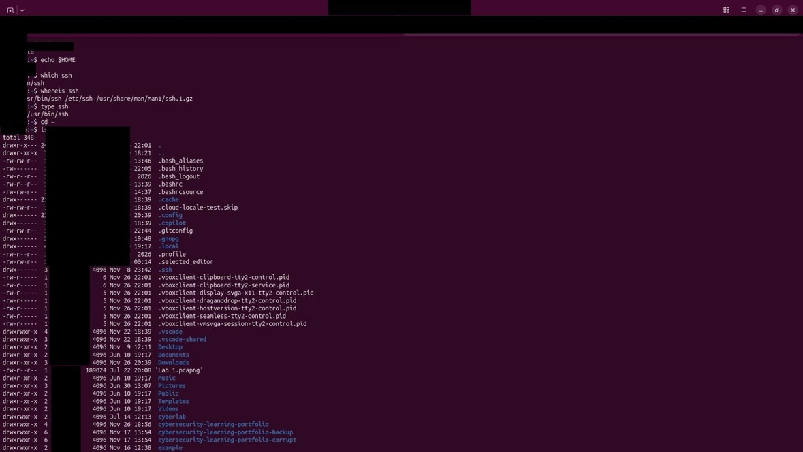
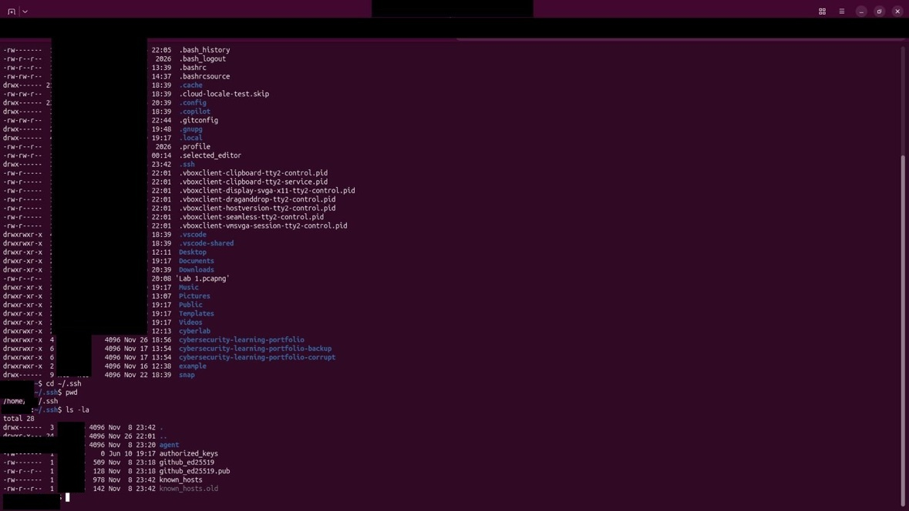

# Mini-Lab 5 — SSH Command Discovery and Configuration Directory

## 1. Lab Overview

| Field | Value |
| --- | --- |
| Lab Title | Mini-Lab 5 — SSH Command Discovery and Configuration Directory |
| Lab ID | P01-ML-05 |
| Phase | Phase 01 — Linux, Networking & Foundations |
| Category | Linux Fundamentals / SSH |
| Status | Completed |
| Date | 2026-10-01 |
| Author | Daniel Solano |
| Scope / Target | Personal Ubuntu virtual machine (controlled laboratory environment) |
| Authorization | Personal lab |

### Description

This mini-lab introduces the SSH environment on Linux through command discovery, filesystem navigation, and inspection of the per-user SSH directory. Using `pwd` and `echo $HOME` to anchor the session in the filesystem, `which`, `whereis`, and `type` to establish where the `ssh` command lives and how the shell resolves it, and `ls -la` to inspect the home directory and `~/.ssh`, the exercise answers three questions that precede any SSH work: where am I, where is the SSH client, and what SSH material does this account already hold. It is an introductory exploration exercise: no SSH keys were generated, no SSH server was configured, and no remote connection was established.

### Key Results

- Confirmed the session's anchor points: the current working directory with `pwd`, and the home directory through the `$HOME` environment variable.
- Located the SSH client three ways: `which ssh` returned `/usr/bin/ssh`; `whereis ssh` returned the binary (`/usr/bin/ssh`), the system SSH directory (`/etc/ssh`), and the manual page (`/usr/share/man/man1/ssh.1.gz`); `type ssh` reported `ssh is /usr/bin/ssh`, confirming Bash resolves the name to that executable — not an alias, function, or builtin.
- Navigated to the home directory with `cd ~` and listed it with `ls -la`; the hidden entries (names beginning with a dot) include the `.ssh` directory.
- Inspected `~/.ssh` (`ls -la`): the directory itself is `drwx------` (700), and it contains an `agent` subdirectory, an empty `authorized_keys` (0 bytes, 600), an Ed25519 key pair created for GitHub (`github_ed25519`, 600; `github_ed25519.pub`, 644), and the client host-key files `known_hosts` (600) and `known_hosts.old` (644). Only filenames and metadata were inspected — no private-key contents were displayed at any point.

> **Documentation accuracy note.** The original execution was not captured in screenshots. The procedure in Section 5 is documented from the author's handwritten notes — the authoritative source for the original execution — and the terminal evidence, which agree on the commands and the workflow. The screenshots are **supplementary evidence from a later documentation session** (November 26, 2026): they show the same commands and the same `~/.ssh` contents, but session-specific values are those of the captured session. The outputs shown are representative: they illustrate what each command produces, confirmed against the captured terminal evidence and by reproducing the same commands on a Linux system. They are not a transcript of the original execution, and no claim is made that the original run was independently recorded. The key pair stored in `~/.ssh` is dated November 8, 2026 — it was created for the author's GitHub SSH setup that day and **predates this mini-lab's inspection**; the exercise generated no keys and made no connection. Usernames and hostnames in commands and outputs use the generic identifiers `student` (local user) and `linux-vm` (hostname) in place of the author's real local account details, and the home directory is written as `/home/<user>`.

## 2. Objectives

- Display the current working directory with `pwd` and the home directory with `echo $HOME`, and explain `$HOME` as an environment variable.
- Locate a command's executable with `which`, using the directories listed in `PATH`.
- Use `whereis` to find the binary, related directories, and manual page associated with a command.
- Use `type` to determine how Bash interprets a command name (alias, function, builtin, or executable file).
- Navigate with `cd ~` and explain that `~` represents the current user's home directory.
- List hidden files with `ls -la` and explain the `-l` (long format) and `-a` (include dotfiles) options.
- Navigate to `~/.ssh` and identify the files a per-user SSH directory commonly holds.
- Distinguish the roles of `authorized_keys` (inbound authorization) and `known_hosts` (server identity verification), and read the permissions on SSH-related files.

## 3. Laboratory Environment

| Component | Details |
| --- | --- |
| Host OS | Windows 11 |
| Hypervisor / VM Platform | Oracle VM VirtualBox 7.2.8 |
| Guest OS | Ubuntu Desktop 26.04 |
| Shell | Bash |
| Tools | OpenSSH client (`ssh`), `which`, `whereis`, `type` (Bash builtin), coreutils (`pwd`, `cd`, `ls`) — versions not recorded during the original execution |

## 4. Technical Background

When a user types a command name such as `ssh`, the shell must resolve that name to something runnable. Bash checks, in order, aliases, functions, builtins, and finally the executable files found by searching the directories listed in the `PATH` environment variable. Three standard tools expose different parts of that resolution: `which` reports the executable that `PATH` lookup finds; `whereis` searches the standard system locations for a command's binary, source, and manual pages; and `type` reports how the current shell itself interprets the name.

Every account has a home directory — the directory the shell starts in and the anchor for per-user configuration. Its absolute path is stored in the `$HOME` environment variable, and the shell expands `~` to the same path. Files and directories whose names begin with a dot are hidden from ordinary listings; they hold per-user configuration, which is why `ls -a` is required to see them.

SSH keeps its per-user material in `~/.ssh`, a conventional directory (distinct from the system-wide `/etc/ssh`). It typically holds the user's key pairs (a private key and its `.pub` public counterpart), `authorized_keys` (the public keys accepted for logging **into** this account when the machine runs an SSH server), `known_hosts` (the host keys of servers this client has contacted, used to verify server identity on later connections), and `config` (per-host client options, when present). Because the private keys in this directory grant access to remote systems, its permissions are restrictive by design: OpenSSH expects the directory at 700 and private keys at 600, and refuses to use key material that other users can read.

## 5. Laboratory Procedure

> The original execution was not captured in screenshots. The command sequence below is the authoritative procedure, documented from the author's handwritten notes and the terminal evidence, which agree on the commands and the workflow. The outputs shown are representative: they illustrate what each command produces, confirmed against the captured terminal evidence (November 26, 2026) and by reproducing the same commands on a Linux system. They are not a transcript of the original execution, and no claim is made that the original run was independently recorded. In the screenshots, the local username and the owner column of the listings are redacted; the home path is documented here as `/home/<user>`.

### Part 1: Confirm the Working Directory and the Home Directory

**Purpose:** Establish where the session is in the filesystem and where the user's home directory is, before looking for any SSH material.

**Commands Executed:**

```bash
pwd
echo $HOME
```

**Command Explanation:** `pwd` prints the absolute path of the current working directory. `echo $HOME` prints the value of the `HOME` environment variable, which the system sets to the current user's home directory.

**Expected Output:** The path of the directory the shell is in, followed by the home directory path.

**Representative Output:**

```text
/home/<user>
/home/<user>
```

**Technical Interpretation:** The two commands answer different questions that happen to coincide at the start of a session: `pwd` reports a *state* (where the shell currently is), while `$HOME` reports a *configuration* (where the user's home is, regardless of the shell's current position). After `cd` elsewhere, `pwd` changes but `$HOME` does not. Almost every per-user path in Linux — including `~/.ssh` — is defined relative to `$HOME`, so confirming it first anchors everything that follows.

### Part 2: Locate the SSH Client

**Purpose:** Find where the `ssh` command lives on this system and how Bash resolves the name `ssh`.

**Commands Executed:**

```bash
which ssh
whereis ssh
type ssh
```

**Command Explanation:** `which` searches the directories in `PATH`, in order, and prints the first matching executable. `whereis` searches the standard system locations and reports the binary, any source, and the manual page for a command. `type` is a Bash builtin that reports how the shell interprets a name: an alias, a function, a builtin, or a file (with its path).

**Expected Output:** The client executable under `/usr/bin`, plus the system SSH directory and the manual page from `whereis`.

**Representative Output:**

```text
/usr/bin/ssh
ssh: /usr/bin/ssh /etc/ssh /usr/share/man/man1/ssh.1.gz
ssh is /usr/bin/ssh
```

**Technical Interpretation:** The three answers are consistent and complementary. `which` answers the practical question — the program that will run is `/usr/bin/ssh`, the OpenSSH client. `whereis` gives the wider map: the same binary, `/etc/ssh` (the **system-wide** SSH directory, holding the server configuration and the client-wide configuration — not the per-user directory inspected in Part 4), and the manual page `ssh.1.gz`. `type` closes the loop from the shell's point of view: `ssh` is not shadowed by an alias or function, so the name resolves directly to the executable. If `type` had reported an alias, the alias — not the binary — is what would run, which is why `type` is the definitive check.

### Part 3: Inspect the Home Directory

**Purpose:** Return to the home directory and list all of its entries, including the hidden ones, to locate the SSH directory.

**Commands Executed:**

```bash
cd ~
ls -la
```

**Command Explanation:** `cd ~` changes to the home directory (`~` expands to `$HOME`). `ls -la` lists in long format (`-l`: permissions, owner, size, modification time, name) including hidden entries (`-a`: names beginning with a dot).

**Expected Output:** The full contents of the home directory — the standard user folders alongside dotfiles and dot-directories such as `.bashrc`, `.config`, and `.ssh`.

**Representative Output (abridged):**

```text
total 348
drwxr-x--- 24 student student 4096 Nov 26 22:01 ..
drwx------  3 student student 4096 Nov  8 23:42 .ssh
drwxrwxr-x  4 student student 4096 Nov 26 18:56 cybersecurity-learning-portfolio
...
```

**Technical Interpretation:** The `-a` flag is what makes this step work: without it, `.ssh` — and every other dotfile — is invisible, and the directory appears not to exist. The listing shows `.ssh` with permissions `drwx------` (700): only the owner can enter or list it, the posture OpenSSH requires for a directory holding private keys. The full listing also shows the mix a home directory normally holds — shell configuration (`.bashrc`, `.bash_aliases`), application configuration (`.config`, `.gnupg`), and the user's working folders.

### Part 4: Inspect the SSH Configuration Directory

**Purpose:** Enter `~/.ssh`, confirm the path, and inventory the SSH material this account holds, with its permissions.

**Commands Executed:**

```bash
cd ~/.ssh
pwd
ls -la
```

**Command Explanation:** `cd ~/.ssh` changes into the per-user SSH directory. `pwd` confirms the absolute path. `ls -la` lists its contents in long format, including permissions and sizes.

**Expected Output:** The path `/home/<user>/.ssh`, and a short listing of SSH files — key material, authorization and host-key files — with restrictive permissions.

**Actual Observed Output (documentation session, November 26, 2026; owner column anonymized):**

```text
/home/<user>/.ssh
total 28
drwx------ 3 student student 4096 Nov  8 23:42 .
drwxr-x--- 24 student student 4096 Nov 26 22:01 ..
[covered by the author's redaction] 4096 Nov  8 23:20 agent
-rw------- 1 student student    0 Jun 10 19:17 authorized_keys
-rw------- 1 student student  509 Nov  8 23:18 github_ed25519
-rw-r--r-- 1 student student  128 Nov  8 23:18 github_ed25519.pub
-rw------- 1 student student  978 Nov  8 23:42 known_hosts
-rw-r--r-- 1 student student  142 Nov  8 23:42 known_hosts.old
```

**Technical Interpretation:** The listing is a complete, healthy per-user SSH directory. The directory itself is 700 and every private element is 600: the Ed25519 private key `github_ed25519` (509 bytes) is readable only by its owner, while its public counterpart `github_ed25519.pub` (128 bytes) is world-readable — which is safe, because a public key is meant to be shared. `authorized_keys` exists but is **empty (0 bytes)**: no public key is currently authorized to log into this account. `known_hosts` (978 bytes) records the host keys of servers this client has previously contacted; `known_hosts.old` (142 bytes) is the backup copy OpenSSH keeps when `known_hosts` is updated, so a previous state can be recovered. The `agent` subdirectory belongs to the SSH agent, which holds keys in memory for the session. The timestamps tell the directory's history honestly: the key pair and host-key files date from November 8, 2026 — the day the author configured SSH access to GitHub — while this mini-lab only *inspected* them.

## 6. Commands & Technical Analysis

| Command | What it does | Result in this lab |
| --- | --- | --- |
| `pwd` | Prints the current working directory | Session's starting directory |
| `echo $HOME` | Prints the `HOME` environment variable | `/home/<user>` |
| `which ssh` | First `ssh` executable found via `PATH` | `/usr/bin/ssh` |
| `whereis ssh` | Binary, source, and manual-page locations for `ssh` | `/usr/bin/ssh`, `/etc/ssh`, `/usr/share/man/man1/ssh.1.gz` |
| `type ssh` | How Bash interprets the name `ssh` | `ssh is /usr/bin/ssh` (a file, not an alias/function/builtin) |
| `cd ~` | Changes to the home directory | — |
| `ls -la` | Long listing including hidden entries | Reveals `.ssh` among the home directory's dotfiles |
| `cd ~/.ssh` | Changes to the per-user SSH directory | — |
| `ls -la` (in `~/.ssh`) | Long listing of the SSH directory | Key pair, `authorized_keys`, `known_hosts`, `known_hosts.old`, `agent` |

**Contents of `~/.ssh` observed:**

| Entry | Permissions | Size | Purpose |
| --- | --- | --- | --- |
| `agent` | (covered by redaction in the evidence) | directory | SSH agent directory; supports holding keys in memory for the session |
| `authorized_keys` | `-rw-------` (600) | 0 bytes (empty) | Public keys authorized to authenticate **to this account** when the machine acts as an SSH server |
| `github_ed25519` | `-rw-------` (600) | 509 bytes | Private SSH key (Ed25519) — contents never displayed |
| `github_ed25519.pub` | `-rw-r--r--` (644) | 128 bytes | The corresponding public key — safe to share |
| `known_hosts` | `-rw-------` (600) | 978 bytes | Host identity keys of SSH servers this client has previously encountered |
| `known_hosts.old` | `-rw-r--r--` (644) | 142 bytes | Previous version of `known_hosts`, retained by OpenSSH after an update |

The distinction that matters most in this table is between `authorized_keys` and `known_hosts`: they guard opposite directions of a connection. `authorized_keys` is the **server-side** list — it decides whose public keys may log into this account. `known_hosts` is the **client-side** record — it lets this machine verify that a server it connects to is the same one it contacted before. Confusing the two is a common beginner error; this mini-lab's inventory keeps them separate.

## 7. Results & Observations

- The SSH client is the OpenSSH client at `/usr/bin/ssh`, resolved directly by Bash with no alias or function in between.
- `whereis` separated the three locations a newcomer often conflates: the client binary (`/usr/bin/ssh`), the system-wide SSH directory (`/etc/ssh`), and the documentation (`/usr/share/man/man1/ssh.1.gz`) — while the per-user directory is a fourth location, `~/.ssh`, found by navigation rather than by `whereis`.
- `.ssh` does not appear in a plain `ls` of the home directory; `ls -la` is required, because the name begins with a dot.
- The permissions observed match OpenSSH's expected posture without any changes being made: directory 700, private key 600, `authorized_keys` 600, public key 644.
- `authorized_keys` is present but empty: the account holds key material for connecting *out* (the GitHub key pair) but currently authorizes no key for logging *in*.
- The presence of `known_hosts` and `known_hosts.old` shows the client has connected to SSH servers in the past and that its host-key file has been updated at least once — but no connection was made or tested during this mini-lab, and the key files' November 8, 2026 timestamps predate the inspection.
- The screenshots capture the session from `echo $HOME` onward; the opening `pwd` had scrolled out of the captured frame. The full command order in Section 5 follows the author's handwritten notes.

## 8. Security Analysis

This mini-lab is an inspection exercise, and its security value is in learning to *read* an SSH directory before touching one:

- **Private keys are the crown jewels of the directory.** Whoever reads `github_ed25519` can authenticate as its owner wherever the public key is accepted. The observed permissions — directory 700, private key 600 — are exactly the posture OpenSSH requires, and they were verified by reading, not changed by this lab. A private key must never be committed to a repository, pasted into a chat, or included in a screenshot; this document reproduces only its filename and metadata, never its contents.
- **Public keys are safe to share.** `github_ed25519.pub` at 644 is not a weakness: a public key cannot be used to derive the private key or to log in — it is the half that is *supposed* to be distributed to servers and services such as GitHub.
- **`authorized_keys` is the inbound door.** It is empty here (0 bytes), so this account currently accepts no key-based logins. On any machine running an SSH server, an unexpected entry in this file is a persistence red flag: it means someone arranged to log in later. Reviewing it is a standard step in incident response.
- **`known_hosts` is the client's memory of server identity.** On first contact, SSH stores the server's host key; on later connections it compares. A mismatch produces the well-known warning and can mean a reinstalled server — or a man-in-the-middle attack. The presence of `known_hosts.old` shows this safety mechanism has already rotated once on this machine.
- **Discovery commands are reconnaissance basics.** `which`, `whereis`, and `type` establish what will actually execute when a name is typed. On an unfamiliar or possibly compromised machine, verifying that `ssh` resolves to the genuine system binary — and is not shadowed by an alias or a script earlier in `PATH` — is a small check with real defensive value.

Scope discipline: the items above split into what was **observed** in this mini-lab (file inventory, permissions, the resolution of `ssh` to `/usr/bin/ssh`) and **conceptual context** (how these files are abused or audited in real incidents). No permissions audit beyond reading the listing, no hardening, no key generation, and no connection took place in this exercise.

## 9. Troubleshooting & Challenges

| Issue | Cause | Resolution |
| --- | --- | --- |
| `.ssh` not visible in the home directory listing | Entries beginning with a dot are hidden from a plain `ls` | Re-listed with `ls -la`; the `-a` option includes dotfiles |
| Opening `pwd` output not present in the screenshots | The captured frames begin at `echo $HOME`; the first command had scrolled out of view | Procedure documented from the author's handwritten notes, which record `pwd` as step 1 |
| Left edge of the captured terminal is partially out of frame | The capture crops the first characters of several lines (e.g., the leading `/usr` of the `whereis` output) | Full paths confirmed against the author's notes and by reproducing the commands on a Linux system, where `whereis ssh` returns the identical three locations |
| `agent` line's permissions not legible in the evidence | The author's redaction bar covers that field | Documented as not legible; no permission value is claimed for the `agent` directory |

## 10. Lessons Learned

- Three different tools answer three different questions about a command: `which` (what `PATH` finds), `whereis` (where its binary, directories, and manual live), and `type` (what the shell will actually run).
- `~`, `$HOME`, and the home path are the same anchor expressed three ways; per-user configuration — including `~/.ssh` — is defined relative to it.
- Hidden files are not absent files: `ls -a` is the difference between "there is no `.ssh`" and seeing the directory that holds the account's keys.
- An SSH directory can be read like a short report: the key pair tells where the user connects *to*, `authorized_keys` tells who may connect *in*, and `known_hosts` tells which servers the client has met.
- Permissions on SSH material follow a simple pattern worth memorizing: directory 700, private keys and `authorized_keys` 600, public keys 644.
- An empty `authorized_keys` and an untouched, correctly permissioned key pair are findings too — an inventory that shows a healthy state is a valid result.

## 11. References

- OpenSSH — `ssh(1)` manual page (local copy: `/usr/share/man/man1/ssh.1.gz`, located in this lab with `whereis`).
- OpenSSH — `ssh-keygen(1)` and `ssh-agent(1)` manual pages: key file formats, the `~/.ssh` directory layout, and the roles of `authorized_keys` and `known_hosts`.
- GNU Bash manual — shell builtin `type`, tilde expansion (`~`), and environment variables (`HOME`, `PATH`).
- `which(1)` and `whereis(1)` manual pages.
- Companion documentation in this repository: [Mini-Lab 2 — Linux File Permissions and User Identification](../mini-lab-02-linux-file-permissions/README.md) for the permission model applied here, and [Mini-Lab 1 — Linux Files and Directories](../mini-lab-01-linux-files-and-directories/README.md) for the basic file operations.

## 12. Conclusion

Mini-Lab 5 located the SSH client on this system (`/usr/bin/ssh`, confirmed by `which`, `whereis`, and `type`), anchored the session in the filesystem (`pwd`, `$HOME`, `~`), and inventoried the per-user SSH directory. The inventory shows a correctly permissioned Ed25519 key pair created earlier for GitHub, an empty `authorized_keys`, and `known_hosts` with its `.old` backup — a healthy, ordinary SSH directory, understood file by file. This groundwork prepares the next steps in the phase, where SSH moves from inspection to use: connecting with SSH and SFTP (Practice 03) and the advanced-permission and SSH-cryptography mini-labs that follow in the scheme.

## 13. Evidence & Supporting Files

> Sanitize all evidence before publishing: remove credentials, private keys, API tokens, personal information, and sensitive network details (public IPs, internal hostnames, MAC addresses). The screenshots below were sanitized by the author (local username and the listings' owner column redacted). They received one additional redaction in this documentation pass — the visible tail of the home path in the `echo $HOME` output of screenshot 01 was covered — and the published versions were re-inspected and verified clean. The screenshots show filenames and directory metadata only; **no private-key contents appear in them or anywhere in this document**. No packet capture is published with this lab.

| Filename | Description | Related Step |
| --- | --- | --- |
| `screenshots/01-ssh-command-discovery.jpg` | Terminal capture from the documentation session (November 26, 2026): `echo $HOME`, `which ssh`, `whereis ssh`, `type ssh`, `cd ~`, and the start of the home `ls -la`. Supplementary evidence; the original execution was not captured. Additional redaction applied in this documentation pass, as described above. | Parts 1–3 |
| `screenshots/02-ssh-directory-listing.jpg` | Terminal capture from the same session: the tail of the home listing, `cd ~/.ssh`, `pwd`, and the full `ls -la` of `~/.ssh` with permissions, sizes, and dates. Supplementary evidence; the original execution was not captured. | Parts 3–4 |





### Mini-Lab Directory Structure

```text
mini-lab-05-ssh-command-discovery-and-configuration-directory/
├── README.md
└── screenshots/
    ├── 01-ssh-command-discovery.jpg
    └── 02-ssh-directory-listing.jpg
```

## 14. Laboratory Completion Record

| Field | Value |
| --- | --- |
| Completion Status | Completed |
| Completion Date | 2026-10-01 |
| Documentation Version | v1.0 |
| Author | Daniel Solano |
| Related Phase | Phase 01 — Linux, Networking & Foundations |
| Related Resources | [Mini-Lab 1 — Linux Files and Directories](../mini-lab-01-linux-files-and-directories/README.md), [Mini-Lab 2 — Linux File Permissions and User Identification](../mini-lab-02-linux-file-permissions/README.md), [Mini-Lab 3 — Linux Processes & Services](../mini-lab-03-linux-processes-and-services/README.md), [Mini-Lab 4 — Network Configuration and Socket Inspection](../mini-lab-04-network-configuration-and-socket-inspection/README.md), [Practice 02 — DNS Fundamentals and Analysis](../../practices/practice-02-dns-fundamentals/README.md) |
