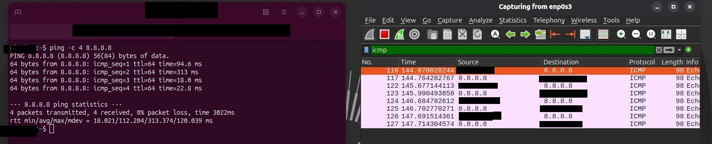

# Practice Lab #1 — Wireshark, ICMP & ARP Analysis

## 1. Lab Overview

| Field | Value |
| --- | --- |
| Lab Title | Wireshark, ICMP & ARP Analysis |
| Lab ID | P01-LAB-01 |
| Phase | Phase 01 — Linux, Networking & Foundations |
| Category | Linux Administration / Networking / Blue Team |
| Status | Completed |
| Date | 2025-08-31 |
| Author | Daniel Solano |
| Scope / Target | Personal Ubuntu virtual machine and its virtual NAT network |
| Authorization | Personal laboratory environment |

> **Scope / Target** identifies the systems, networks, or applications included in the laboratory. **Authorization** establishes the context — a personal lab or an explicitly authorized environment — and encourages responsible, controlled security testing. Both fields apply across Linux, networking, OSINT, Blue Team, Red Team, and other cybersecurity exercises.

### Description

This laboratory explores basic network identification, connectivity testing, and packet analysis using Linux networking utilities and Wireshark. It focuses on understanding how ICMP tests connectivity and how ARP resolves IPv4 addresses into MAC addresses on a local network.

### Key Results

- ICMP connectivity: 4 requests, 4 replies, 0% packet loss (rtt min/avg/max 18.0/112.2/313.4 ms).
- ARP resolution: one Request and one Reply resolved the gateway 10.0.2.2.
- Packet capture: 591 packets over ~9 minutes; only 12 are lab traffic (10 ICMP + 2 ARP). The rest is VM background traffic.
- The four ICMP Time Exceeded messages are background WS-Discovery traffic (TTL 1), not part of the ping test.

## 2. Objectives

- Identify the virtual machine's network interface, IPv4 address, and MAC address.
- Identify the default gateway and inspect the system's neighbor table.
- Generate ICMP traffic using ping and analyze Echo Request and Echo Reply messages.
- Capture and inspect ARP requests and replies using Wireshark.
- Understand the relationship between Ethernet, IPv4, ICMP, and ARP.
- Relate ARP behavior to network reconnaissance and potential ARP spoofing attacks.

## 3. Laboratory Environment

| Component | Details |
| --- | --- |
| Host OS | Windows 11 |
| Hypervisor / VM Platform | Oracle VM VirtualBox 7.2.8 (version at the time of the lab) |
| Guest OS | Ubuntu Desktop 26.04 |
| Network Configuration | VirtualBox NAT; observed subnet 10.0.2.0/24; gateway 10.0.2.2 |
| Network Interface | enp0s3 |
| Tools | Wireshark 4.6.4, Linux iproute2 utilities, APT |
| Packet Capture | PCAPNG analyzed for verification only; not published (see Section 13) |

> Add or remove rows as needed. Record exact tool versions from `tool --version` output in the procedure, not from memory.

## 4. Technical Background

- **IPv4:** Network-layer protocol used to address and route packets between devices.
- **MAC Address:** Link-layer address used to identify a network interface within a local network.
- **ARP (Address Resolution Protocol):** Resolves an IPv4 address into a corresponding MAC address on a local network.
- **ICMP (Internet Control Message Protocol):** Network-layer control and diagnostic protocol. The ping utility uses ICMP Echo Request and Echo Reply messages.
- **Echo Request:** ICMP Type 8, Code 0.
- **Echo Reply:** ICMP Type 0, Code 0.
- **TTL (Time To Live):** IPv4 header field decremented by routers. A packet is discarded when its TTL expires.
- **Identifier and Sequence Number:** ICMP fields used to associate requests with their corresponding replies and distinguish individual messages.
- **OUI (Organizationally Unique Identifier):** A MAC address prefix associated with an organization or manufacturer. Wireshark resolves the OUI to a vendor name. In this lab, the observed OUIs were `08:00:27` (VirtualBox, assigned to the VM interface) and `52:54:00` (VirtualBox NAT gateway). Other common OUIs noted during study: `00:50:56` (VMware), `B8:27:EB` (Raspberry Pi).
- **Neighbor Table:** Kernel-maintained information mapping network addresses to link-layer addresses. On Linux, `ip neigh` shows this table, which covers IPv4 ARP entries and IPv6 neighbor-discovery entries.
- **ARP Cache:** The IPv4-only view of the neighbor table, also readable from `/proc/net/arp`.
- **TTL fingerprinting:** The initial TTL of a packet can hint at the sender's operating system: Linux systems typically start at 64, Windows at 128, and Cisco devices at 255. This is a heuristic used in OS fingerprinting, not a definitive identification. The `ttl=64` shown by `ping` is the TTL of the received Echo Reply as it arrived at this machine; routers decrement TTL in transit, so it does not by itself establish the destination's initial TTL or operating system.
- **ICMP Identifier in analysis:** The Identifier field links replies to the ping process that sent them. Unusual or fixed Identifier patterns are also used by analysts to detect scanning tools, monitoring, and malware that hides traffic inside ICMP (ICMP tunnels, beacons), by following a session and correlating packets.

## 5. Laboratory Procedure

> Record steps chronologically. For each step, clearly distinguish five elements: **Commands Executed** (the exact commands actually executed during the laboratory), **Command Explanation** (purpose, flags, arguments, and expected behavior), **Expected Output** (expected results, when relevant and known), **Actual Observed Output** (real output obtained from the environment), and **Technical Interpretation** (what the observed output demonstrates). Never present expected output as actual evidence.

### Step 1: Inspect network configuration

**Purpose:** Identify the virtual machine's network interface and IPv4 configuration.

**Commands Executed:**

```bash
ip addr
```

**Command Explanation:** Displays network interfaces, their operational states, MAC addresses, and assigned IP addresses.

**Expected Output:** The active interface with its IPv4 address, netmask, and MAC address.

**Actual Observed Output:**

```text
2: enp0s3: <BROADCAST,MULTICAST,UP,LOWER_UP> mtu 1500 qdisc fq_codel state UP
    link/ether [REDACTED] brd ff:ff:ff:ff:ff:ff
    inet 10.0.2.15/24 brd 10.0.2.255 scope global dynamic noprefixroute enp0s3
```

**Technical Interpretation:** The virtual machine uses the enp0s3 interface, state UP. Its IPv4 address is 10.0.2.15/24, so devices in 10.0.2.0/24 are on the same local network. The `/24` netmask is 255.255.255.0. The loopback interface `lo` (127.0.0.1) represents the machine communicating with itself and is not used for this external connectivity test.

### Step 2: Inspect the neighbor table

**Purpose:** Identify known IPv4-to-MAC address mappings, including the gateway.

**Commands Executed:**

```bash
ip neigh
```

**Command Explanation:** Displays the Linux neighbor table, which covers IPv4 ARP entries and IPv6 neighbor-discovery entries — it is not only the IPv4 ARP cache.

**Expected Output:** An entry for the gateway 10.0.2.2 with its MAC address.

**Actual Observed Output:**

```text
10.0.2.2 dev enp0s3 lladdr [REDACTED] REACHABLE
```

**Technical Interpretation:** The system already has a neighbor-table entry for the gateway 10.0.2.2. The REACHABLE state indicates that the neighbor is currently considered reachable according to Linux neighbor-state tracking.

### Step 3: Prepare Wireshark and check capture permissions

**Purpose:** Launch Wireshark and inspect the permissions required to capture network traffic.

**Commands Executed:**

```bash
wireshark &
getent group wireshark
groups
ls -l /usr/bin/dumpcap
sudo usermod -aG wireshark nio
newgrp wireshark
```

**Command Explanation:**

- `wireshark &` launches Wireshark in the background so the terminal stays usable.
- `getent group wireshark` checks whether the Wireshark group exists in the system database.
- `groups` displays the groups associated with the current user session.
- `ls -l /usr/bin/dumpcap` inspects the capture utility's permissions.
- `sudo usermod -aG wireshark nio` adds user `nio` to the Wireshark supplementary group.
- `newgrp wireshark` starts a shell with the selected group as its active group, without closing the session.

**Expected Output:** Wireshark opens; the group and dumpcap checks show whether the user can capture without root.

**Actual Observed Output:**

```text
$ getent group wireshark
wireshark:x:115:
$ ls -l /usr/bin/dumpcap
-rwxr-x--- root wireshark /usr/bin/dumpcap
```

Wireshark 4.6.4 opened. A non-blocking GUI warning was shown at launch (desktop portal application registration, `QDBusError("org.freedesktop.portal.Error.Failed", "Could not register app ID: Connection already associated with an application ID")`); Wireshark still launched and captured normally.

**Technical Interpretation:** The `wireshark` group exists (GID 115) but initially had no users. `dumpcap` is owned by root, group `wireshark`, with permissions `rwxr-x---`: root can do everything, the Wireshark group can execute it, and others have no access. Group membership and dumpcap permissions determine whether a regular user can capture packets without running the full graphical application as root. After adding the user to the group, capture worked as user `nio`.

Note: the exact installation and permission-change sequence should be confirmed against the terminal history before publication. No `apt install wireshark` command is documented in the laboratory notes; Wireshark 4.6.4 was already present on the system.

### Step 4: Select the capture interface

**Purpose:** Capture traffic from the virtual machine's active network interface.

**Commands Executed:** Interface selected in the Wireshark GUI: `enp0s3`.

**Command Explanation:** Wireshark captures on the chosen interface. The loopback interface (`lo`) carries only local traffic and is not used for this external connectivity test.

**Expected Output:** Wireshark starts capturing on enp0s3.

**Actual Observed Output:** Wireshark captured on enp0s3 (591 packets over the capture window).

**Technical Interpretation:** enp0s3 carries the virtual machine's network traffic, so it is the correct interface for observing the ICMP and ARP exchanges of this lab.

### Step 5: Apply an ICMP display filter

**Purpose:** Isolate ICMP packets in Wireshark.

**Wireshark display filter:**

```text
icmp
```

**Command Explanation:** A display filter limits the visible packet list to ICMP traffic. It does not modify or delete packets from the original capture.

**Expected Output:** Only ICMP packets shown in the packet list.

**Actual Observed Output:** 8 ICMP packets displayed (4.7% of the capture at that point).

**Technical Interpretation:** The filter isolated the Echo Request and Echo Reply messages generated by the ping test for inspection.

### Step 6: Generate ICMP traffic

**Purpose:** Test connectivity to Google's public DNS IP address.

**Commands Executed:**

```bash
ping -c 4 8.8.8.8
```

**Command Explanation:**

- `ping` sends ICMP Echo Requests.
- `-c 4` limits the test to four requests.
- `8.8.8.8` is the destination IPv4 address (Google's public DNS server).

**Expected Output:** Four Echo Replies, 0% packet loss.

**Actual Observed Output:**

```text
PING 8.8.8.8 (8.8.8.8) 56(84) bytes of data.
64 bytes from 8.8.8.8: icmp_seq=1 ttl=64 time=94.6 ms
64 bytes from 8.8.8.8: icmp_seq=2 ttl=64 time=313 ms
64 bytes from 8.8.8.8: icmp_seq=3 ttl=64 time=18.0 ms
64 bytes from 8.8.8.8: icmp_seq=4 ttl=64 time=22.8 ms

--- 8.8.8.8 ping statistics ---
4 packets transmitted, 4 received, 0% packet loss, time 3022ms
rtt min/avg/max/mdev = 18.021/112.204/313.374/120.039 ms
```

**Technical Interpretation:** All four requests received replies, confirming connectivity. The observed round-trip times varied (18.0–313 ms), indicating that latency was not constant during the test. The RTT (Round Trip Time) is used to detect latency, diagnose networks, and measure connections such as VPNs.

### Step 7: Inspect ICMP packet fields

**Purpose:** Examine the packet structure in Wireshark.

**Commands Executed:** Packet 116 opened in Wireshark; IPv4 and ICMP sections expanded.

**Expected Output:** Echo Request fields matching the ping command: source 10.0.2.15, destination 8.8.8.8, Type 8, Code 0.

**Actual Observed Output:**

```text
Frame 116: 98 bytes on wire
Ethernet II, Src: [REDACTED], Dst: [REDACTED]
Internet Protocol Version 4, Src: 10.0.2.15, Dst: 8.8.8.8
    Total Length: 84
    Identification: 0x2fec (12268)
    Time to Live: 64
Internet Control Message Protocol
    Type: 8 (Echo (ping) request)
    Code: 0
    Checksum: 0x... [correct]
    Identifier (BE): 51150
    Sequence Number (BE): 1
```

**Technical Interpretation:** The packet details confirm the ICMP Echo Request messages generated by the ping command. Corresponding Echo Replies use Type 0, Code 0 and retain the matching identifier and sequence numbers. The first ping used ICMP Identifier 51150 with sequence numbers 1–4; the second ping (Step 9) used Identifier 51151. The checksum was reported as good, indicating the packet arrived intact.

### Step 8: Flush the neighbor table

**Purpose:** Remove existing neighbor-cache entries before repeating the connectivity test, so the address-resolution process can be observed again.

**Commands Executed:**

```bash
sudo ip neigh flush all
```

**Command Explanation:** Flushes Linux neighbor-table entries.

**Expected Output:** The neighbor table is emptied; the next packet to the gateway requires a new ARP exchange.

**Actual Observed Output:** Command completed without error (no output). A subsequent `ip neigh` showed the gateway entry rebuilt after traffic resumed.

**Technical Interpretation:** This command flushes Linux neighbor-table entries. It affects IPv4 ARP and IPv6 neighbor-discovery information, rather than only ARP.

### Step 9: Repeat the connectivity test

**Purpose:** Generate traffic after the flush and observe the resulting address-resolution exchange.

**Commands Executed:**

```bash
ping -c 1 8.8.8.8
```

**Command Explanation:** A single ICMP Echo Request to the same destination, now requiring the gateway's MAC address to be resolved again.

**Expected Output:** One Echo Reply, 0% packet loss.

**Actual Observed Output:**

```text
PING 8.8.8.8 (8.8.8.8) 56(84) bytes of data.
64 bytes from 8.8.8.8: icmp_seq=1 ttl=64 time=125 ms

--- 8.8.8.8 ping statistics ---
1 packets transmitted, 1 received, 0% packet loss, time 0ms
rtt min/avg/max/mdev = 125.072/125.072/125.072/0.000 ms
```

**Technical Interpretation:** Connectivity remained successful after the neighbor-table flush. The packet capture shows the address-resolution exchange associated with the gateway (Step 10).

### Step 10: Inspect ARP traffic

**Purpose:** Observe the address-resolution process in Wireshark.

**Wireshark display filter:**

```text
arp
```

**Expected Output:** An ARP Request followed by an ARP Reply for the gateway.

**Actual Observed Output:**

```text
507  468.334015052  [REDACTED]  Broadcast  ARP  42  Who has 10.0.2.2? Tell 10.0.2.15
508  468.335498499  [REDACTED]  [REDACTED]  ARP  64  10.0.2.2 is at [REDACTED]
```

**Technical Interpretation:** The virtual machine (10.0.2.15) wants to send a ping to the internet, but it only knows the gateway's IP address (10.0.2.2), not its MAC address. It sends an ARP broadcast asking "Who has 10.0.2.2?" The VirtualBox virtual router replies "I am 10.0.2.2 and my MAC is [REDACTED]." The VM can now send the ICMP packets: Ethernet frames need the gateway's MAC address to deliver packets to the next hop outside the local subnet.

### Step 11: Inspect the kernel ARP table (second method)

**Purpose:** Confirm the gateway mapping from the kernel, using a second method.

**Commands Executed:**

```bash
ip link
cat /proc/net/arp
```

**Command Explanation:**

- `ip link` shows the network interfaces and their MAC addresses.
- `cat /proc/net/arp` shows the kernel's ARP cache.

**Expected Output:** The gateway entry 10.0.2.2 mapped to its MAC address on enp0s3.

**Actual Observed Output:**

```text
$ cat /proc/net/arp
IP address       HW type     Flags       HW address            Mask     Device
10.0.2.2         0x1         0x2         [REDACTED]            *        enp0s3
```

**Technical Interpretation:** The kernel's ARP table contains the gateway's IPv4-to-MAC mapping, confirming the same resolution observed in Wireshark. This provides a second way to inspect the address resolution.

## 6. Commands & Technical Analysis

| Command | Purpose | Flags / Arguments | Technical Relevance |
| --- | --- | --- | --- |
| `ip addr` | Inspect interface configuration | — | Identifies IP addressing and interfaces |
| `ip neigh` | Inspect neighbor table | — | Shows IP-to-link-layer mappings |
| `ip link` | Inspect interfaces and MAC addresses | — | Second method to see interfaces and MACs |
| `wireshark &` | Launch Wireshark | `&` (background) | Starts packet-analysis software |
| `getent group wireshark` | Inspect group configuration | — | Helps diagnose capture permissions |
| `groups` | Inspect user groups | — | Verifies group membership |
| `ls -l /usr/bin/dumpcap` | Inspect capture utility permissions | — | Helps diagnose packet-capture access |
| `sudo usermod -aG wireshark nio` | Add user to group | `-aG` (append to supplementary group) | Changes supplementary group membership |
| `newgrp wireshark` | Start shell with selected group | — | Applies group context to the new shell |
| `ping -c 4 8.8.8.8` | Test connectivity | `-c 4` (four requests) | Generates ICMP Echo messages |
| `sudo ip neigh flush all` | Clear neighbor entries | — | Allows address resolution to occur again |
| `ping -c 1 8.8.8.8` | Repeat connectivity test | `-c 1` (one request) | Generates traffic after the flush |
| `cat /proc/net/arp` | Inspect kernel ARP table | — | Shows IPv4-to-MAC mappings |

## 7. Results & Observations

### Findings

Headline results are summarized in Key Results (Section 1). This section presents the supporting evidence: the protocol inventory, the Time Exceeded analysis, and the expected-vs-observed comparison.



### PCAPNG protocol inventory

Verified with `tshark` against the original capture (591 packets):

| Protocol | Packet count |
| --- | --- |
| TCP | 420 |
| UDP | 101 |
| IPv6 | 54 |
| ICMP | 14 |
| ARP | 2 |
| **Total** | **591** |

The 14 ICMP packets consisted of:

- 5 Echo Requests (Type 8, Code 0).
- 5 Echo Replies (Type 0, Code 0).
- 4 Time Exceeded messages (Type 11, Code 0).

The four Time Exceeded messages came from the gateway (10.0.2.2) and were addressed to the virtual machine. Their cause was established by inspecting the quoted packet inside the ICMP error message: each one quotes an original WS-Discovery multicast packet (UDP port 3702, destination 239.255.255.250) sent by the virtual machine with TTL 1. The gateway decremented the TTL to 0 and returned Time Exceeded in transit. This is background service-discovery traffic, not part of the ping test.

### Expected vs. Observed Behavior

| Item | Expected | Observed | Notes |
| --- | --- | --- | --- |
| Interface state | Active network interface | enp0s3 was UP | Confirmed |
| ICMP connectivity | Echo Replies | 4 replies to 4 requests | 0% packet loss |
| ARP resolution | Request followed by Reply | One Request and one Reply | Gateway mapping observed |
| Neighbor cache | Gateway entry available after communication | Gateway entry reported as REACHABLE | Confirmed |
| Packet capture | Relevant ICMP and ARP traffic | Additional TCP, UDP, and IPv6 traffic | Background traffic also captured; capture not published |

### Supporting Evidence

- `screenshots/01-network-configuration.jpg` — Interface configuration (`ip addr`) and Wireshark startup.
- `screenshots/02-icmp-connectivity.jpg` — Ping results and ICMP packet list.
- `screenshots/03-arp-exchange.jpg` — Ping results, ARP filter, and ARP Reply packet details.
- `screenshots/04-kernel-arp-table.jpg` — Interface details (`ip link`) and kernel ARP table (`/proc/net/arp`).

## 8. Security Analysis

### Security Mechanisms

ARP provides local IPv4 address resolution, while ICMP provides network diagnostics and control messaging. Linux maintains neighbor information in its kernel neighbor table. On this system, packet capture is restricted by group membership: `dumpcap` is executable only by root and the `wireshark` group (`rwxr-x---`).

### Vulnerabilities & Weaknesses

ARP does not provide cryptographic authentication of address-resolution messages. Consequently, a malicious device on the same local network may attempt to send forged ARP messages and manipulate another device's neighbor cache.

No ARP spoofing or poisoning attack was performed or demonstrated in this laboratory.

### Attack Surfaces & Abuse Scenarios

- ARP spoofing: Forged ARP messages may associate an IP address with an attacker's MAC address.
- ARP poisoning: Manipulated neighbor-cache entries may redirect local network traffic.
- Man-in-the-Middle (MITM): Traffic may be intercepted or relayed if an attacker successfully positions themselves between communicating devices.
- ICMP abuse: Some malware uses ICMP to hide communications, send data, and receive commands (ICMP tunnels, beacons). The ICMP Identifier can help an analyst follow a session, identify a beacon, and correlate packets.

These are potential abuse scenarios, not findings from the captured experiment.

### Defensive Controls & Mitigations

- Use network segmentation to limit exposure to untrusted devices.
- Monitor unexpected IP-to-MAC changes.
- Use Dynamic ARP Inspection where supported by managed network infrastructure.
- Apply static ARP entries selectively in controlled environments.
- Monitor network traffic for suspicious ARP activity.

### Real-World Relevance

Understanding ARP and ICMP is useful in network troubleshooting, packet analysis, asset discovery, and SOC investigations. Analysts can use these protocols to investigate connectivity problems, identify devices, and recognize potentially suspicious address-resolution behavior. OUI analysis also helps analysts find unknown devices, detect virtual machines, and spot suspicious devices on a network.

## 9. Troubleshooting & Challenges

| Issue | Diagnostics | Resolution | Status |
| --- | --- | --- | --- |
| Wireshark capture permissions | Inspected the Wireshark group (`getent group wireshark`) and dumpcap permissions (`ls -l /usr/bin/dumpcap`) | User added to the `wireshark` group; capture worked as user `nio` | Resolved |
| Wireshark launch warning | GUI reported an application registration warning involving the desktop portal | Wireshark still launched and captured normally | Non-blocking warning observed |
| Virtual machine clock incorrect | Capture timestamps showed 2026-07-22 while the lab was performed 2025-08-31 | Time corrected in the VM | Resolved |

## 10. Lessons Learned

- Identified the virtual machine's network interface and IPv4 configuration.
- Learned how Linux maintains neighbor information.
- Observed the relationship between IPv4 addresses and MAC addresses.
- Generated and analyzed ICMP Echo Requests and Echo Replies.
- Used Wireshark display filters to isolate protocol traffic.
- Inspected ARP requests and replies at packet level.
- Learned why a host needs the gateway's MAC address before sending Ethernet frames outside its local subnet.
- Connected ARP's lack of authentication with potential spoofing and poisoning scenarios.
- Learned how OUI prefixes identify device vendors and help detect virtual machines.
- Learned how TTL values can hint at an operating system and how the ICMP Identifier links requests to replies.

## 11. References

| Source | Link |
| --- | --- |
| Wireshark User's Guide | https://www.wireshark.org/docs/wsug_html_chunked/ |
| Wireshark Display Filter Reference | https://www.wireshark.org/docs/dfref/ |
| Linux ip manual | https://man7.org/linux/man-pages/man8/ip.8.html |
| Linux arp manual | https://man7.org/linux/man-pages/man7/arp.7.html |
| RFC 826 — Address Resolution Protocol | https://www.rfc-editor.org/rfc/rfc826 |
| RFC 792 — Internet Control Message Protocol | https://www.rfc-editor.org/rfc/rfc792 |
| RFC 791 — Internet Protocol | https://www.rfc-editor.org/rfc/rfc791 |

## 12. Conclusion

This laboratory demonstrated how a Linux virtual machine identifies its network configuration, resolves the gateway's MAC address through ARP, and tests external connectivity using ICMP.

Wireshark provided packet-level visibility into the communication process, while Linux networking utilities provided complementary information about interfaces and neighbor mappings.

The exercise established practical foundations for future work in network monitoring, traffic analysis, and the investigation of ARP-based attacks. Future practices will cover how ARP spoofing, ARP poisoning, and Man-in-the-Middle attacks work and how to detect them.

## 13. Evidence & Supporting Files

> Sanitization note: no packet capture is published in this repository. The original capture (591 packets) was analyzed with `tshark` for verification only. Screenshots were sanitized by the author: MAC addresses are redacted with black bars, and MAC addresses are likewise redacted in this document. The IP addresses shown are the virtual NAT network (10.0.2.0/24) and Google's public DNS (8.8.8.8). No credentials, tokens, or personal information are present in the published evidence. Note: two screenshots retain tiny fragments of redacted values (the last bytes of the gateway MAC in the ARP table screenshot and part of a vendor string in the ARP packet list); they do not reveal the full addresses.

| Filename | Description | Related Step |
| --- | --- | --- |
| `screenshots/01-network-configuration.jpg` | Network configuration and Wireshark startup | 1–4 |
| `screenshots/02-icmp-connectivity.jpg` | ICMP test and packet inspection | 5–7 |
| `screenshots/03-arp-exchange.jpg` | ARP packet inspection | 8–10 |
| `screenshots/04-kernel-arp-table.jpg` | Interface information and kernel ARP table | 2, 11 |

### Practice Directory Structure

```text
practice-01-wireshark-ping-arp/
├── README.md
└── screenshots/
    ├── 01-network-configuration.jpg
    ├── 02-icmp-connectivity.jpg
    ├── 03-arp-exchange.jpg
    └── 04-kernel-arp-table.jpg
```

## 14. Laboratory Completion Record

| Field | Value |
| --- | --- |
| Completion Status | Completed — documentation under review |
| Completion Date | 2025-08-31 |
| Documentation Version | v0.1 — Initial review draft |
| Author | Daniel Solano |
| Related Phase | Phase 01 — Linux, Networking & Foundations |
| Related Resources | Phase 01 README and Cybersecurity Learning Portfolio |
