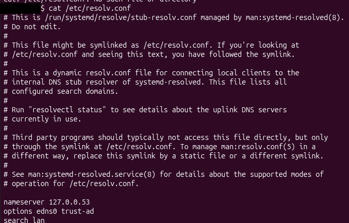
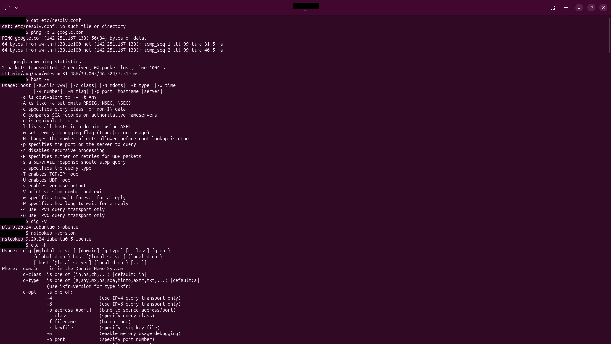
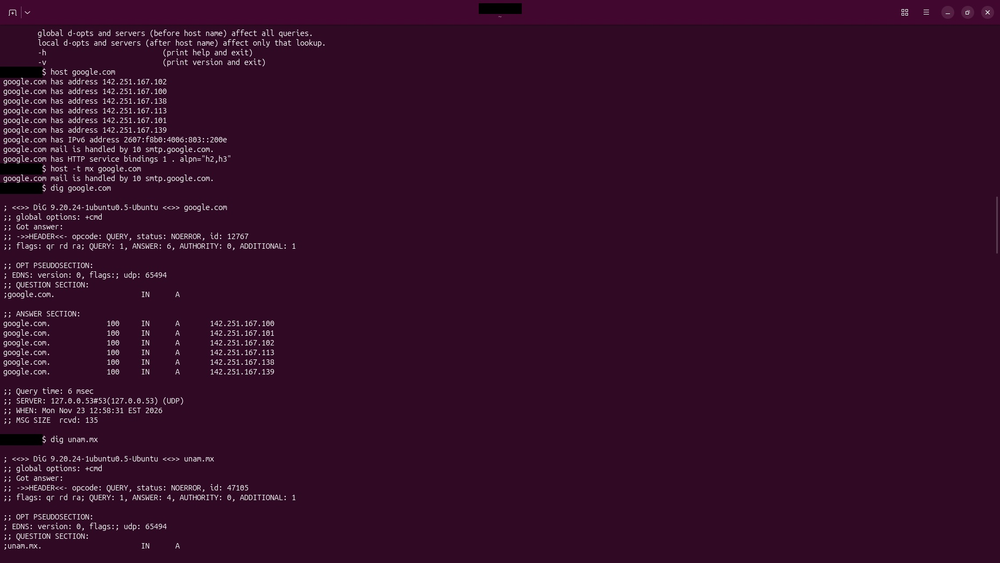
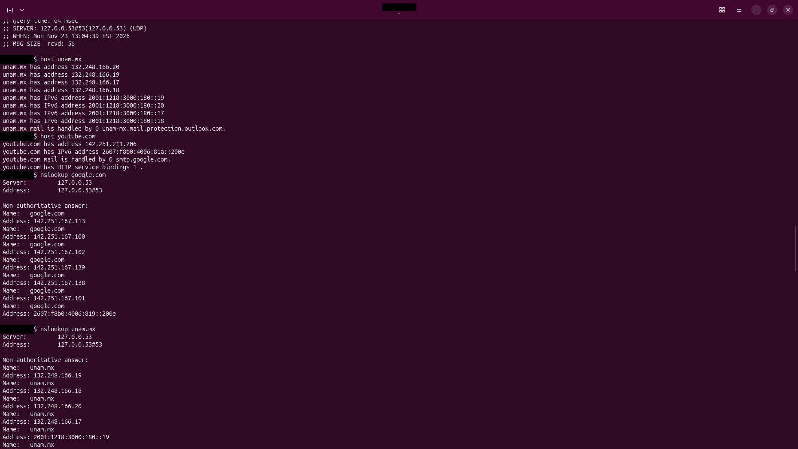
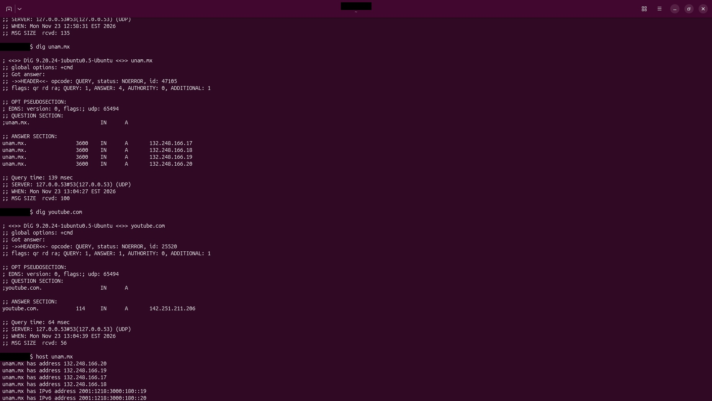
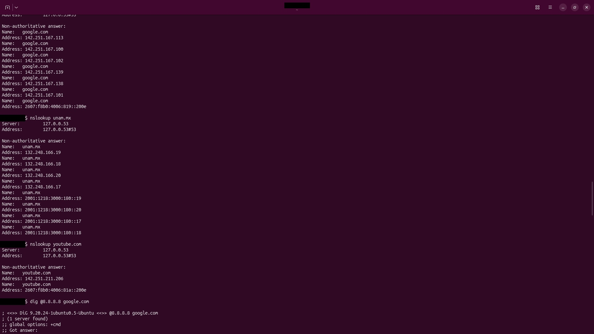
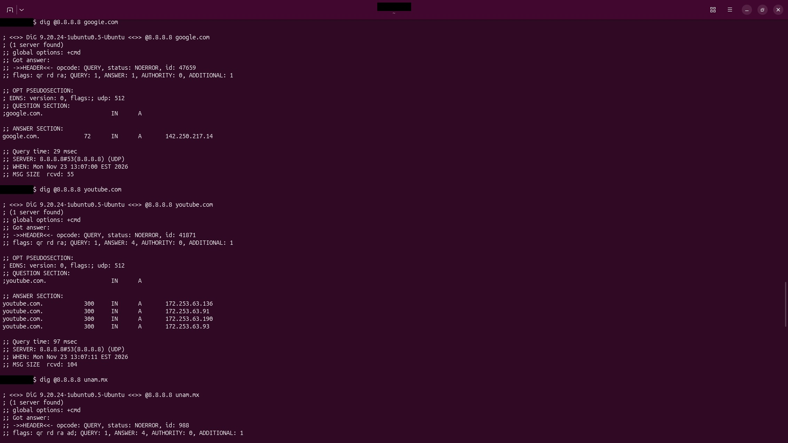
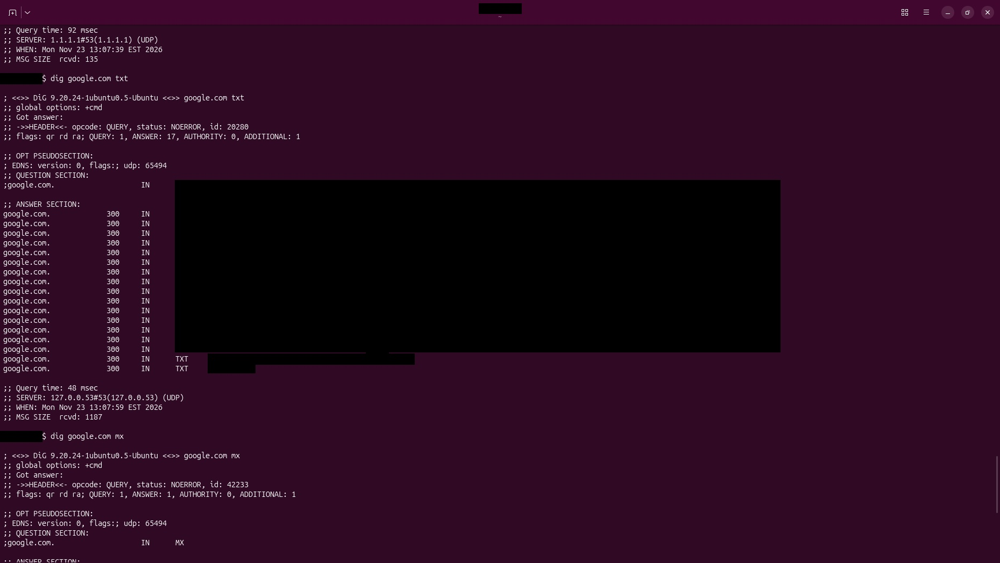
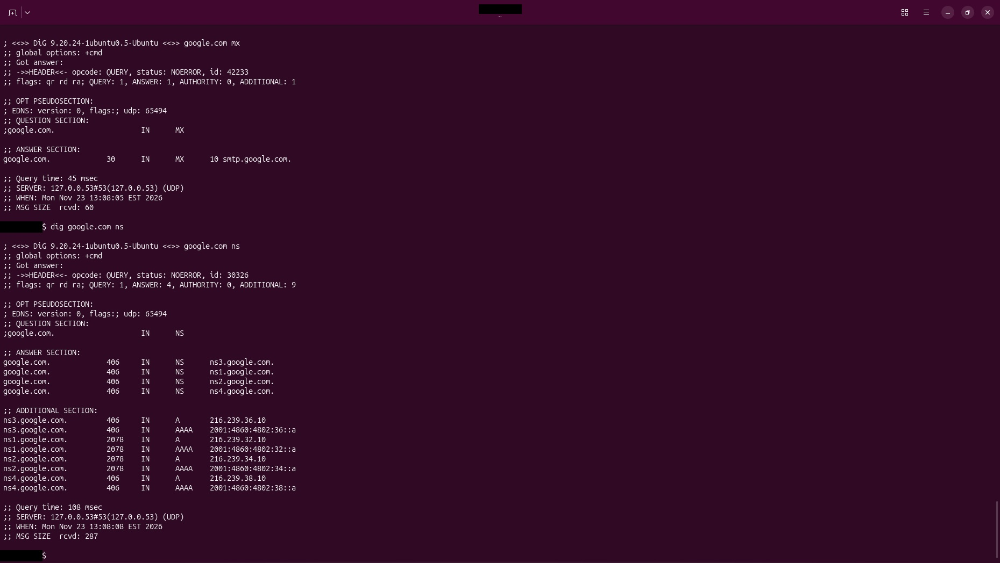

# Practice Lab #2 — DNS Fundamentals and Analysis

## 1. Lab Overview

| Field | Value |
| --- | --- |
| Lab Title | DNS Fundamentals and Analysis |
| Lab ID | P01-LAB-02 |
| Phase | Phase 01 — Linux, Networking & Foundations |
| Category | Networking / DNS / Reconnaissance |
| Status | Completed |
| Original Completion Date | 2026-09-16 |
| Evidence Recreation Date | 2026-11-23 |
| Author | Daniel Solano |
| Scope / Target | Public DNS records of public domains (google.com, unam.mx, youtube.com), queried from a personal Ubuntu virtual machine |
| Authorization | Personal laboratory environment; passive queries of publicly published DNS data only |

> **Scope / Target** identifies the systems, networks, or applications included in the laboratory. **Authorization** establishes the context — a personal lab or an explicitly authorized environment — and encourages responsible, controlled security testing. Both fields apply across Linux, networking, OSINT, Blue Team, Red Team, and other cybersecurity exercises.

### Description

This laboratory explores how DNS resolution works on a Linux system and how public DNS records are inspected with the command-line utilities `host`, `dig`, and `nslookup`. It identifies the resolver the system is actually configured to use, verifies that hostname resolution works, compares the three query tools and their output formats, queries specific public resolvers directly, and inspects the A, AAAA, MX, TXT, and NS records of real domains. The practice closes by relating DNS enumeration to cybersecurity reconnaissance: what an analyst can learn about an organization's public infrastructure from DNS alone, and what DNS data cannot prove.

### Key Results

- **Resolver identified:** the system does not query a public DNS server directly. `/etc/resolv.conf` points to the local systemd-resolved stub at **127.0.0.53**, and every default query in the evidence was answered by that stub — the same DNS listener identified on the machine in Mini-Lab 4.
- **Resolution verified:** `ping -c 2 google.com` resolved the name and received 2 of 2 replies with 0% packet loss.
- **Answers depend on the resolver:** google.com via the local stub returned six A records (142.251.167.x); the same name via 8.8.8.8 returned one (142.250.217.14). youtube.com via the stub returned 142.251.211.206; via 8.8.8.8 it returned four addresses in 172.253.63.x.
- **Record types inspected:** A and AAAA for three domains, MX (google.com → `10 smtp.google.com`), TXT (17 records for google.com; values not reproduced), and NS (ns1–ns4.google.com, with glue records).
- **Mail provider identified from MX alone:** unam.mx mail is handled by Microsoft (`unam-mx.mail.protection.outlook.com`), while google.com and youtube.com mail is handled by Google (`smtp.google.com`).

## 2. Objectives

- Inspect the system's DNS configuration and identify the resolver in use.
- Verify hostname resolution together with ICMP connectivity.
- Identify the versions of the DNS query utilities and read their help/usage output correctly.
- Query A, AAAA, and MX information with `host` and interpret its concise output.
- Read a complete `dig` response: header, status, flags, question and answer sections, TTL, query time, server, and message size.
- Query with `nslookup` and explain the meaning of a non-authoritative answer.
- Query specific public resolvers (8.8.8.8, 1.1.1.1) with dig's `@` syntax and compare their answers with the default resolver's.
- Inspect TXT, MX, and NS records and explain the purpose of each record type.
- Relate DNS enumeration to cybersecurity reconnaissance and phishing investigation.

## 3. Laboratory Environment

| Component | Details |
| --- | --- |
| Host OS | Windows 11 |
| Hypervisor / VM Platform | Oracle VM VirtualBox 7.2.8 (version at the time of the lab) |
| Guest OS | Ubuntu Desktop 26.04 |
| Network Configuration | VirtualBox NAT; subnet 10.0.2.0/24; gateway 10.0.2.2 |
| DNS Configuration | systemd-resolved stub resolver at 127.0.0.53 (see Step 1) |
| Tools | `host`, `dig`, `nslookup` (BIND utilities 9.20.24 in the evidence recreation; 9.20.18 recorded in the original session's notes), `ping`, `cat` |
| Packet Capture | None — this practice works with query output only |

> Add or remove rows as needed. Record exact tool versions from `tool --version` output in the procedure, not from memory.

## 4. Technical Background

- **DNS (Domain Name System):** The distributed database that translates human-readable names (google.com) into IP addresses and publishes related information (mail servers, name servers, verification text). The author's study notes describe it as *"the internet's phone book."*
- **Resolver:** The component that answers a DNS question on behalf of a client. Applications on this system talk to a local **stub resolver** (systemd-resolved at 127.0.0.53), which forwards queries to upstream recursive resolvers and caches the answers.
- **Recursive vs. authoritative:** A recursive resolver searches on the client's behalf and answers from its cache or by asking other servers; an authoritative server holds the original records for a zone. Answers received from a cache are labeled **non-authoritative**.
- **A record:** Maps a name to an IPv4 address.
- **AAAA record:** Maps a name to an IPv6 address.
- **MX (Mail Exchanger) record:** Names the servers that accept email for a domain, with a preference value — the **lowest** number is tried first.
- **TXT record:** Publishes text data, commonly used for domain-ownership verification and email-security policies such as SPF.
- **NS (Name Server) record:** Identifies the authoritative name servers for a zone.
- **HTTPS/SVCB records:** Service-binding records; `host` reported them for google.com and youtube.com as "HTTP service bindings."
- **TTL (Time To Live):** How long, in seconds, an answer may be cached. Cached answers show a counting-down TTL, so two queries minutes apart rarely show identical values.
- **Response status:** **NOERROR** means the query completed without a DNS error. **NXDOMAIN** means the queried name does not exist. **SERVFAIL** means the server failed to complete the query. **REFUSED** means the server refused to answer. Only NOERROR was observed in this practice; the others were studied as concepts.
- **Flags:** `qr` — the message is a response; `rd` — recursion desired ("if you don't know it, look it up for me," in the author's notes); `ra` — recursion available ("yes, I can"); `ad` — authenticated data (DNSSEC validation signaled by the resolver).
- **Why answers differ:** Large services publish multiple A records and return different answers depending on the resolver's location and their load-balancing systems. Multiple A records do **not** necessarily mean multiple independent physical servers, and no single answer is permanent.

## 5. Laboratory Procedure

> Record steps chronologically. For each step, clearly distinguish five elements: **Commands Executed** (the exact commands actually executed during the laboratory), **Command Explanation** (purpose, flags, arguments, and expected behavior), **Expected Output** (expected results, when relevant and known), **Actual Observed Output** (real output obtained from the environment), and **Technical Interpretation** (what the observed output demonstrates). Never present expected output as actual evidence.
>
> The procedure below follows the author's handwritten notes (Steps 1–7, plus the record-type queries listed as extra commands). The screenshots are from the evidence recreation of November 23, 2026; where the recreation expanded the original work (additional domains), that is stated in the step.

### Step 1: Inspect the DNS configuration

**Purpose:** See which DNS resolver Ubuntu is configured to use.

**Commands Executed:**

```bash
cat /etc/resolv.conf
```

**Command Explanation:** `/etc/resolv.conf` is the file applications read to learn which name server to ask. On this system it is a symbolic link to the stub file maintained by systemd-resolved, as the file's own header comments state.

**Expected Output:** A `nameserver` line identifying the resolver.

**Actual Observed Output:**

```text
# This is /run/systemd/resolve/stub-resolv.conf managed by man:systemd-resolved(8).
# Do not edit.
...
nameserver 127.0.0.53
options edns0 trust-ad
search lan
```

**Technical Interpretation:** The system's resolver is the local stub at **127.0.0.53**, not a public DNS server: systemd-resolved listens on that loopback address, receives every application query, and forwards it to the upstream servers it learned (for example by DHCP). `options edns0 trust-ad` enables EDNS and records trust in DNSSEC authenticated answers; `search lan` is the search domain appended to short names, supplied by the VirtualBox NAT network.



*The corrected `cat /etc/resolv.conf` output: a dynamically managed stub file whose only name server is 127.0.0.53.*

### Step 2: Test resolution and connectivity

**Purpose:** Verify that DNS resolution works end to end ("ver si DNS funciona," in the author's notes).

**Commands Executed:**

```bash
ping -c 2 google.com
```

**Command Explanation:** `ping` first resolves the hostname through the system resolver, then sends ICMP Echo Requests to the resulting address. `-c 2` sends exactly two requests.

**Expected Output:** The name resolves to an IPv4 address and replies arrive.

**Actual Observed Output:**

```text
PING google.com (142.251.167.138) 56(84) bytes of data.
64 bytes from ww-in-f138.1e100.net (142.251.167.138): icmp_seq=1 ttl=99 time=31.5 ms
64 bytes from ww-in-f138.1e100.net (142.251.167.138): icmp_seq=2 ttl=99 time=46.5 ms

--- google.com ping statistics ---
2 packets transmitted, 2 received, 0% packet loss, time 1004ms
rtt min/avg/max/mdev = 31.486/39.005/46.524/7.519 ms
```

**Technical Interpretation:** Resolution and connectivity both work: the stub returned 142.251.167.138 for google.com and both echo requests were answered (the `ttl=99` shown is the TTL of the replies as they arrived). This test proves that A-record resolution plus ICMP work; it does not test any other record type.

### Step 3: Identify the utility versions and help output

**Purpose:** Record the exact versions of the DNS tools and review dig's options.

**Commands Executed:**

```bash
host -V
dig -v
nslookup -version
dig -h
```

**Command Explanation:** `host -V` (capital V) prints the host version; `dig -v` prints the DiG version; `nslookup -version` prints the nslookup version; `dig -h` prints dig's help, including the query types it accepts (a, any, mx, ns, soa, hinfo, axfr, txt, …).

**Expected Output:** One version string per utility, plus dig's help text.

**Actual Observed Output:**

```text
DiG 9.20.24-1ubuntu0.5-Ubuntu
nslookup 9.20.24-1ubuntu0.5-Ubuntu
```

In the recreation, `host -v` was run **without a hostname**: because `-v` selects verbose mode rather than version, `host` printed its usage text instead of a version. The host version is therefore not shown in the recreation evidence; the original session's notes record all three utilities at **9.20.18-1ubuntu2.1-Ubuntu**.

**Technical Interpretation:** Version output must be read for what it is: help or usage text is not a lookup result, and a version flag differs per tool (`-V` for host, `-v` for dig, `-version` for nslookup). The recreation environment ships BIND 9.20.24 utilities; the original session ran 9.20.18.



*The session's start: the failed first `cat` attempt (see Section 9), the successful ping, the host usage output, and the dig/nslookup versions.*

### Step 4: Query DNS with host

**Purpose:** Obtain a domain's IP addresses, mail exchanger, and related records with the simplest query tool ("pregunta la dirección IP").

**Commands Executed:**

```bash
host google.com
host -t mx google.com
host unam.mx
host youtube.com
```

**Command Explanation:** With no options, `host` prints the A, AAAA, MX, and service-binding records it receives, one fact per line. `-t mx` restricts the query to MX records. The original session queried google.com; the recreation added unam.mx and youtube.com.

**Expected Output:** Several lines per domain: IPv4 addresses, an IPv6 address, and the mail handler.

**Actual Observed Output:**

```text
google.com has address 142.251.167.102
google.com has address 142.251.167.100
google.com has address 142.251.167.138
google.com has address 142.251.167.113
google.com has address 142.251.167.101
google.com has address 142.251.167.139
google.com has IPv6 address 2607:f8b0:4006:803::200e
google.com mail is handled by 10 smtp.google.com.
google.com has HTTP service bindings 1 . alpn="h2,h3"
```

```text
unam.mx has address 132.248.166.17
unam.mx has address 132.248.166.18
unam.mx has address 132.248.166.19
unam.mx has address 132.248.166.20
unam.mx has IPv6 address 2001:1218:3000:180::17
unam.mx mail is handled by 0 unam-mx.mail.protection.outlook.com.
```

```text
youtube.com has address 142.251.211.206
youtube.com has IPv6 address 2607:f8b0:4006:81a::200e
youtube.com mail is handled by 0 smtp.google.com.
youtube.com has HTTP service bindings 1 .
```

**Technical Interpretation:** One command already maps a domain's public face: several IPv4 addresses (published for high availability, load balancing, speed, and redundancy, per the author's notes), IPv6 connectivity, and the organization that receives its email. The MX preference is a priority — the lowest value wins (the notes give the example ordering 5, 10, 20). UNAM's MX points to Microsoft's mail-protection service, so its email is operated by Microsoft 365; Google's own domains point to `smtp.google.com`. None of these addresses is permanent: they are the answers given at query time.



*`host google.com`, the explicit MX query, and the start of the `dig` inspection.*



*`host unam.mx` (note the Outlook mail handler), `host youtube.com`, and the first `nslookup` answers.*

### Step 5: Inspect full DNS responses with dig

**Purpose:** See the complete query/response exchange, not just the answer ("demuestra todo el proceso de consulta").

**Commands Executed:**

```bash
dig google.com
dig unam.mx
dig youtube.com
```

**Command Explanation:** `dig` prints the whole DNS message: a header (status, flags, counts), the QUESTION SECTION (what was asked: name, class IN, type A), the ANSWER SECTION (the records, each with its TTL), and a footer with the query time, the server that answered, the timestamp, and the message size. IN is the Internet class of the record.

**Expected Output:** Status NOERROR with one or more A records per domain.

**Actual Observed Output:**

```text
; <<>> DiG 9.20.24-1ubuntu0.5-Ubuntu <<>> google.com
;; ->>HEADER<<- opcode: QUERY, status: NOERROR, id: 12767
;; flags: qr rd ra; QUERY: 1, ANSWER: 6, AUTHORITY: 0, ADDITIONAL: 1

;; QUESTION SECTION:
;google.com.                    IN      A

;; ANSWER SECTION:
google.com.             100     IN      A       142.251.167.100
google.com.             100     IN      A       142.251.167.101
google.com.             100     IN      A       142.251.167.102
google.com.             100     IN      A       142.251.167.113
google.com.             100     IN      A       142.251.167.138
google.com.             100     IN      A       142.251.167.139

;; Query time: 6 msec
;; SERVER: 127.0.0.53#53(127.0.0.53) (UDP)
;; WHEN: Mon Nov 23 12:58:31 EST 2026
;; MSG SIZE  rcvd: 135
```

```text
unam.mx.                3600    IN      A       132.248.166.17
unam.mx.                3600    IN      A       132.248.166.18
unam.mx.                3600    IN      A       132.248.166.19
unam.mx.                3600    IN      A       132.248.166.20
;; Query time: 139 msec — SERVER: 127.0.0.53#53 — MSG SIZE rcvd: 100
```

```text
youtube.com.            114     IN      A       142.251.211.206
;; Query time: 64 msec — SERVER: 127.0.0.53#53 — MSG SIZE rcvd: 56
```

**Technical Interpretation:** Every answer came from the local stub (SERVER 127.0.0.53#53) with status NOERROR — the query completed without a DNS error, which says nothing about whether the domain is secure or trustworthy. The flags `qr rd ra` show a response to a recursion-desired query from a resolver offering recursion. TTLs differ by design: Google's A records allow 100 seconds of caching here, UNAM's allow a full hour (3600). The original session's notes record a `dig google.com` example with TTL 77, a 37 ms query time, and a 55-byte message — different numbers from a different moment, which is normal for DNS and is exactly why this document never treats one query's values as permanent.



*Full `dig` responses for unam.mx (TTL 3600) and youtube.com, answered by the stub.*

### Step 6: Query with nslookup

**Purpose:** Query the same domains with the third classic utility and compare its presentation.

**Commands Executed:**

```bash
nslookup google.com
nslookup unam.mx
nslookup youtube.com
```

**Command Explanation:** `nslookup` names the server it asked (here the stub, 127.0.0.53#53) and then lists the answer's names and addresses in a simple two-column format. The original session's example domain was openai.com; the recreation used the three domains of Steps 4–5.

**Expected Output:** The server identification followed by the resolved addresses, marked as a non-authoritative answer.

**Actual Observed Output:**

```text
Server:         127.0.0.53
Address:        127.0.0.53#53

Non-authoritative answer:
Name:   google.com
Address: 142.251.167.113
Name:   google.com
Address: 142.251.167.100
Name:   google.com
Address: 142.251.167.102
Name:   google.com
Address: 142.251.167.139
Name:   google.com
Address: 142.251.167.138
Name:   google.com
Address: 142.251.167.101
Name:   google.com
Address: 2607:f8b0:4006:819::200e
```

unam.mx returned the same four IPv4 addresses as `dig` plus four IPv6 addresses (2001:1218:3000:180::17–::20); youtube.com returned 142.251.211.206 and 2607:f8b0:4006:81a::200e. All three answers were marked non-authoritative.

**Technical Interpretation:** "Non-authoritative answer" is the key reading skill of this step: the stub answered from its cache or by recursion, not from the zone's authoritative servers, so nslookup labels the data accordingly. The data agrees with `host` and `dig` — three tools, three presentations of the same DNS database.



*`nslookup` answers for the three domains via 127.0.0.53, and the first direct query to a public resolver.*

### Step 7: Query specific public resolvers

**Purpose:** Bypass the configured resolver and ask a chosen DNS server directly ("consultar DNS específicos").

**Commands Executed:**

```bash
dig @8.8.8.8 google.com
dig @8.8.8.8 youtube.com
dig @8.8.8.8 unam.mx
dig @1.1.1.1 google.com
```

**Command Explanation:** The `@server` argument tells dig which resolver to ask: 8.8.8.8 is Google's public DNS resolver and 1.1.1.1 is Cloudflare's. The SERVER line in each response proves which resolver actually answered.

**Expected Output:** Valid answers from the public resolvers, not necessarily identical to the stub's.

**Actual Observed Output:**

```text
;; ->>HEADER<<- opcode: QUERY, status: NOERROR, id: 47659
;; flags: qr rd ra; QUERY: 1, ANSWER: 1, AUTHORITY: 0, ADDITIONAL: 1

google.com.             72      IN      A       142.250.217.14

;; Query time: 29 msec
;; SERVER: 8.8.8.8#53(8.8.8.8) (UDP)
;; MSG SIZE  rcvd: 55
```

```text
youtube.com.            300     IN      A       172.253.63.136
youtube.com.            300     IN      A       172.253.63.91
youtube.com.            300     IN      A       172.253.63.190
youtube.com.            300     IN      A       172.253.63.93
;; Query time: 97 msec — SERVER: 8.8.8.8#53 — MSG SIZE rcvd: 104
```

The @8.8.8.8 query for unam.mx also returned NOERROR with 4 answers; its header additionally carried the `ad` flag (flags: qr rd ra ad). For the @1.1.1.1 query, the recreation screenshot preserves only the end of the response — `;; Query time: 92 msec`, `;; SERVER: 1.1.1.1#53(1.1.1.1) (UDP)`, `;; MSG SIZE rcvd: 135` — so the answer section of that query is not documented here.

**Technical Interpretation:** This is the practice's central comparison. The same names return different addresses from different resolvers: google.com is six 142.251.167.x addresses via the stub but a single 142.250.217.14 via 8.8.8.8, and youtube.com changes from 142.251.211.206 to the 172.253.63.x set. Large providers steer each resolver toward nearby infrastructure (CDN/anycast localization) and balance load, so a DNS answer is a function of *who asks, where, and when* — a fact an analyst must remember before treating any observed IP as "the" address of a service.



*Direct queries to 8.8.8.8 for google.com, youtube.com, and unam.mx, with answers that differ from the local stub's.*

### Step 8: Inspect TXT, MX, and NS records

**Purpose:** Read the record types used for verification, mail routing, and authority (the "extra commands" in the author's notes: `dig empresa.com NS / TXT / MX`).

**Commands Executed:**

```bash
dig google.com TXT
dig google.com MX
dig google.com NS
```

**Command Explanation:** Adding a type argument makes dig return that record type: TXT for published text (domain verification, email-security policies), MX for the mail exchangers and their priorities, and NS for the zone's authoritative name servers.

**Expected Output:** A set of TXT strings, one MX record, and the list of authoritative name servers.

**Actual Observed Output:**

```text
;; ->>HEADER<<- opcode: QUERY, status: NOERROR, id: 20280
;; flags: qr rd ra; QUERY: 1, ANSWER: 17, AUTHORITY: 0, ADDITIONAL: 1
;; Query time: 48 msec — SERVER: 127.0.0.53#53 — MSG SIZE rcvd: 1187
```

The TXT query returned **17 records** (TTL 300). Their values are domain-verification and email-security strings; they are covered in the sanitized screenshot and are **not reproduced** in this document.

```text
google.com.             30      IN      MX      10 smtp.google.com.
;; Query time: 45 msec — SERVER: 127.0.0.53#53 — MSG SIZE rcvd: 60
```

```text
google.com.             406     IN      NS      ns3.google.com.
google.com.             406     IN      NS      ns1.google.com.
google.com.             406     IN      NS      ns2.google.com.
google.com.             406     IN      NS      ns4.google.com.

;; ADDITIONAL SECTION (glue):
ns1.google.com.         2078    IN      A       216.239.32.10
ns2.google.com.         2078    IN      A       216.239.34.10
ns3.google.com.         406     IN      A       216.239.36.10
ns4.google.com.         406     IN      A       216.239.38.10
(plus an AAAA record for each name server)
;; Query time: 108 msec — SERVER: 127.0.0.53#53 — MSG SIZE rcvd: 287
```

**Technical Interpretation:** The three record types map three different facts about a domain: TXT shows what the domain *claims and proves* (ownership verifications, mail policy), MX shows *where its email goes* (here, Google itself, priority 10 — confirming the Step 4 reading), and NS shows *who operates its DNS* (Google's four authoritative servers, delivered with glue A/AAAA records so the servers themselves can be reached). Together with Steps 4–6, an analyst now holds the domain's addresses, mail path, DNS operator, and published verification surface — all from public data.



*The tail of the @1.1.1.1 response and the TXT query: 17 records whose values are covered in the image and are not reproduced in this document. The MX query begins below.*



*The MX answer (`10 smtp.google.com`) and the NS answer (ns1–ns4.google.com with glue records in the ADDITIONAL SECTION).*

## 6. Commands & Technical Analysis

| Command | Tool | Purpose |
| --- | --- | --- |
| `cat /etc/resolv.conf` | cat | Identify the configured resolver (systemd-resolved stub, 127.0.0.53) |
| `ping -c 2 google.com` | ping | Verify resolution plus ICMP connectivity (2 packets) |
| `host -V` / `dig -v` / `nslookup -version` | BIND utilities | Record exact tool versions |
| `dig -h` | dig | Review dig's options and query types |
| `host <domain>` | host | Concise A, AAAA, MX, and service-binding summary |
| `host -t mx <domain>` | host | Restrict the query to MX records |
| `dig <domain>` | dig | Full response inspection (header, sections, TTL, timing) |
| `nslookup <domain>` | nslookup | Simple lookups; shows the answering server and non-authoritative labeling |
| `dig @8.8.8.8 <domain>` | dig | Query Google's public resolver directly |
| `dig @1.1.1.1 <domain>` | dig | Query Cloudflare's public resolver directly |
| `dig <domain> TXT` | dig | Inspect published text/verification records (values not reproduced) |
| `dig <domain> MX` | dig | Identify mail exchangers and priorities |
| `dig <domain> NS` | dig | Identify authoritative name servers |

## 7. Results & Observations

### Findings

- The system resolver is the systemd-resolved stub at 127.0.0.53; it answered every default query in the evidence (dig SERVER line, nslookup Server line).
- Resolution works end to end: the ping test resolved google.com and received 2/2 replies, 0% loss.
- `host`, `dig`, and `nslookup` agree on the underlying data while presenting it at three levels of detail: one-line facts, the full protocol message, and a simple server-plus-answer list.
- Answers are resolver-dependent (Step 7): the stub and 8.8.8.8 returned different address sets for both google.com and youtube.com.
- TTLs observed: google.com A — 100 s (via stub) and 72 s (via 8.8.8.8); youtube.com A — 114 s (via stub) and 300 s (via 8.8.8.8); unam.mx A — 3600 s; google.com TXT — 300 s; MX — 30 s; NS — 406 s.
- Mail infrastructure identified: google.com and youtube.com → Google (`smtp.google.com`); unam.mx → Microsoft (`unam-mx.mail.protection.outlook.com`).
- The @8.8.8.8 response for unam.mx carried the DNSSEC `ad` flag; no response in the practice returned NXDOMAIN, SERVFAIL, or REFUSED.

### The same question, three resolvers

| Query | Via stub (127.0.0.53) | Via 8.8.8.8 |
| --- | --- | --- |
| google.com A | 142.251.167.100, .101, .102, .113, .138, .139 (TTL 100) | 142.250.217.14 (TTL 72) |
| youtube.com A | 142.251.211.206 (TTL 114) | 172.253.63.91, .93, .136, .190 (TTL 300) |
| unam.mx A | 132.248.166.17–.20 (TTL 3600) | 4 answers, NOERROR, `ad` flag set |

### Expected vs. Observed Behavior

| Expectation | Observation |
| --- | --- |
| The system queries a public DNS server directly | It queries the local systemd-resolved stub (127.0.0.53), which forwards upstream |
| Every resolver returns the same addresses for a name | Address sets differ by resolver (CDN localization and load balancing) |
| `host -v` prints the version | `-v` is verbose mode; without a hostname it prints usage. The version flag is `-V` |
| A TXT query returns one short string | google.com returns 17 TXT records (1187-byte response) |
| Cached and fresh answers show the same TTL | TTLs count down in caches and differ between queries |

### Supporting Evidence

Nine sanitized screenshots (Section 13) cover the full session: configuration, connectivity, versions, and the host, dig, and nslookup queries, including the public-resolver comparisons and the TXT/MX/NS inspections.

## 8. Security Analysis

### DNS enumeration as reconnaissance

DNS is public by design, which makes it the natural first step of reconnaissance — the author's notes put it directly: before engaging a company, an analyst needs to know what infrastructure it has, and a penetration tester typically starts with `host`, `dig`, and `nslookup` to discover servers, domains, and mail systems. From this practice alone, an analyst can extract:

- **Public-facing infrastructure:** A/AAAA records reveal the addresses and address families a domain publishes, and how many distinct endpoints answer for it.
- **Mail infrastructure (MX):** MX records name the mail operator. That supports phishing investigation — the notes' example: check whether the MX records of a domain sending suspicious mail actually belong to the company it claims to be (here, UNAM's mail verifiably belongs to Microsoft's protection service, and Google's to Google).
- **DNS provider (NS):** NS records identify who operates the zone, which matters for attack-surface mapping and for knowing where records could be changed.
- **Published claims (TXT):** TXT records expose verification tokens and email-security policy (for example SPF), useful both for legitimate inventory and for spotting misconfigurations.
- **Suspicious-domain investigation:** the same queries, run against an unknown domain, quickly show its hosting addresses, mail path, and DNS operator — standard first checks in phishing triage.

### Limits of the technique

- DNS enumeration is **reconnaissance, not exploitation**: this practice performed passive queries of public data and made no attempt to access any system.
- A NOERROR response means the query succeeded; it is **not** evidence that a domain is secure, trustworthy, or well configured.
- Observed addresses are **not proof of vulnerability**, nor of how many physical servers exist — they are the answers one resolver gave at one moment.
- TXT verification values are treated as sensitive-adjacent in this portfolio: the screenshot redacts them and this document does not reproduce them, even though they are publicly queryable.

### Defensive relevance

Defenders use the same skills in reverse: inventorying what the organization publishes, removing records that leak unnecessary detail, monitoring for unauthorized DNS changes, and validating that MX/TXT data matches the intended mail configuration.

## 9. Troubleshooting & Challenges

| Issue | Cause | Resolution |
| --- | --- | --- |
| `cat etc/resolv.conf` → "No such file or directory" | The path was typed without its leading slash, making it a relative path | Re-ran as `cat /etc/resolv.conf`; the correct output is shown in Step 1 |
| `host -v` printed the usage text instead of a version | `-v` selects verbose mode and no hostname was given; the version flag is `-V` | Version identification completed with `dig -v` and `nslookup -version`; the host version (9.20.18) is taken from the original session's notes |
| Different queries returned different IPs for the same name | Normal DNS behavior: resolver-dependent answers, caching, and TTL countdown | Documented as a finding (Step 7) rather than treated as an error |
| The @1.1.1.1 response is only partially visible in the evidence | The terminal capture preserved only the response footer | Only the footer values (server, query time, message size) are documented; the answer section is not claimed |

## 10. Lessons Learned

- Always identify the resolver before interpreting answers: on modern Ubuntu the first hop is the systemd-resolved stub at 127.0.0.53, and every result in this practice is downstream of that fact.
- `host` answers "what is it?", `dig` answers "what exactly did the server say?", and `nslookup` answers "who did I ask, and what did they say?" — choosing the tool is choosing the question.
- A DNS answer is a snapshot, not a fact of nature: TTLs count down, caches age, and different resolvers legitimately return different addresses.
- Small flag details change meaning entirely (`-v` vs. `-V`), and help/usage output must never be mistaken for a query result.
- MX, NS, and TXT records turn a bare domain name into an infrastructure sketch — addresses, mail operator, DNS operator, published policies — which is why DNS enumeration opens both reconnaissance and phishing investigations.
- Redaction is part of the evidence workflow: verification strings stay covered even when the underlying data is public.

## 11. References

- BIND 9 documentation and the `dig`, `host`, and `nslookup` manual pages (ISC).
- RFC 1034 — Domain Names: Concepts and Facilities.
- RFC 1035 — Domain Names: Implementation and Specification.
- systemd-resolved service documentation and the `resolv.conf` manual page (systemd).
- Google Public DNS (8.8.8.8) and Cloudflare 1.1.1.1 resolver documentation.
- Author's handwritten laboratory notes for Practice Lab #2 (original session, September 16, 2026).

## 12. Conclusion

The practice established the full local resolution path — application, systemd-resolved stub at 127.0.0.53, upstream resolvers — and demonstrated it with three query tools across three real domains. `host` provided fast infrastructure summaries, `dig` exposed the complete protocol exchange (status, flags, sections, TTL, timing), and `nslookup` made the answering server and the non-authoritative nature of cached answers explicit. Querying 8.8.8.8 and 1.1.1.1 directly proved that DNS answers depend on the resolver, and the TXT, MX, and NS inspections showed how much organizational information DNS publishes: mail operators, DNS operators, and verification surface. These are the foundational skills for DNS reconnaissance, phishing triage, and network troubleshooting.

## 13. Evidence & Supporting Files

> **Dates and accuracy:** the practice was originally completed on **September 16, 2026**; the author's handwritten notes are the record of that session. The screenshots in this folder are from an **evidence recreation on November 23, 2026**, in which the same procedure was repeated to capture clean images. The original session's notes record details that differ from the recreation — the utilities were BIND 9.20.18 (the recreation shows 9.20.24), the nslookup example domain was openai.com, and an example `dig google.com` response showed TTL 77, a 37 ms query time, and a 55-byte message. DNS answers, TTLs, and timings are time-dependent, so these differences are expected; outputs quoted in Section 5 are the recreation's, and original-session values are always identified as coming from the notes.
>
> **Sanitization note:** screenshots were sanitized by the author — terminal prompts and the window title are redacted with black bars, and usernames and hostnames in this document use the generic identifiers `student` (local user) and `linux-vm` (hostname) in place of the author's real local account details. In screenshot 07 the TXT record values are covered by redaction — the author's original black box, extended by the reviewer at the author's request to cover the two values that remained visible beneath it — and no TXT value is reproduced in this document's text. The remaining content is public DNS data for google.com, unam.mx, and youtube.com, plus the loopback stub address 127.0.0.53. No credentials, tokens, or personal information are present in the published evidence. No packet capture was made or published for this practice.

| Filename | Description | Related Step |
| --- | --- | --- |
| `screenshots/01-dns-connectivity-and-tool-versions.jpg` | First `cat` attempt and error, ping test, host usage output, dig/nslookup versions and dig help | 2–3 |
| `screenshots/02-host-and-dig-a-records.jpg` | `host google.com`, `host -t mx`, full `dig google.com`, start of `dig unam.mx` | 4–5 |
| `screenshots/03-dig-domain-lookups.jpg` | `dig unam.mx` and `dig youtube.com` answers; `host unam.mx` addresses | 4–5 |
| `screenshots/04-host-and-nslookup-results.jpg` | `host unam.mx` mail handler, `host youtube.com`, `nslookup` for google.com and unam.mx | 4, 6 |
| `screenshots/05-nslookup-and-resolver-results.jpg` | `nslookup` answers for unam.mx and youtube.com; first `dig @8.8.8.8` | 6–7 |
| `screenshots/06-querying-public-dns-resolvers.jpg` | `dig @8.8.8.8` for google.com, youtube.com, and unam.mx | 7 |
| `screenshots/07-dns-txt-records-redacted.jpg` | Tail of the @1.1.1.1 response; `dig google.com TXT` with values redacted; start of the MX query | 7–8 |
| `screenshots/08-dns-mx-and-ns-records.jpg` | `dig google.com MX` and `dig google.com NS` with glue records | 8 |
| `screenshots/09-resolv-conf-systemd-resolved.jpg` | Close-up of `/etc/resolv.conf`: systemd-resolved stub, nameserver 127.0.0.53 | 1 |

### Practice Directory Structure

```text
practice-02-dns-fundamentals/
├── README.md
└── screenshots/
    ├── 01-dns-connectivity-and-tool-versions.jpg
    ├── 02-host-and-dig-a-records.jpg
    ├── 03-dig-domain-lookups.jpg
    ├── 04-host-and-nslookup-results.jpg
    ├── 05-nslookup-and-resolver-results.jpg
    ├── 06-querying-public-dns-resolvers.jpg
    ├── 07-dns-txt-records-redacted.jpg
    ├── 08-dns-mx-and-ns-records.jpg
    └── 09-resolv-conf-systemd-resolved.jpg
```

## 14. Laboratory Completion Record

| Field | Value |
| --- | --- |
| Completion Status | Completed |
| Completion Date | 2026-09-16 |
| Evidence Recreation Date | 2026-11-23 |
| Documentation Version | v1.0 |
| Author | Daniel Solano |
| Related Phase | Phase 01 — Linux, Networking & Foundations |
| Related Resources | Phase 01 README and Cybersecurity Learning Portfolio |
